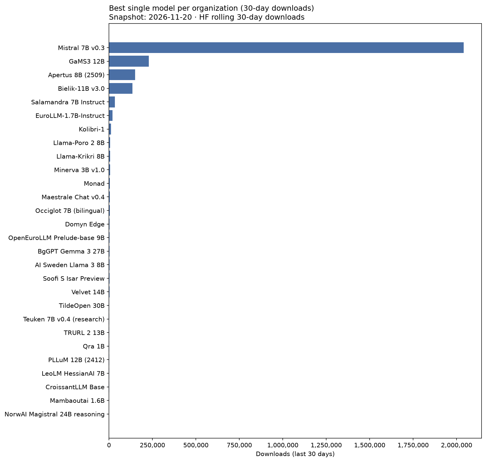
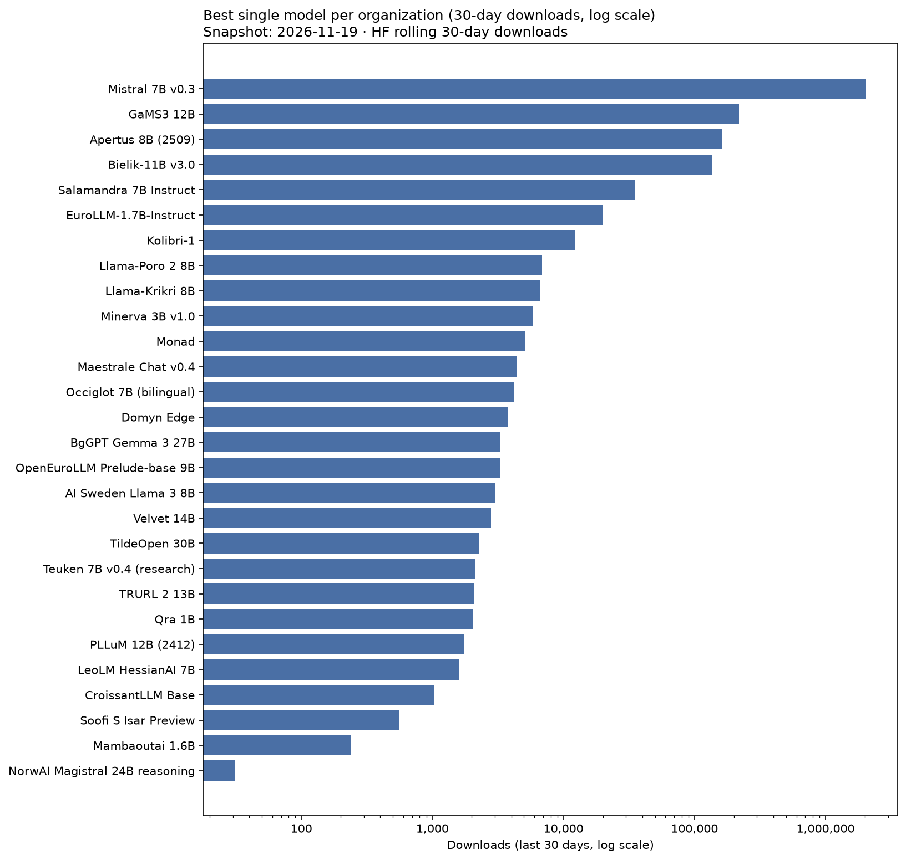

# European LLM Hugging Face download leaderboard

- **Snapshot date:** 2026-11-17
- **Generated at:** 2026-11-17T15:48:24Z
- **Ranking metric:** `total_downloads_30d` (last 30 days, summed across official format variants)
- **Rows:** 197

General-purpose generative LLMs, including general-purpose multimodal models. Task-specific OCR, translation, RAG, coding, math/proof, decision and function-calling specialists are excluded, alongside auxiliary models.

Historical snapshots retain their original scope; changes across the scope correction on 2026-11-16 also reflect the removed repositories.

## Charts

### Trends over time

From daily snapshots in `data/metrics/timeseries.jsonl` (top 15 models / top 10 orgs by latest-day volume). Rolling-30d charts use a symlog y-axis (0 at zero, log compression above).

Rolling-30-day charts omit incomplete model observations; organization totals have a gap if any member model is incomplete. Complete zero observations remain zero.

Daily estimates omit intervals where the catalog changed, its identity is unknown, or a fetch was incomplete; they resume after two complete observations of the same catalog. This avoids counting newly added models’ lifetime downloads as daily growth.

| Rank | Model | Country | Developer | Org | Downloads (30d) | Δ 30d | All-time | Momentum | Params | Repos |
| ---: | --- | :---: | --- | --- | ---: | ---: | ---: | ---: | ---: | ---: |
| 1 | Mistral 7B v0.3 | FR | Mistral AI | [mistralai](https://huggingface.co/mistralai) | 2,035,174 | +13,399 | 60,866,301 | 3.3% | 7.25B | 2 |
| 2 | Mistral 7B v0.2 | FR | Mistral AI | [mistralai](https://huggingface.co/mistralai) | 1,132,028 | -27,641 | 66,992,607 | 1.7% | 7.24B | 1 |
| 3 | Ministral 3 14B (2512) | FR | Mistral AI | [mistralai](https://huggingface.co/mistralai) | 642,427 | -12,422 | 4,580,925 | 13.7% | 13.95B | 6 |
| 4 | Mistral 7B v0.1 | FR | Mistral AI | [mistralai](https://huggingface.co/mistralai) | 552,032 | +562 | 46,563,781 | 1.2% | 7.24B | 2 |
| 5 | Mixtral 8x7B v0.1 | FR | Mistral AI | [mistralai](https://huggingface.co/mistralai) | 359,588 | -263 | 32,868,749 | 1.1% | 46.70B | 2 |
| 6 | Ministral 3 8B (2512) | FR | Mistral AI | [mistralai](https://huggingface.co/mistralai) | 264,368 | +322 | 2,590,106 | 9.8% | 8.92B | 6 |
| 7 | GaMS3 12B | SI | CJVT UL (Center za jezikovne vire in tehnologije, University of Ljubljana) | [cjvt](https://huggingface.co/cjvt) | 213,200 | +73 | 332,167 | 49.3% | 12.77B | 4 |
| 8 | Ministral 3 3B (2512) | FR | Mistral AI | [mistralai](https://huggingface.co/mistralai) | 211,158 | +2,170 | 5,939,405 | 3.5% | 3.85B | 7 |
| 9 | Apertus 8B (2509) | CH | swiss-ai | [swiss-ai](https://huggingface.co/swiss-ai) | 189,229 | -12,334 | 4,698,379 | 3.9% | 8.05B | 2 |
| 10 | Mistral Small 3.1 (24B, 2503) | FR | Mistral AI | [mistralai](https://huggingface.co/mistralai) | 144,674 | +4,587 | 5,048,334 | 2.8% | 24.01B | 2 |
| 11 | Bielik-11B v3.0 | PL | SpeakLeash / ACK Cyfronet AGH | [speakleash](https://huggingface.co/speakleash) | 130,332 | +3,784 | 4,297,138 | 3.0% | 11.34B | 10 |
| 12 | Mistral NeMo (2407) | FR | Mistral AI | [mistralai](https://huggingface.co/mistralai) | 130,176 | -15,155 | 16,690,541 | 0.8% | 12.25B | 3 |
| 13 | Mistral Small 3.2 (24B, 2506) | FR | Mistral AI | [mistralai](https://huggingface.co/mistralai) | 106,519 | +903 | 5,664,316 | 1.8% | 24.01B | 1 |
| 14 | Voxtral Mini 3B (2507) | FR | Mistral AI | [mistralai](https://huggingface.co/mistralai) | 106,480 | +20,411 | 6,601,663 | 1.6% | 4.68B | 1 |
| 15 | Mistral Small 24B (2501) | FR | Mistral AI | [mistralai](https://huggingface.co/mistralai) | 101,909 | +583 | 7,735,927 | 1.3% | 23.57B | 2 |
| 16 | Ministral 8B Instruct (2410) | FR | Mistral AI | [mistralai](https://huggingface.co/mistralai) | 63,307 | +889 | 8,614,098 | 0.7% | 8.02B | 1 |
| 17 | Mixtral 8x22B v0.1 | FR | Mistral AI | [mistralai](https://huggingface.co/mistralai) | 44,723 | +896 | 11,299,489 | 0.4% | 140.63B | 2 |
| 18 | Magistral Small (2506) | FR | Mistral AI | [mistralai](https://huggingface.co/mistralai) | 36,145 | -2,107 | 807,847 | 4.0% | 23.57B | 2 |
| 19 | Salamandra 7B Instruct | ES | BSC-LT | [BSC-LT](https://huggingface.co/BSC-LT) | 36,129 | +623 | 736,702 | 4.3% | 7.77B | 5 |
| 20 | Mistral Small 4 (119B, 2603) | FR | Mistral AI | [mistralai](https://huggingface.co/mistralai) | 36,029 | +916 | 753,525 | 4.2% | 119.40B | 3 |
| 21 | EuroLLM-1.7B-Instruct | EU | utter-project | [utter-project](https://huggingface.co/utter-project) | 19,786 | +53 | 948,389 | 1.9% | 1.66B | 1 |
| 22 | Mistral Large 4 (1T-A52B) | FR | Mistral AI | [mistralai](https://huggingface.co/mistralai) | 19,631 | +2,632 | 19,693 | 16.4% | — | 2 |
| 23 | Bielik-11B v2.3 | PL | SpeakLeash / ACK Cyfronet AGH | [speakleash](https://huggingface.co/speakleash) | 17,522 | 0 | 803,960 | 1.9% | 11.25B | 10 |
| 24 | Magistral Small (2509) | FR | Mistral AI | [mistralai](https://huggingface.co/mistralai) | 17,293 | -4,062 | 371,548 | 3.7% | 24.01B | 2 |
| 25 | Apertus v1.5 8B | CH | swiss-ai | [swiss-ai](https://huggingface.co/swiss-ai) | 15,229 | -39 | 750,249 | 1.8% | 8.90B | 5 |
| 26 | Mistral Large Instruct (2411) | FR | Mistral AI | [mistralai](https://huggingface.co/mistralai) | 14,811 | +108 | 4,946,998 | 0.3% | 122.61B | 1 |
| 27 | Mistral Medium 3.5 (128B) | FR | Mistral AI | [mistralai](https://huggingface.co/mistralai) | 14,763 | -179 | 1,123,824 | 1.2% | 127.70B | 2 |
| 28 | Kolibri-1 | DE | Aleph Alpha | [Aleph-Alpha](https://huggingface.co/Aleph-Alpha) | 13,404 | -53 | 36,020 | 9.9% | 78.10B | 2 |
| 29 | EuroLLM-1.7B (base) | EU | utter-project | [utter-project](https://huggingface.co/utter-project) | 13,161 | +699 | 250,437 | 3.8% | — | 1 |
| 30 | Mistral Large Instruct (2407) | FR | Mistral AI | [mistralai](https://huggingface.co/mistralai) | 12,820 | +5 | 5,047,976 | 0.2% | 122.61B | 1 |
| 31 | EuroLLM-9B-Instruct | EU | utter-project | [utter-project](https://huggingface.co/utter-project) | 10,805 | -162 | 499,574 | 1.8% | 9.15B | 1 |
| 32 | Bielik-7B v0.1 | PL | SpeakLeash | [speakleash](https://huggingface.co/speakleash) | 10,478 | -93 | 526,225 | 1.7% | 7.24B | 8 |
| 33 | Mistral Small Instruct (2409) | FR | Mistral AI | [mistralai](https://huggingface.co/mistralai) | 9,438 | +64 | 5,392,511 | 0.2% | 22.25B | 1 |
| 34 | Bielik-4.5B v3.0 | PL | SpeakLeash | [speakleash](https://huggingface.co/speakleash) | 8,113 | +628 | 263,109 | 2.2% | 4.76B | 8 |
| 35 | Mistral Large 3 (675B, 2512) | FR | Mistral AI | [mistralai](https://huggingface.co/mistralai) | 7,938 | +252 | 89,134 | 4.2% | — | 5 |
| 36 | Apertus v1.5 70B | CH | swiss-ai | [swiss-ai](https://huggingface.co/swiss-ai) | 7,923 | -435 | 37,068 | 5.8% | 72.01B | 4 |
| 37 | Apertus v1.1 4B | CH | swiss-ai | [swiss-ai](https://huggingface.co/swiss-ai) | 7,898 | +158 | 23,997 | 6.4% | 3.83B | 5 |
| 38 | Pixtral 12B (2409) | FR | Mistral AI | [mistralai](https://huggingface.co/mistralai) | 7,376 | +313 | 143,723 | 3.0% | — | 2 |
| 39 | Llama-Krikri 8B | GR | ILSP | [ilsp](https://huggingface.co/ilsp) | 7,359 | +32 | 120,785 | 3.3% | 8.42B | 7 |
| 40 | Apertus v1.1 1.5B | CH | swiss-ai | [swiss-ai](https://huggingface.co/swiss-ai) | 7,312 | -51 | 17,520 | 6.2% | 1.51B | 6 |
| 41 | Bielik-11B v3.1 | PL | SpeakLeash / ACK Cyfronet AGH | [speakleash](https://huggingface.co/speakleash) | 6,954 | +795 | 6,954 | 6.5% | 11.17B | 8 |
| 42 | Apertus 70B (2509) | CH | swiss-ai | [swiss-ai](https://huggingface.co/swiss-ai) | 6,923 | -552 | 552,376 | 1.1% | 70.60B | 2 |
| 43 | Llama-Poro 2 8B | FI | LumiOpen | [LumiOpen](https://huggingface.co/LumiOpen) | 6,872 | +937 | 58,191 | 4.3% | 8.03B | 7 |
| 44 | Voxtral Small 24B (2507) | FR | Mistral AI | [mistralai](https://huggingface.co/mistralai) | 6,853 | +162 | 998,681 | 0.6% | 24.26B | 1 |
| 45 | EuroLLM-9B-Instruct (2512) | EU | utter-project | [utter-project](https://huggingface.co/utter-project) | 6,589 | +85 | 162,078 | 2.5% | 9.15B | 1 |
| 46 | EuroLLM-22B-Instruct (2512) | EU | utter-project | [utter-project](https://huggingface.co/utter-project) | 6,545 | -84 | 605,707 | 0.9% | 22.64B | 1 |
| 47 | Apertus v1.1 0.5B | CH | swiss-ai | [swiss-ai](https://huggingface.co/swiss-ai) | 6,526 | +97 | 24,556 | 5.2% | 572.6M | 5 |
| 48 | Minerva 3B v1.0 | IT | SapienzaNLP | [sapienzanlp](https://huggingface.co/sapienzanlp) | 5,845 | -2 | 138,781 | 2.4% | 2.89B | 1 |
| 49 | Salamandra 2B | ES | BSC-LT | [BSC-LT](https://huggingface.co/BSC-LT) | 5,632 | -16 | 153,723 | 2.2% | 2.25B | 7 |
| 50 | Minerva 350M v1.0 | IT | SapienzaNLP | [sapienzanlp](https://huggingface.co/sapienzanlp) | 5,599 | -2 | 159,737 | 2.2% | 351.6M | 1 |
| 51 | Bielik-1.5B v3.0 | PL | SpeakLeash | [speakleash](https://huggingface.co/speakleash) | 5,416 | +56 | 65,543 | 3.3% | 1.60B | 9 |
| 52 | Monad | FR | PleIAs | [PleIAs](https://huggingface.co/PleIAs) | 4,854 | +142 | 39,526 | 3.5% | 56.7M | 1 |
| 53 | Maestrale Chat v0.4 | IT | mii-llm | [mii-llm](https://huggingface.co/mii-llm) | 4,417 | -27 | 155,632 | 1.7% | 7.24B | 4 |
| 54 | EuroLLM-22B (2512 base) | EU | utter-project | [utter-project](https://huggingface.co/utter-project) | 4,313 | +197 | 29,524 | 3.3% | 22.64B | 1 |
| 55 | Modello Italia 9B | IT | SapienzaNLP | [sapienzanlp](https://huggingface.co/sapienzanlp) | 4,203 | -33 | 125,380 | 1.9% | 8.54B | 2 |
| 56 | Minerva 7B v1.0 | IT | SapienzaNLP | [sapienzanlp](https://huggingface.co/sapienzanlp) | 4,136 | -90 | 141,312 | 1.7% | 7.40B | 3 |
| 57 | Occiglot 7B (bilingual) | EU | occiglot | [occiglot](https://huggingface.co/occiglot) | 4,051 | -37 | 378,992 | 0.8% | 7.24B | 8 |
| 58 | ALIA 40B Instruct (2606) | ES | BSC-LT | [BSC-LT](https://huggingface.co/BSC-LT) | 3,935 | +2,747 | 12,604 | 3.5% | 40.43B | 2 |
| 59 | EuroMoE 2.6B-A0.6B (2512) | EU | utter-project | [utter-project](https://huggingface.co/utter-project) | 3,780 | -118 | 41,778 | 2.7% | 2.61B | 3 |
| 60 | Salamandra 7B (base) | ES | BSC-LT | [BSC-LT](https://huggingface.co/BSC-LT) | 3,722 | +137 | 55,501 | 2.4% | 7.77B | 3 |
| 61 | OpenEuroLLM Prelude-base 9B | EU | openeurollm | [openeurollm](https://huggingface.co/openeurollm) | 3,605 | -330 | 79,068 | 2.0% | 9.09B | 1 |
| 62 | Bielik-Minitron 7B v3.0 | PL | SpeakLeash / ACK Cyfronet AGH | [speakleash](https://huggingface.co/speakleash) | 3,604 | -78 | 131,599 | 1.6% | 7.48B | 9 |
| 63 | Domyn Edge | IT | Domyn | [domyn](https://huggingface.co/domyn) | 3,535 | +209 | 3,578 | 3.4% | 3.93B | 2 |
| 64 | Baguettotron | FR | PleIAs | [PleIAs](https://huggingface.co/PleIAs) | 3,523 | -1 | 45,120 | 2.4% | 13.29B | 3 |
| 65 | BgGPT Gemma 3 27B | BG | INSAIT | [INSAIT-Institute](https://huggingface.co/INSAIT-Institute) | 3,396 | -9 | 22,978 | 2.8% | 27.43B | 3 |
| 66 | EuroLLM-9B (2512) | EU | utter-project | [utter-project](https://huggingface.co/utter-project) | 3,286 | +157 | 13,569 | 2.9% | 9.15B | 1 |
| 67 | Minerva Chat v0.1 | IT | mii-llm | [mii-llm](https://huggingface.co/mii-llm) | 3,225 | -28 | 96,962 | 1.6% | 2.89B | 1 |
| 68 | Bielik-11B v2.2 | PL | SpeakLeash / ACK Cyfronet AGH | [speakleash](https://huggingface.co/speakleash) | 2,996 | -24 | 170,509 | 1.1% | 11.17B | 16 |
| 69 | AI Sweden Llama 3 8B | SE | AI Sweden | [AI-Sweden-Models](https://huggingface.co/AI-Sweden-Models) | 2,947 | +451 | 96,087 | 1.5% | 8.03B | 10 |
| 70 | Velvet 14B | IT | Almawave | [AlmawaveLabs](https://huggingface.co/AlmawaveLabs) | 2,808 | +20 | 70,661 | 1.6% | 14.08B | 1 |
| 71 | MamayLM Gemma 3 12B v2.0 | UA | INSAIT | [INSAIT-Institute](https://huggingface.co/INSAIT-Institute) | 2,780 | +6 | 21,505 | 2.3% | 12.19B | 2 |
| 72 | Velvet 2B | IT | Almawave | [AlmawaveLabs](https://huggingface.co/AlmawaveLabs) | 2,752 | +1 | 89,529 | 1.5% | 2.22B | 1 |
| 73 | EuroLLM-9B (base) | EU | utter-project | [utter-project](https://huggingface.co/utter-project) | 2,667 | +192 | 87,140 | 1.4% | 9.15B | 1 |
| 74 | Poro 34B | FI | LumiOpen | [LumiOpen](https://huggingface.co/LumiOpen) | 2,350 | -8 | 231,181 | 0.7% | 35.13B | 4 |
| 75 | TildeOpen 30B | LV | Tilde | [TildeAI](https://huggingface.co/TildeAI) | 2,267 | +24 | 103,036 | 1.1% | 30.68B | 1 |
| 76 | MamayLM Gemma 3 4B v1.0 | UA | INSAIT | [INSAIT-Institute](https://huggingface.co/INSAIT-Institute) | 2,152 | +15 | 23,485 | 1.7% | 4.30B | 2 |
| 77 | TRURL 2 13B | PL | Voicelab | [Voicelab](https://huggingface.co/Voicelab) | 2,105 | -15 | 359,037 | 0.5% | — | 3 |
| 78 | Teuken 7B v0.4 (research) | DE | openGPT-X | [openGPT-X](https://huggingface.co/openGPT-X) | 2,099 | -1 | 81,386 | 1.2% | 7.45B | 1 |
| 79 | GaMS 9B | SI | CJVT UL (Center za jezikovne vire in tehnologije, University of Ljubljana) | [cjvt](https://huggingface.co/cjvt) | 2,071 | -14 | 52,393 | 1.4% | 9.24B | 4 |
| 80 | ALIA 40B (base) | ES | BSC-LT | [BSC-LT](https://huggingface.co/BSC-LT) | 2,056 | -11 | 454,988 | 0.4% | 40.43B | 1 |
| 81 | Magistral Small (2507) | FR | Mistral AI | [mistralai](https://huggingface.co/mistralai) | 2,052 | -390 | 157,524 | 0.8% | 23.57B | 2 |
| 82 | Qra 1B | PL | OPI-PG | [OPI-PG](https://huggingface.co/OPI-PG) | 2,029 | -11 | 160,613 | 0.8% | 1.10B | 1 |
| 83 | Teuken 7B v0.4 (commercial) | DE | openGPT-X | [openGPT-X](https://huggingface.co/openGPT-X) | 1,996 | -3 | 108,903 | 1.0% | 7.45B | 1 |
| 84 | TRURL 2 7B | PL | Voicelab | [Voicelab](https://huggingface.co/Voicelab) | 1,913 | -10 | 304,004 | 0.5% | 6.74B | 2 |
| 85 | Qra 7B | PL | OPI-PG | [OPI-PG](https://huggingface.co/OPI-PG) | 1,911 | -13 | 187,333 | 0.7% | 6.74B | 1 |
| 86 | EuroLLM-22B-Instruct (Preview) | EU | utter-project | [utter-project](https://huggingface.co/utter-project) | 1,909 | -15 | 35,561 | 1.4% | 22.64B | 1 |
| 87 | Qra 13B | PL | OPI-PG | [OPI-PG](https://huggingface.co/OPI-PG) | 1,845 | -14 | 148,050 | 0.7% | 13.02B | 1 |
| 88 | Pleias 350M Preview | FR | PleIAs | [PleIAs](https://huggingface.co/PleIAs) | 1,783 | +346 | 420,455 | 0.3% | 353.4M | 1 |
| 89 | Domyn Small v1.0 | IT | Domyn | [domyn](https://huggingface.co/domyn) | 1,761 | +88 | 10,347 | 1.6% | 9.82B | 1 |
| 90 | PLLuM 12B (2412) | PL | CYFRAGOVPL / PLLuM consortium | [CYFRAGOVPL](https://huggingface.co/CYFRAGOVPL) | 1,754 | -11 | 180,274 | 0.6% | 12.25B | 6 |
| 91 | Pleias 1.2B Preview | FR | PleIAs | [PleIAs](https://huggingface.co/PleIAs) | 1,704 | +182 | 417,038 | 0.3% | 1.20B | 1 |
| 92 | Pleias 3B Preview | FR | PleIAs | [PleIAs](https://huggingface.co/PleIAs) | 1,672 | +374 | 401,884 | 0.3% | 3.21B | 1 |
| 93 | LeoLM HessianAI 7B | DE | LeoLM | [LeoLM](https://huggingface.co/LeoLM) | 1,634 | -24 | 802,681 | 0.2% | — | 3 |
| 94 | Llama-Poro 2 70B | FI | LumiOpen | [LumiOpen](https://huggingface.co/LumiOpen) | 1,616 | +3 | 41,191 | 1.1% | 70.55B | 3 |
| 95 | Maestrale Chat v0.3 | IT | mii-llm | [mii-llm](https://huggingface.co/mii-llm) | 1,530 | -8 | 55,145 | 1.0% | 7.24B | 5 |
| 96 | Maestrale Chat v0.2 | IT | mii-llm | [mii-llm](https://huggingface.co/mii-llm) | 1,470 | -8 | 53,895 | 1.0% | 7.24B | 1 |
| 97 | Viking 13B | FI | LumiOpen | [LumiOpen](https://huggingface.co/LumiOpen) | 1,450 | -20 | 34,786 | 1.1% | 14.03B | 1 |
| 98 | PLLuM 12B (2512) | PL | CYFRAGOVPL / PLLuM consortium | [CYFRAGOVPL](https://huggingface.co/CYFRAGOVPL) | 1,447 | -88 | 44,978 | 1.0% | 12.25B | 3 |
| 99 | PLLuM 4B (2512) | PL | CYFRAGOVPL / PLLuM consortium | [CYFRAGOVPL](https://huggingface.co/CYFRAGOVPL) | 1,357 | -17 | 9,825 | 1.2% | 4.30B | 3 |
| 100 | MamayLM Gemma 3 27B v2.0 | UA | INSAIT | [INSAIT-Institute](https://huggingface.co/INSAIT-Institute) | 1,276 | -16 | 9,602 | 1.2% | 28.84B | 3 |
| 101 | Bielik-11B v2.6 | PL | SpeakLeash / ACK Cyfronet AGH | [speakleash](https://huggingface.co/speakleash) | 1,170 | -8 | 175,442 | 0.4% | 11.51B | 9 |
| 102 | Viking 7B | FI | LumiOpen | [LumiOpen](https://huggingface.co/LumiOpen) | 1,153 | -14 | 57,037 | 0.7% | 7.55B | 1 |
| 103 | CroissantLLM Base | FR | croissantllm | [croissantllm](https://huggingface.co/croissantllm) | 1,080 | -15 | 58,990 | 0.7% | 1.35B | 3 |
| 104 | Viking 33B | FI | LumiOpen | [LumiOpen](https://huggingface.co/LumiOpen) | 1,052 | -15 | 31,966 | 0.8% | 33.12B | 1 |
| 105 | Teuken 7B v0.6 | DE | openGPT-X | [openGPT-X](https://huggingface.co/openGPT-X) | 998 | +4 | 671,607 | 0.1% | 7.45B | 2 |
| 106 | MamayLM Gemma 3 12B v1.0 | UA | INSAIT | [INSAIT-Institute](https://huggingface.co/INSAIT-Institute) | 987 | -97 | 45,358 | 0.7% | 12.19B | 2 |
| 107 | BgGPT Gemma 3 12B | BG | INSAIT | [INSAIT-Institute](https://huggingface.co/INSAIT-Institute) | 974 | -6 | 219,343 | 0.3% | 12.19B | 3 |
| 108 | LeoLM Mistral HessianAI 7B | DE | LeoLM | [LeoLM](https://huggingface.co/LeoLM) | 878 | -6 | 233,728 | 0.3% | — | 2 |
| 109 | EuroVLM 9B Preview | EU | UTTER consortium | [utter-project](https://huggingface.co/utter-project) | 875 | 0 | 8,593 | 0.8% | 9.57B | 1 |
| 110 | Baguettotron 600M | FR | PleIAs | [PleIAs](https://huggingface.co/PleIAs) | 841 | +11 | 1,830 | 0.8% | 608.3M | 1 |
| 111 | CroissantLLM Chat v0.1 | FR | croissantllm | [croissantllm](https://huggingface.co/croissantllm) | 812 | +11 | 96,822 | 0.4% | 1.35B | 8 |
| 112 | Bielik-11B v2.0 | PL | SpeakLeash / ACK Cyfronet AGH | [speakleash](https://huggingface.co/speakleash) | 807 | -22 | 24,202 | 0.6% | 11.17B | 5 |
| 113 | Pharia-1-LLM-7B-control | DE | Aleph Alpha | [Aleph-Alpha](https://huggingface.co/Aleph-Alpha) | 798 | -25 | 82,141 | 0.4% | 7.04B | 4 |
| 114 | BgGPT Gemma 3 4B | BG | INSAIT | [INSAIT-Institute](https://huggingface.co/INSAIT-Institute) | 766 | -133 | 15,016 | 0.7% | 4.33B | 3 |
| 115 | BgGPT 7B v0.2 | BG | INSAIT | [INSAIT-Institute](https://huggingface.co/INSAIT-Institute) | 710 | -29 | 112,607 | 0.3% | 7.29B | 2 |
| 116 | GaMS 1B | SI | CJVT UL (Center za jezikovne vire in tehnologije, University of Ljubljana) | [cjvt](https://huggingface.co/cjvt) | 705 | -8 | 17,171 | 0.6% | 1.54B | 4 |
| 117 | Bielik-11B v2.1 | PL | SpeakLeash / ACK Cyfronet AGH | [speakleash](https://huggingface.co/speakleash) | 694 | -19 | 31,960 | 0.5% | 11.17B | 5 |
| 118 | GaMS 2B | SI | CJVT UL (Center za jezikovne vire in tehnologije, University of Ljubljana) | [cjvt](https://huggingface.co/cjvt) | 642 | +11 | 20,969 | 0.5% | 3.20B | 2 |
| 119 | TildeOpen 30B (64k) | LV | Tilde | [TildeAI](https://huggingface.co/TildeAI) | 585 | -9 | 3,832 | 0.6% | 30.68B | 1 |
| 120 | BgGPT Gemma 2 9B | BG | INSAIT | [INSAIT-Institute](https://huggingface.co/INSAIT-Institute) | 584 | 0 | 28,074 | 0.5% | 9.24B | 2 |
| 121 | Soofi S Isar Preview | DE | Soofi Project | [Soofi-Project](https://huggingface.co/Soofi-Project) | 554 | 0 | 12,588 | 0.5% | 31.59B | 6 |
| 122 | GaMS2 27B | SI | CJVT UL (Center za jezikovne vire in tehnologije, University of Ljubljana) | [cjvt](https://huggingface.co/cjvt) | 537 | -1 | 1,798 | 0.5% | 852,480 | 2 |
| 123 | MamayLM Gemma 2 9B v0.1 | UA | INSAIT | [INSAIT-Institute](https://huggingface.co/INSAIT-Institute) | 500 | -28 | 22,261 | 0.4% | 9.24B | 2 |
| 124 | Llama-PLLuM 8B (2512) | PL | CYFRAGOVPL / PLLuM consortium | [CYFRAGOVPL](https://huggingface.co/CYFRAGOVPL) | 450 | +9 | 4,559 | 0.4% | 8.03B | 3 |
| 125 | Bielik-11B v2.5 | PL | SpeakLeash / ACK Cyfronet AGH | [speakleash](https://huggingface.co/speakleash) | 445 | +8 | 5,794 | 0.4% | 11.51B | 5 |
| 126 | EuroLLM 1.5 9B | EU | utter-project | [utter-project](https://huggingface.co/utter-project) | 433 | +133 | 1,312 | 0.4% | 9.15B | 2 |
| 127 | BgGPT Gemma 2 27B | BG | INSAIT | [INSAIT-Institute](https://huggingface.co/INSAIT-Institute) | 366 | -27 | 12,306 | 0.3% | 27.23B | 2 |
| 128 | GaMS 27B | SI | CJVT UL (Center za jezikovne vire in tehnologije, University of Ljubljana) | [cjvt](https://huggingface.co/cjvt) | 335 | +43 | 38,030 | 0.2% | 27.23B | 3 |
| 129 | OpenEuroLLM Prelude SFT Excellent v0.2 | EU | OpenEuroLLM | [openeurollm](https://huggingface.co/openeurollm) | 308 | +6 | 308 | 0.3% | 9.09B | 1 |
| 130 | Llama-PLLuM 8B (2412) | PL | CYFRAGOVPL / PLLuM consortium | [CYFRAGOVPL](https://huggingface.co/CYFRAGOVPL) | 300 | +22 | 70,676 | 0.2% | 8.03B | 3 |
| 131 | BgGPT Gemma 2 2.6B | BG | INSAIT | [INSAIT-Institute](https://huggingface.co/INSAIT-Institute) | 287 | -15 | 22,257 | 0.2% | 2.61B | 2 |
| 132 | LeoLM HessianAI 13B | DE | LeoLM | [LeoLM](https://huggingface.co/LeoLM) | 286 | -6 | 107,376 | 0.1% | — | 3 |
| 133 | Mambaoutai 1.6B | FR | LightOn | [lightonai](https://huggingface.co/lightonai) | 276 | +6 | 1,395 | 0.3% | 1.62B | 1 |
| 134 | Nesso 4B | IT | mii-llm | [mii-llm](https://huggingface.co/mii-llm) | 258 | -40 | 2,883 | 0.3% | 4.02B | 2 |
| 135 | ALIA 40B Instruct (2601) | ES | BSC-LT | [BSC-LT](https://huggingface.co/BSC-LT) | 237 | -23 | 32,989 | 0.2% | 40.43B | 2 |
| 136 | OpenEuroLLM Prelude-long 9B | EU | OpenEuroLLM | [openeurollm](https://huggingface.co/openeurollm) | 225 | +125 | 225 | 0.2% | 9.09B | 1 |
| 137 | Bielik-11B v2 (base) | PL | SpeakLeash / ACK Cyfronet AGH | [speakleash](https://huggingface.co/speakleash) | 210 | -9 | 42,011 | 0.1% | 11.17B | 1 |
| 138 | Minerva 1B v1.0 | IT | SapienzaNLP | [sapienzanlp](https://huggingface.co/sapienzanlp) | 202 | +13 | 29,861 | 0.2% | 1.01B | 1 |
| 139 | LeoLM HessianAI 70B | DE | LeoLM | [LeoLM](https://huggingface.co/LeoLM) | 198 | -8 | 19,775 | 0.2% | 68.98B | 2 |
| 140 | BgGPT 7B v0.1 | BG | INSAIT | [INSAIT-Institute](https://huggingface.co/INSAIT-Institute) | 187 | -9 | 16,715 | 0.2% | 7.29B | 2 |
| 141 | Soofi S Rhine Preview | DE | Soofi Project | [Soofi-Project](https://huggingface.co/Soofi-Project) | 187 | 0 | 3,006 | 0.2% | 31.59B | 6 |
| 142 | Pixtral Large (2411) | FR | Mistral AI | [mistralai](https://huggingface.co/mistralai) | 184 | -1 | 4,487 | 0.2% | — | 1 |
| 143 | Occiglot 7B EU5 | EU | occiglot | [occiglot](https://huggingface.co/occiglot) | 181 | -5 | 322,355 | 0.0% | 7.24B | 2 |
| 144 | PAGnol xl | FR | LightOn / Inria | [lightonai](https://huggingface.co/lightonai) | 178 | +8 | 1,635 | 0.2% | 1.64B | 1 |
| 145 | Velvet2 3B Speech | IT | Almawave | [AlmawaveLabs](https://huggingface.co/AlmawaveLabs) | 175 | 0 | 204 | 0.2% | 4.55B | 1 |
| 146 | Alfred 40B (1023) | FR | LightOn | [lightonai](https://huggingface.co/lightonai) | 170 | -2 | 78,641 | 0.1% | — | 1 |
| 147 | Meltemi 7B v1.5 | GR | ILSP | [ilsp](https://huggingface.co/ilsp) | 169 | -1 | 39,480 | 0.1% | 7.48B | 2 |
| 148 | TowerVision 2B | EU | UTTER consortium | [utter-project](https://huggingface.co/utter-project) | 168 | -2 | 2,759 | 0.2% | 3.02B | 1 |
| 149 | Meltemi 7B v1 | GR | ILSP | [ilsp](https://huggingface.co/ilsp) | 161 | +1 | 44,718 | 0.1% | 7.70B | 5 |
| 150 | PLLuM 8x7B (2412) | PL | CYFRAGOVPL / PLLuM consortium | [CYFRAGOVPL](https://huggingface.co/CYFRAGOVPL) | 156 | -1 | 28,503 | 0.1% | 46.70B | 6 |
| 151 | Llama-PLLuM 70B (2512) | PL | CYFRAGOVPL / PLLuM consortium | [CYFRAGOVPL](https://huggingface.co/CYFRAGOVPL) | 141 | +2 | 12,779 | 0.1% | 70.55B | 2 |
| 152 | ALIA 40B Instruct (2605) | ES | BSC-LT | [BSC-LT](https://huggingface.co/BSC-LT) | 130 | -6 | 2,958 | 0.1% | 40.43B | 2 |
| 153 | GPT-SW3 1.3B | SE | AI Sweden | [AI-Sweden-Models](https://huggingface.co/AI-Sweden-Models) | 129 | +2 | 306,785 | 0.0% | 1.47B | 4 |
| 154 | Zagreus 0.4B (ITA) | IT | mii-llm | [mii-llm](https://huggingface.co/mii-llm) | 124 | +2 | 5,234 | 0.1% | 437.8M | 1 |
| 155 | Salamandra VL 7B (2512) | ES | Barcelona Supercomputing Center | [BSC-LT](https://huggingface.co/BSC-LT) | 123 | -4 | 2,099 | 0.1% | 8.90B | 1 |
| 156 | EuroLLM-22B (Preview base) | EU | utter-project | [utter-project](https://huggingface.co/utter-project) | 121 | -8 | 2,602 | 0.1% | — | 1 |
| 157 | Llama-PLLuM 70B (2508) | PL | CYFRAGOVPL / PLLuM consortium | [CYFRAGOVPL](https://huggingface.co/CYFRAGOVPL) | 115 | +3 | 5,114 | 0.1% | 70.55B | 3 |
| 158 | Soofi S Instruct Preview | DE | Soofi Project | [Soofi-Project](https://huggingface.co/Soofi-Project) | 113 | 0 | 7,511 | 0.1% | 31.59B | 6 |
| 159 | TowerVision 9B | EU | UTTER consortium | [utter-project](https://huggingface.co/utter-project) | 106 | -5 | 1,380 | 0.1% | 9.66B | 1 |
| 160 | PAGnol medium | FR | LightOn / Inria | [lightonai](https://huggingface.co/lightonai) | 105 | +8 | 1,162 | 0.1% | 380.0M | 1 |
| 161 | Alfred 40B (0723) | FR | LightOn | [lightonai](https://huggingface.co/lightonai) | 98 | -1 | 5,543 | 0.1% | — | 1 |
| 162 | EuroVLM 1.7B Preview | EU | UTTER consortium | [utter-project](https://huggingface.co/utter-project) | 98 | -3 | 3,041 | 0.1% | 2.06B | 1 |
| 163 | Velvet2 3B | IT | Almawave | [AlmawaveLabs](https://huggingface.co/AlmawaveLabs) | 98 | 0 | 115 | 0.1% | 3.89B | 1 |
| 164 | Open Zagreus 0.4B | IT | mii-llm | [mii-llm](https://huggingface.co/mii-llm) | 93 | +17 | 473 | 0.1% | 437.8M | 1 |
| 165 | CroissantCool v0.2 | FR | CroissantLLM consortium | [croissantllm](https://huggingface.co/croissantllm) | 85 | 0 | 14,809 | 0.1% | 1.35B | 1 |
| 166 | Llama-PLLuM 70B (2412) | PL | CYFRAGOVPL / PLLuM consortium | [CYFRAGOVPL](https://huggingface.co/CYFRAGOVPL) | 82 | +2 | 38,763 | 0.1% | 70.55B | 3 |
| 167 | PAGnol small | FR | LightOn / Inria | [lightonai](https://huggingface.co/lightonai) | 68 | +6 | 4,662 | 0.1% | — | 1 |
| 168 | PAGnol large | FR | LightOn / Inria | [lightonai](https://huggingface.co/lightonai) | 65 | +4 | 888 | 0.1% | — | 1 |
| 169 | Zagreus 0.4B (SPA) | IT | mii-llm | [mii-llm](https://huggingface.co/mii-llm) | 65 | -1 | 274 | 0.1% | 437.8M | 1 |
| 170 | Zagreus 0.4B (FRA) | IT | mii-llm | [mii-llm](https://huggingface.co/mii-llm) | 64 | 0 | 216 | 0.1% | 437.8M | 1 |
| 171 | Velvet2 3B Vision | IT | Almawave | [AlmawaveLabs](https://huggingface.co/AlmawaveLabs) | 63 | +4 | 78 | 0.1% | 4.33B | 1 |
| 172 | TowerVideo 2B | EU | UTTER consortium | [utter-project](https://huggingface.co/utter-project) | 61 | 0 | 1,130 | 0.1% | 3.02B | 1 |
| 173 | Nesso 0.4B Instruct | IT | mii-llm | [mii-llm](https://huggingface.co/mii-llm) | 60 | -3 | 1,332 | 0.1% | 560.9M | 1 |
| 174 | OpenEuroLLM Prelude SFT Excellent v0.1 | EU | OpenEuroLLM | [openeurollm](https://huggingface.co/openeurollm) | 55 | -3 | 58 | 0.1% | 9.10B | 1 |
| 175 | Zagreus 0.4B (POR) | IT | mii-llm | [mii-llm](https://huggingface.co/mii-llm) | 54 | +2 | 320 | 0.1% | 437.8M | 1 |
| 176 | TowerVideo 9B | EU | UTTER consortium | [utter-project](https://huggingface.co/utter-project) | 52 | -3 | 482 | 0.1% | 9.66B | 1 |
| 177 | Llama-PLLuM 8B (2508) | PL | CYFRAGOVPL / PLLuM consortium | [CYFRAGOVPL](https://huggingface.co/CYFRAGOVPL) | 44 | +2 | 1,465 | 0.0% | 8.03B | 1 |
| 178 | Salamandra 7B Vision | ES | Barcelona Supercomputing Center | [BSC-LT](https://huggingface.co/BSC-LT) | 43 | -1 | 3,720 | 0.0% | 8.19B | 1 |
| 179 | Flor 6.3B | ES | BSC-LT | [BSC-LT](https://huggingface.co/BSC-LT) | 37 | -3 | 623 | 0.0% | 6.25B | 2 |
| 180 | NorwAI Magistral 24B reasoning | NO | NorwAI / NTNU | [NorwAI](https://huggingface.co/NorwAI) | 31 | 0 | 547,892 | 0.0% | 23.85B | 1 |
| 181 | Maestrale Chat v0.1 | IT | mii-llm | [mii-llm](https://huggingface.co/mii-llm) | 30 | 0 | 154 | 0.0% | 7.24B | 1 |
| 182 | CroissantCool v0.1 | FR | CroissantLLM consortium | [croissantllm](https://huggingface.co/croissantllm) | 28 | +1 | 606 | 0.0% | 1.35B | 1 |
| 183 | NorwAI Mistral-7B | NO | NorwAI / NTNU | [NorwAI](https://huggingface.co/NorwAI) | 25 | 0 | 111,668 | 0.0% | 7.54B | 3 |
| 184 | GPT-SW3 20B | SE | AI Sweden | [AI-Sweden-Models](https://huggingface.co/AI-Sweden-Models) | 22 | 0 | 141,983 | 0.0% | 20.92B | 5 |
| 185 | Tyr 7B | SE | AI Sweden | [AI-Sweden-Models](https://huggingface.co/AI-Sweden-Models) | 22 | +1 | 913 | 0.0% | 7.24B | 1 |
| 186 | PLLuM 12B (2508) | PL | CYFRAGOVPL / PLLuM consortium | [CYFRAGOVPL](https://huggingface.co/CYFRAGOVPL) | 19 | +2 | 381 | 0.0% | 12.25B | 1 |
| 187 | GPT-sl Base | SI | CJVT UL | [cjvt](https://huggingface.co/cjvt) | 16 | +1 | 1,762 | 0.0% | — | 1 |
| 188 | GPT-SW3 126M | SE | AI Sweden | [AI-Sweden-Models](https://huggingface.co/AI-Sweden-Models) | 10 | 0 | 893,762 | 0.0% | 186.1M | 4 |
| 189 | Soofi S Base | DE | Soofi Project | [Soofi-Project](https://huggingface.co/Soofi-Project) | 8 | 0 | 1,509 | 0.0% | 31.58B | 2 |
| 190 | GPT-SW3 6.7B v2 | SE | AI Sweden | [AI-Sweden-Models](https://huggingface.co/AI-Sweden-Models) | 7 | +4 | 262,851 | 0.0% | 7.11B | 5 |
| 191 | PLLuM 12B nc (2507) | PL | CYFRAGOVPL / PLLuM consortium | [CYFRAGOVPL](https://huggingface.co/CYFRAGOVPL) | 4 | 0 | 6,171 | 0.0% | 12.25B | 3 |
| 192 | GPT-SW3 40B | SE | AI Sweden | [AI-Sweden-Models](https://huggingface.co/AI-Sweden-Models) | 3 | 0 | 59,796 | 0.0% | 39.93B | 2 |
| 193 | Emma 5 Boost | IT | mii-llm | [mii-llm](https://huggingface.co/mii-llm) | 0 | 0 | 8 | 0.0% | 1.39B | 1 |
| 194 | GPT-SW3 356M | SE | AI Sweden | [AI-Sweden-Models](https://huggingface.co/AI-Sweden-Models) | 0 | 0 | 334,511 | 0.0% | 470.6M | 4 |
| 195 | GPT-SW3 6.7B | SE | AI Sweden | [AI-Sweden-Models](https://huggingface.co/AI-Sweden-Models) | 0 | 0 | 68,906 | 0.0% | 7.11B | 1 |
| 196 | NorwAI Llama2-7B | NO | NorwAI / NTNU | [NorwAI](https://huggingface.co/NorwAI) | 0 | 0 | 65,548 | 0.0% | 7.03B | 1 |
| 197 | NorwAI Mixtral-8x7B | NO | NorwAI / NTNU | [NorwAI](https://huggingface.co/NorwAI) | 0 | 0 | 2,172 | 0.0% | 47.00B | 2 |

## Organizations

Same downloads, aggregated across every model version an organization publishes.

| Rank | Organization | Developer | Country | Downloads (30d) | All-time | Models | Momentum |
| ---: | --- | --- | :---: | ---: | ---: | ---: | ---: |
| 1 | [mistralai](https://huggingface.co/mistralai) | Mistral AI | FR | 6,079,896 | 301,913,713 | 27 | 2.0% |
| 2 | [swiss-ai](https://huggingface.co/swiss-ai) | swiss-ai | CH | 241,040 | 6,104,145 | 7 | 3.9% |
| 3 | [cjvt](https://huggingface.co/cjvt) | CJVT UL (Center za jezikovne vire in tehnologije, University of Ljubljana) | SI | 217,506 | 464,290 | 7 | 38.5% |
| 4 | [speakleash](https://huggingface.co/speakleash) | SpeakLeash / ACK Cyfronet AGH | PL | 188,741 | 6,544,446 | 13 | 2.8% |
| 5 | [utter-project](https://huggingface.co/utter-project) | utter-project | EU | 74,755 | 2,695,056 | 18 | 2.7% |
| 6 | [BSC-LT](https://huggingface.co/BSC-LT) | BSC-LT | ES | 52,044 | 1,455,907 | 10 | 3.3% |
| 7 | [sapienzanlp](https://huggingface.co/sapienzanlp) | SapienzaNLP | IT | 19,985 | 595,071 | 5 | 2.9% |
| 8 | [INSAIT-Institute](https://huggingface.co/INSAIT-Institute) | INSAIT | BG | 14,965 | 571,507 | 13 | 2.2% |
| 9 | [LumiOpen](https://huggingface.co/LumiOpen) | LumiOpen | FI | 14,493 | 454,352 | 6 | 2.6% |
| 10 | [PleIAs](https://huggingface.co/PleIAs) | PleIAs | FR | 14,377 | 1,325,853 | 6 | 1.0% |
| 11 | [Aleph-Alpha](https://huggingface.co/Aleph-Alpha) | Aleph Alpha | DE | 14,202 | 118,161 | 2 | 6.5% |
| 12 | [mii-llm](https://huggingface.co/mii-llm) | mii-llm | IT | 11,390 | 372,528 | 13 | 2.4% |
| 13 | [ilsp](https://huggingface.co/ilsp) | ILSP | GR | 7,689 | 204,983 | 3 | 2.5% |
| 14 | [AlmawaveLabs](https://huggingface.co/AlmawaveLabs) | Almawave | IT | 5,896 | 160,587 | 5 | 2.3% |
| 15 | [CYFRAGOVPL](https://huggingface.co/CYFRAGOVPL) | CYFRAGOVPL / PLLuM consortium | PL | 5,869 | 403,488 | 12 | 1.2% |
| 16 | [OPI-PG](https://huggingface.co/OPI-PG) | OPI-PG | PL | 5,785 | 495,996 | 3 | 1.0% |
| 17 | [domyn](https://huggingface.co/domyn) | Domyn | IT | 5,296 | 13,925 | 2 | 4.6% |
| 18 | [openGPT-X](https://huggingface.co/openGPT-X) | openGPT-X | DE | 5,093 | 861,896 | 3 | 0.5% |
| 19 | [occiglot](https://huggingface.co/occiglot) | occiglot | EU | 4,232 | 701,347 | 2 | 0.5% |
| 20 | [openeurollm](https://huggingface.co/openeurollm) | openeurollm | EU | 4,193 | 79,659 | 4 | 2.3% |
| 21 | [Voicelab](https://huggingface.co/Voicelab) | Voicelab | PL | 4,018 | 663,041 | 2 | 0.5% |
| 22 | [AI-Sweden-Models](https://huggingface.co/AI-Sweden-Models) | AI Sweden | SE | 3,140 | 2,165,594 | 9 | 0.1% |
| 23 | [LeoLM](https://huggingface.co/LeoLM) | LeoLM | DE | 2,996 | 1,163,560 | 4 | 0.2% |
| 24 | [TildeAI](https://huggingface.co/TildeAI) | Tilde | LV | 2,852 | 106,868 | 2 | 1.4% |
| 25 | [croissantllm](https://huggingface.co/croissantllm) | croissantllm | FR | 2,005 | 171,227 | 4 | 0.7% |
| 26 | [lightonai](https://huggingface.co/lightonai) | LightOn | FR | 960 | 93,926 | 7 | 0.5% |
| 27 | [Soofi-Project](https://huggingface.co/Soofi-Project) | Soofi Project | DE | 862 | 24,614 | 4 | 0.7% |
| 28 | [NorwAI](https://huggingface.co/NorwAI) | NorwAI / NTNU | NO | 56 | 727,280 | 4 | 0.0% |

### By best single model

Ranked by each organization's single highest-downloading model (no summing across versions) — who has the biggest individual hit.

| Rank | Organization | Best model | Downloads (30d) | All-time | Overall model rank |
| ---: | --- | --- | ---: | ---: | ---: |
| 1 | [mistralai](https://huggingface.co/mistralai) | Mistral 7B v0.3 | 2,035,174 | 60,866,301 | 1 |
| 2 | [cjvt](https://huggingface.co/cjvt) | GaMS3 12B | 213,200 | 332,167 | 7 |
| 3 | [swiss-ai](https://huggingface.co/swiss-ai) | Apertus 8B (2509) | 189,229 | 4,698,379 | 9 |
| 4 | [speakleash](https://huggingface.co/speakleash) | Bielik-11B v3.0 | 130,332 | 4,297,138 | 11 |
| 5 | [BSC-LT](https://huggingface.co/BSC-LT) | Salamandra 7B Instruct | 36,129 | 736,702 | 19 |
| 6 | [utter-project](https://huggingface.co/utter-project) | EuroLLM-1.7B-Instruct | 19,786 | 948,389 | 21 |
| 7 | [Aleph-Alpha](https://huggingface.co/Aleph-Alpha) | Kolibri-1 | 13,404 | 36,020 | 28 |
| 8 | [ilsp](https://huggingface.co/ilsp) | Llama-Krikri 8B | 7,359 | 120,785 | 39 |
| 9 | [LumiOpen](https://huggingface.co/LumiOpen) | Llama-Poro 2 8B | 6,872 | 58,191 | 43 |
| 10 | [sapienzanlp](https://huggingface.co/sapienzanlp) | Minerva 3B v1.0 | 5,845 | 138,781 | 48 |
| 11 | [PleIAs](https://huggingface.co/PleIAs) | Monad | 4,854 | 39,526 | 52 |
| 12 | [mii-llm](https://huggingface.co/mii-llm) | Maestrale Chat v0.4 | 4,417 | 155,632 | 53 |
| 13 | [occiglot](https://huggingface.co/occiglot) | Occiglot 7B (bilingual) | 4,051 | 378,992 | 57 |
| 14 | [openeurollm](https://huggingface.co/openeurollm) | OpenEuroLLM Prelude-base 9B | 3,605 | 79,068 | 61 |
| 15 | [domyn](https://huggingface.co/domyn) | Domyn Edge | 3,535 | 3,578 | 63 |
| 16 | [INSAIT-Institute](https://huggingface.co/INSAIT-Institute) | BgGPT Gemma 3 27B | 3,396 | 22,978 | 65 |
| 17 | [AI-Sweden-Models](https://huggingface.co/AI-Sweden-Models) | AI Sweden Llama 3 8B | 2,947 | 96,087 | 69 |
| 18 | [AlmawaveLabs](https://huggingface.co/AlmawaveLabs) | Velvet 14B | 2,808 | 70,661 | 70 |
| 19 | [TildeAI](https://huggingface.co/TildeAI) | TildeOpen 30B | 2,267 | 103,036 | 75 |
| 20 | [Voicelab](https://huggingface.co/Voicelab) | TRURL 2 13B | 2,105 | 359,037 | 77 |
| 21 | [openGPT-X](https://huggingface.co/openGPT-X) | Teuken 7B v0.4 (research) | 2,099 | 81,386 | 78 |
| 22 | [OPI-PG](https://huggingface.co/OPI-PG) | Qra 1B | 2,029 | 160,613 | 82 |
| 23 | [CYFRAGOVPL](https://huggingface.co/CYFRAGOVPL) | PLLuM 12B (2412) | 1,754 | 180,274 | 90 |
| 24 | [LeoLM](https://huggingface.co/LeoLM) | LeoLM HessianAI 7B | 1,634 | 802,681 | 93 |
| 25 | [croissantllm](https://huggingface.co/croissantllm) | CroissantLLM Base | 1,080 | 58,990 | 103 |
| 26 | [Soofi-Project](https://huggingface.co/Soofi-Project) | Soofi S Isar Preview | 554 | 12,588 | 121 |
| 27 | [lightonai](https://huggingface.co/lightonai) | Mambaoutai 1.6B | 276 | 1,395 | 133 |
| 28 | [NorwAI](https://huggingface.co/NorwAI) | NorwAI Magistral 24B reasoning | 31 | 547,892 | 180 |

### By momentum

Sorted by momentum (highest first). Momentum highlights orgs whose recent downloads are large *relative to their lifetime total* — i.e. accelerating adoption, not legacy long-tail traffic from an old release.

| Momentum rank | Organization | Momentum | Downloads (30d) | All-time | Downloads rank |
| ---: | --- | ---: | ---: | ---: | ---: |
| 1 | [cjvt](https://huggingface.co/cjvt) | 38.5% | 217,506 | 464,290 | 3 |
| 2 | [Aleph-Alpha](https://huggingface.co/Aleph-Alpha) | 6.5% | 14,202 | 118,161 | 11 |
| 3 | [domyn](https://huggingface.co/domyn) | 4.6% | 5,296 | 13,925 | 17 |
| 4 | [swiss-ai](https://huggingface.co/swiss-ai) | 3.9% | 241,040 | 6,104,145 | 2 |
| 5 | [BSC-LT](https://huggingface.co/BSC-LT) | 3.3% | 52,044 | 1,455,907 | 6 |
| 6 | [sapienzanlp](https://huggingface.co/sapienzanlp) | 2.9% | 19,985 | 595,071 | 7 |
| 7 | [speakleash](https://huggingface.co/speakleash) | 2.8% | 188,741 | 6,544,446 | 4 |
| 8 | [utter-project](https://huggingface.co/utter-project) | 2.7% | 74,755 | 2,695,056 | 5 |
| 9 | [LumiOpen](https://huggingface.co/LumiOpen) | 2.6% | 14,493 | 454,352 | 9 |
| 10 | [ilsp](https://huggingface.co/ilsp) | 2.5% | 7,689 | 204,983 | 13 |
| 11 | [mii-llm](https://huggingface.co/mii-llm) | 2.4% | 11,390 | 372,528 | 12 |
| 12 | [openeurollm](https://huggingface.co/openeurollm) | 2.3% | 4,193 | 79,659 | 20 |
| 13 | [AlmawaveLabs](https://huggingface.co/AlmawaveLabs) | 2.3% | 5,896 | 160,587 | 14 |
| 14 | [INSAIT-Institute](https://huggingface.co/INSAIT-Institute) | 2.2% | 14,965 | 571,507 | 8 |
| 15 | [mistralai](https://huggingface.co/mistralai) | 2.0% | 6,079,896 | 301,913,713 | 1 |
| 16 | [TildeAI](https://huggingface.co/TildeAI) | 1.4% | 2,852 | 106,868 | 24 |
| 17 | [CYFRAGOVPL](https://huggingface.co/CYFRAGOVPL) | 1.2% | 5,869 | 403,488 | 15 |
| 18 | [PleIAs](https://huggingface.co/PleIAs) | 1.0% | 14,377 | 1,325,853 | 10 |
| 19 | [OPI-PG](https://huggingface.co/OPI-PG) | 1.0% | 5,785 | 495,996 | 16 |
| 20 | [croissantllm](https://huggingface.co/croissantllm) | 0.7% | 2,005 | 171,227 | 25 |
| 21 | [Soofi-Project](https://huggingface.co/Soofi-Project) | 0.7% | 862 | 24,614 | 27 |
| 22 | [openGPT-X](https://huggingface.co/openGPT-X) | 0.5% | 5,093 | 861,896 | 18 |
| 23 | [occiglot](https://huggingface.co/occiglot) | 0.5% | 4,232 | 701,347 | 19 |
| 24 | [Voicelab](https://huggingface.co/Voicelab) | 0.5% | 4,018 | 663,041 | 21 |
| 25 | [lightonai](https://huggingface.co/lightonai) | 0.5% | 960 | 93,926 | 26 |
| 26 | [LeoLM](https://huggingface.co/LeoLM) | 0.2% | 2,996 | 1,163,560 | 23 |
| 27 | [AI-Sweden-Models](https://huggingface.co/AI-Sweden-Models) | 0.1% | 3,140 | 2,165,594 | 22 |
| 28 | [NorwAI](https://huggingface.co/NorwAI) | 0.0% | 56 | 727,280 | 28 |

## Notes

- Downloads are Hugging Face Hub **rolling last-30-day** counts, aggregated over official repos matched by config regexes (GGUF / MLX / FP8 / etc. when published by the same org).
- **Params** is the max reported parameter count among member repos (`safetensors.total`, else `gguf.total`).
- **Momentum** = `downloads_30d / (downloads_all_time + 100,000)` — a recency ratio damped by a smoothing constant so low-volume/brand-new rows can't look like they have outsized momentum from a handful of downloads. Higher = more of its lifetime downloads happened in the last 30 days.
- **Trend charts** use [`data/metrics/timeseries.jsonl`](data/metrics/timeseries.jsonl). Rolling-30d lines follow HF’s sliding window; daily Δ lines use day-over-day changes in `downloads_all_time` (approximate new downloads, not unique users).
- Machine-readable data: [`output/leaderboard.json`](output/leaderboard.json), [`output/leaderboard.csv`](output/leaderboard.csv), [`output/leaderboard_orgs.json`](output/leaderboard_orgs.json), [`output/leaderboard_orgs.csv`](output/leaderboard_orgs.csv).
- How this is built / how to add models: [`DEVELOPMENT.md`](DEVELOPMENT.md).
- This file is regenerated by CI (`fetch` workflow) via `scripts/render_leaderboard_md.py`.
