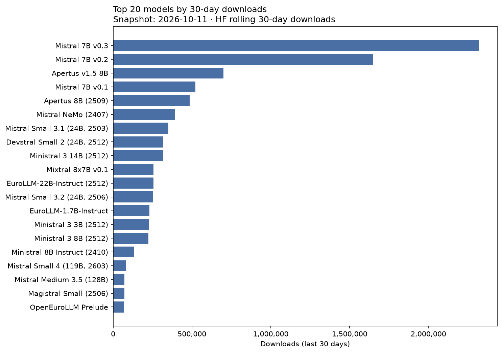
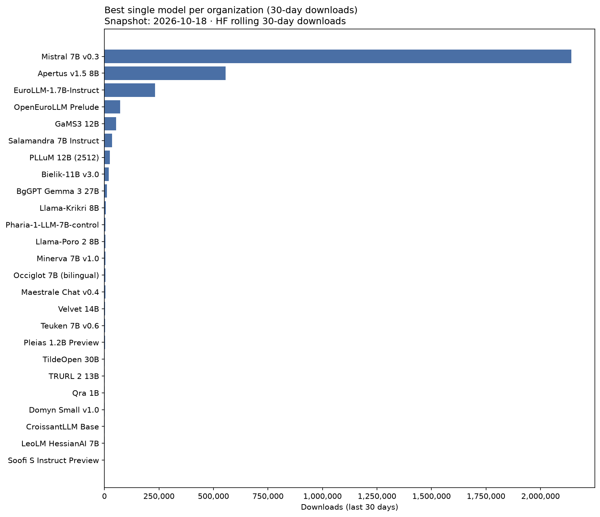
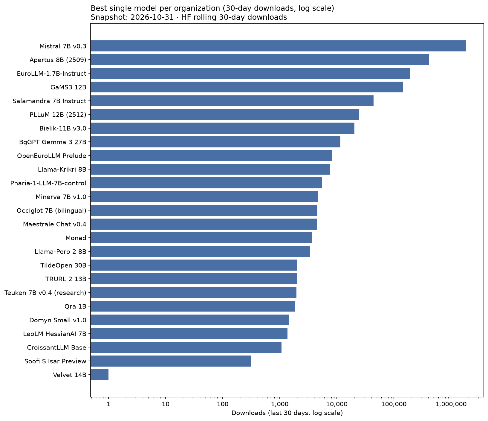
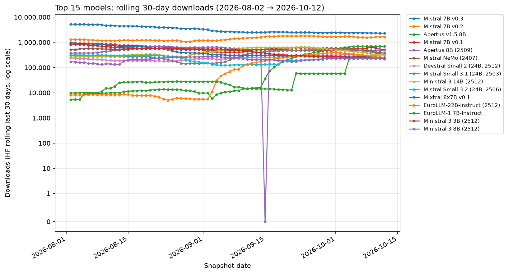
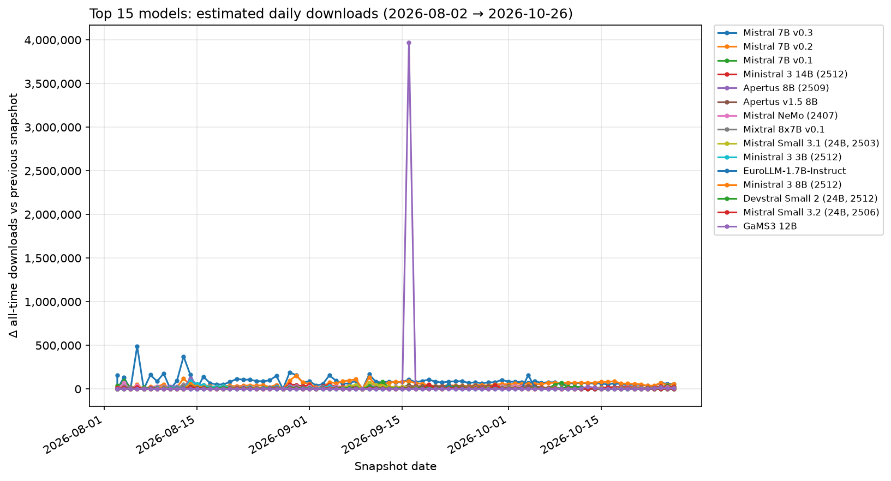
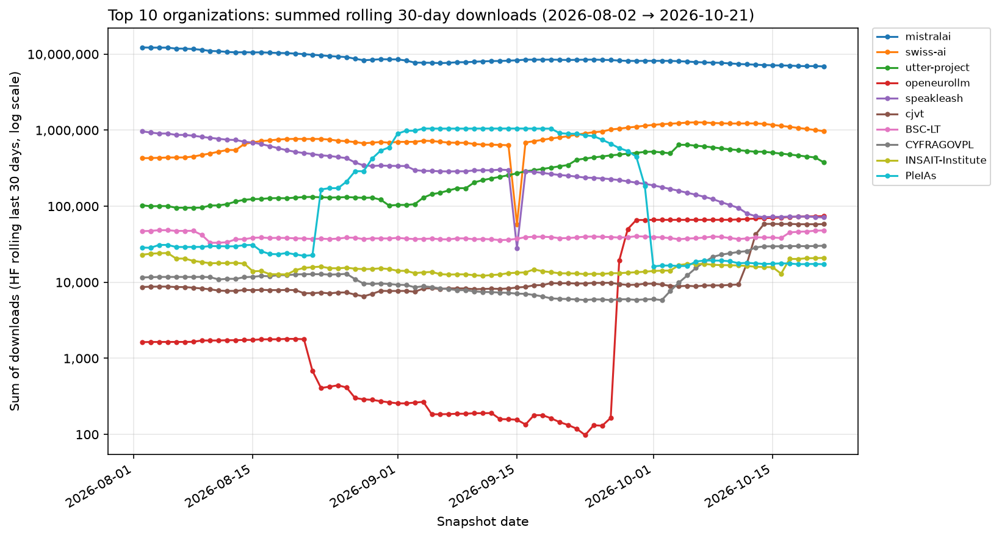
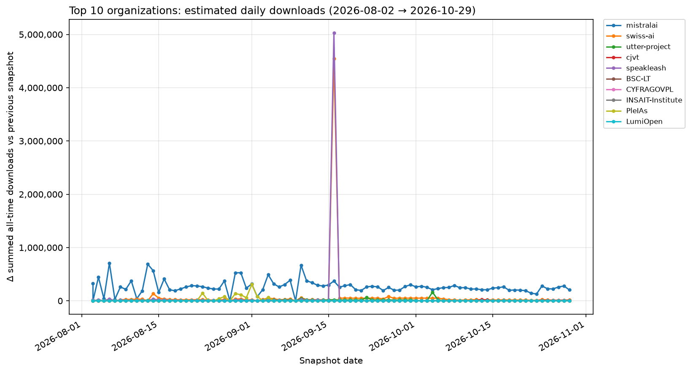

# European LLM Hugging Face download leaderboard

- **Snapshot date:** 2026-10-26
- **Generated at:** 2026-10-26T12:33:42Z
- **Ranking metric:** `total_downloads_30d` (last 30 days, summed across official format variants)
- **Rows:** 158

## Charts

### Trends over time

From daily snapshots in `data/metrics/timeseries.jsonl` (top 15 models / top 10 orgs by latest-day volume). Rolling-30d charts use a symlog y-axis (0 at zero, log compression above).

| Rank | Model | Country | Developer | Org | Downloads (30d) | Δ 30d | All-time | Momentum | Params | Repos |
| ---: | --- | :---: | --- | --- | ---: | ---: | ---: | ---: | ---: | ---: |
| 1 | Mistral 7B v0.3 | FR | Mistral AI | [mistralai](https://huggingface.co/mistralai) | 1,899,346 | -6,380 | 59,191,319 | 3.2% | 7.25B | 2 |
| 2 | Mistral 7B v0.2 | FR | Mistral AI | [mistralai](https://huggingface.co/mistralai) | 1,795,603 | +14,893 | 66,230,738 | 2.7% | 7.24B | 1 |
| 3 | Mistral 7B v0.1 | FR | Mistral AI | [mistralai](https://huggingface.co/mistralai) | 488,591 | +16,123 | 46,150,099 | 1.1% | 7.24B | 2 |
| 4 | Ministral 3 14B (2512) | FR | Mistral AI | [mistralai](https://huggingface.co/mistralai) | 427,602 | +16,947 | 4,090,546 | 10.2% | 13.95B | 6 |
| 5 | Apertus 8B (2509) | CH | swiss-ai | [swiss-ai](https://huggingface.co/swiss-ai) | 423,055 | -20,382 | 4,593,135 | 9.0% | 8.05B | 2 |
| 6 | Apertus v1.5 8B | CH | swiss-ai | [swiss-ai](https://huggingface.co/swiss-ai) | 299,562 | -31,740 | 735,065 | 35.9% | 8.90B | 1 |
| 7 | Mistral NeMo (2407) | FR | Mistral AI | [mistralai](https://huggingface.co/mistralai) | 296,605 | -11,707 | 16,606,126 | 1.8% | 12.25B | 3 |
| 8 | Mixtral 8x7B v0.1 | FR | Mistral AI | [mistralai](https://huggingface.co/mistralai) | 290,329 | +7,883 | 32,603,314 | 0.9% | 46.70B | 2 |
| 9 | Mistral Small 3.1 (24B, 2503) | FR | Mistral AI | [mistralai](https://huggingface.co/mistralai) | 222,486 | -3,155 | 4,929,644 | 4.4% | 24.01B | 2 |
| 10 | Ministral 3 3B (2512) | FR | Mistral AI | [mistralai](https://huggingface.co/mistralai) | 213,933 | -1,432 | 5,776,555 | 3.6% | 4.25B | 7 |
| 11 | EuroLLM-1.7B-Instruct | EU | utter-project | [utter-project](https://huggingface.co/utter-project) | 190,107 | +563 | 935,423 | 18.4% | 1.66B | 1 |
| 12 | Ministral 3 8B (2512) | FR | Mistral AI | [mistralai](https://huggingface.co/mistralai) | 189,098 | -3,466 | 2,371,631 | 7.7% | 8.92B | 6 |
| 13 | Devstral Small 2 (24B, 2512) | FR | Mistral AI | [mistralai](https://huggingface.co/mistralai) | 188,745 | -6,863 | 2,997,928 | 6.1% | 24.01B | 1 |
| 14 | Mistral Small 3.2 (24B, 2506) | FR | Mistral AI | [mistralai](https://huggingface.co/mistralai) | 177,890 | -3,559 | 5,577,089 | 3.1% | 24.01B | 1 |
| 15 | GaMS3 12B | SI | CJVT UL (Center za jezikovne vire in tehnologije, University of Ljubljana) | [cjvt](https://huggingface.co/cjvt) | 90,548 | +9,838 | 156,831 | 35.3% | 12.77B | 5 |
| 16 | Mistral Small 24B (2501) | FR | Mistral AI | [mistralai](https://huggingface.co/mistralai) | 85,892 | +1,881 | 7,657,550 | 1.1% | 23.57B | 2 |
| 17 | Magistral Small (2506) | FR | Mistral AI | [mistralai](https://huggingface.co/mistralai) | 68,532 | +514 | 787,296 | 7.7% | 23.57B | 2 |
| 18 | Mistral Small 4 (119B, 2603) | FR | Mistral AI | [mistralai](https://huggingface.co/mistralai) | 67,500 | -1,887 | 723,133 | 8.2% | 119.40B | 3 |
| 19 | Mixtral 8x22B v0.1 | FR | Mistral AI | [mistralai](https://huggingface.co/mistralai) | 65,582 | +123 | 11,268,195 | 0.6% | 140.63B | 2 |
| 20 | EuroLLM-22B-Instruct (2512) | EU | utter-project | [utter-project](https://huggingface.co/utter-project) | 55,211 | -12,811 | 600,536 | 7.9% | 22.64B | 1 |
| 21 | OpenEuroLLM Prelude | EU | openeurollm | [openeurollm](https://huggingface.co/openeurollm) | 54,846 | -19,162 | 76,086 | 31.1% | — | 1 |
| 22 | Ministral 8B Instruct (2410) | FR | Mistral AI | [mistralai](https://huggingface.co/mistralai) | 54,743 | -3,017 | 8,559,658 | 0.6% | 8.02B | 1 |
| 23 | Mistral Medium 3.5 (128B) | FR | Mistral AI | [mistralai](https://huggingface.co/mistralai) | 44,156 | -7,254 | 1,112,442 | 3.6% | 127.70B | 2 |
| 24 | Salamandra 7B Instruct | ES | BSC-LT | [BSC-LT](https://huggingface.co/BSC-LT) | 38,356 | +426 | 714,619 | 4.7% | 7.77B | 8 |
| 25 | Magistral Small (2509) | FR | Mistral AI | [mistralai](https://huggingface.co/mistralai) | 33,299 | +342 | 359,164 | 7.3% | 24.01B | 2 |
| 26 | EuroLLM-1.7B (base) | EU | utter-project | [utter-project](https://huggingface.co/utter-project) | 27,033 | -515 | 238,379 | 8.0% | — | 1 |
| 27 | PLLuM 12B (2512) | PL | CYFRAGOVPL / PLLuM consortium | [CYFRAGOVPL](https://huggingface.co/CYFRAGOVPL) | 24,441 | -67 | 43,944 | 17.0% | 12.25B | 3 |
| 28 | Apertus 70B (2509) | CH | swiss-ai | [swiss-ai](https://huggingface.co/swiss-ai) | 19,146 | -445 | 548,091 | 3.0% | 70.60B | 2 |
| 29 | Bielik-11B v3.0 | PL | SpeakLeash / ACK Cyfronet AGH | [speakleash](https://huggingface.co/speakleash) | 18,686 | -1,526 | 4,162,241 | 0.4% | 11.34B | 8 |
| 30 | Devstral Small (2507) | FR | Mistral AI | [mistralai](https://huggingface.co/mistralai) | 14,419 | +208 | 644,986 | 1.9% | 23.57B | 2 |
| 31 | EuroLLM-9B-Instruct (2512) | EU | utter-project | [utter-project](https://huggingface.co/utter-project) | 13,191 | -229 | 156,649 | 5.1% | 9.15B | 1 |
| 32 | Bielik-11B v2.3 | PL | SpeakLeash / ACK Cyfronet AGH | [speakleash](https://huggingface.co/speakleash) | 13,186 | -97 | 789,566 | 1.5% | 11.25B | 10 |
| 33 | Mistral Large Instruct (2407) | FR | Mistral AI | [mistralai](https://huggingface.co/mistralai) | 13,021 | +670 | 5,044,797 | 0.3% | 122.61B | 1 |
| 34 | BgGPT Gemma 3 27B | BG | INSAIT | [INSAIT-Institute](https://huggingface.co/INSAIT-Institute) | 11,619 | +36 | 19,959 | 9.7% | 27.43B | 3 |
| 35 | Bielik-7B v0.1 | PL | SpeakLeash | [speakleash](https://huggingface.co/speakleash) | 11,150 | -74 | 517,937 | 1.8% | 7.24B | 8 |
| 36 | Mistral Large 3 (675B, 2512) | FR | Mistral AI | [mistralai](https://huggingface.co/mistralai) | 10,959 | -70 | 82,651 | 6.0% | — | 5 |
| 37 | EuroLLM-9B-Instruct | EU | utter-project | [utter-project](https://huggingface.co/utter-project) | 10,948 | +119 | 491,095 | 1.9% | 9.15B | 1 |
| 38 | Mistral Large Instruct (2411) | FR | Mistral AI | [mistralai](https://huggingface.co/mistralai) | 10,369 | +147 | 4,935,018 | 0.2% | 122.61B | 1 |
| 39 | Mistral Small Instruct (2409) | FR | Mistral AI | [mistralai](https://huggingface.co/mistralai) | 8,172 | +103 | 5,385,011 | 0.1% | 22.25B | 1 |
| 40 | Bielik-Minitron 7B v3.0 | PL | SpeakLeash / ACK Cyfronet AGH | [speakleash](https://huggingface.co/speakleash) | 7,519 | +87 | 138,841 | 3.1% | 7.48B | 5 |
| 41 | Apertus v1.5 70B | CH | swiss-ai | [swiss-ai](https://huggingface.co/swiss-ai) | 6,714 | +1,306 | 31,752 | 5.1% | 72.01B | 1 |
| 42 | Apertus v1.1 0.5B | CH | swiss-ai | [swiss-ai](https://huggingface.co/swiss-ai) | 6,619 | -121 | 19,781 | 5.5% | 572.6M | 5 |
| 43 | Llama-Krikri 8B | GR | ILSP | [ilsp](https://huggingface.co/ilsp) | 6,558 | -126 | 115,230 | 3.0% | 8.42B | 7 |
| 44 | Devstral 2 (123B, 2512) | FR | Mistral AI | [mistralai](https://huggingface.co/mistralai) | 5,652 | +94 | 354,351 | 1.2% | 125.03B | 1 |
| 45 | Pharia-1-LLM-7B-control | DE | Aleph Alpha | [Aleph-Alpha](https://huggingface.co/Aleph-Alpha) | 5,477 | +21 | 81,498 | 3.0% | 7.04B | 4 |
| 46 | Salamandra 2B | ES | BSC-LT | [BSC-LT](https://huggingface.co/BSC-LT) | 5,324 | -75 | 148,865 | 2.1% | 2.25B | 7 |
| 47 | Minerva 7B v1.0 | IT | SapienzaNLP | [sapienzanlp](https://huggingface.co/sapienzanlp) | 4,835 | -140 | 138,035 | 2.0% | 7.40B | 3 |
| 48 | Bielik-11B v2.2 | PL | SpeakLeash / ACK Cyfronet AGH | [speakleash](https://huggingface.co/speakleash) | 4,524 | -51 | 168,315 | 1.7% | 11.17B | 16 |
| 49 | Maestrale Chat v0.4 | IT | mii-llm | [mii-llm](https://huggingface.co/mii-llm) | 4,402 | -6 | 152,200 | 1.7% | 7.24B | 4 |
| 50 | Codestral 22B v0.1 | FR | Mistral AI | [mistralai](https://huggingface.co/mistralai) | 4,344 | -70 | 5,163,013 | 0.1% | 22.25B | 1 |
| 51 | Occiglot 7B (bilingual) | EU | occiglot | [occiglot](https://huggingface.co/occiglot) | 4,339 | +11 | 375,757 | 0.9% | 7.24B | 8 |
| 52 | Apertus v1.1 1.5B | CH | swiss-ai | [swiss-ai](https://huggingface.co/swiss-ai) | 4,334 | +232 | 12,254 | 3.9% | 1.51B | 6 |
| 53 | Devstral Small (2505) | FR | Mistral AI | [mistralai](https://huggingface.co/mistralai) | 3,964 | +872 | 908,286 | 0.4% | 23.57B | 2 |
| 54 | Llama-Poro 2 8B | FI | LumiOpen | [LumiOpen](https://huggingface.co/LumiOpen) | 3,830 | -1 | 51,991 | 2.5% | 8.03B | 7 |
| 55 | Bielik-1.5B v3.0 | PL | SpeakLeash | [speakleash](https://huggingface.co/speakleash) | 3,825 | -2 | 61,141 | 2.4% | 1.60B | 5 |
| 56 | EuroMoE 2.6B-A0.6B (2512) | EU | utter-project | [utter-project](https://huggingface.co/utter-project) | 3,825 | +37 | 38,857 | 2.8% | 2.61B | 3 |
| 57 | Magistral Small (2507) | FR | Mistral AI | [mistralai](https://huggingface.co/mistralai) | 3,550 | -1,182 | 156,305 | 1.4% | 23.57B | 2 |
| 58 | Bielik-4.5B v3.0 | PL | SpeakLeash | [speakleash](https://huggingface.co/speakleash) | 3,525 | -41 | 255,812 | 1.0% | 4.76B | 5 |
| 59 | Apertus v1.1 4B | CH | swiss-ai | [swiss-ai](https://huggingface.co/swiss-ai) | 3,494 | +413 | 18,182 | 3.0% | 3.83B | 5 |
| 60 | Minerva Chat v0.1 | IT | mii-llm | [mii-llm](https://huggingface.co/mii-llm) | 3,034 | -6 | 94,371 | 1.6% | 2.89B | 1 |
| 61 | Monad | FR | PleIAs | [PleIAs](https://huggingface.co/PleIAs) | 3,030 | +73 | 35,369 | 2.2% | 56.7M | 1 |
| 62 | Baguettotron | FR | PleIAs | [PleIAs](https://huggingface.co/PleIAs) | 2,719 | -4 | 42,192 | 1.9% | 13.29B | 3 |
| 63 | Viking 13B | FI | LumiOpen | [LumiOpen](https://huggingface.co/LumiOpen) | 2,659 | -447 | 34,225 | 2.0% | 14.03B | 1 |
| 64 | EuroLLM-22B (2512 base) | EU | utter-project | [utter-project](https://huggingface.co/utter-project) | 2,650 | -32 | 25,712 | 2.1% | 22.64B | 1 |
| 65 | PLLuM 12B (2412) | PL | CYFRAGOVPL / PLLuM consortium | [CYFRAGOVPL](https://huggingface.co/CYFRAGOVPL) | 2,446 | -17 | 178,881 | 0.9% | 12.25B | 6 |
| 66 | Pleias 1.2B Preview | FR | PleIAs | [PleIAs](https://huggingface.co/PleIAs) | 2,267 | -20 | 415,494 | 0.4% | 1.20B | 1 |
| 67 | Pleias 3B Preview | FR | PleIAs | [PleIAs](https://huggingface.co/PleIAs) | 2,096 | -16 | 400,334 | 0.4% | 3.21B | 1 |
| 68 | Mathstral 7B v0.1 | FR | Mistral AI | [mistralai](https://huggingface.co/mistralai) | 2,094 | +64 | 5,302,489 | 0.0% | 7.25B | 1 |
| 69 | MamayLM Gemma 3 12B v2.0 | UA | INSAIT | [INSAIT-Institute](https://huggingface.co/INSAIT-Institute) | 2,061 | -78 | 19,292 | 1.7% | 12.19B | 2 |
| 70 | Pleias 350M Preview | FR | PleIAs | [PleIAs](https://huggingface.co/PleIAs) | 2,054 | -18 | 418,797 | 0.4% | 353.4M | 1 |
| 71 | Salamandra 7B (base) | ES | BSC-LT | [BSC-LT](https://huggingface.co/BSC-LT) | 2,010 | +3 | 51,305 | 1.3% | 7.77B | 1 |
| 72 | GaMS 9B | SI | CJVT UL (Center za jezikovne vire in tehnologije, University of Ljubljana) | [cjvt](https://huggingface.co/cjvt) | 1,960 | +25 | 50,804 | 1.3% | 9.24B | 4 |
| 73 | MamayLM Gemma 3 4B v1.0 | UA | INSAIT | [INSAIT-Institute](https://huggingface.co/INSAIT-Institute) | 1,919 | +5 | 21,698 | 1.6% | 4.30B | 2 |
| 74 | TildeOpen 30B | LV | Tilde | [TildeAI](https://huggingface.co/TildeAI) | 1,900 | +24 | 101,243 | 0.9% | 30.68B | 1 |
| 75 | TRURL 2 13B | PL | Voicelab | [Voicelab](https://huggingface.co/Voicelab) | 1,875 | +26 | 357,404 | 0.4% | — | 3 |
| 76 | Teuken 7B v0.4 (research) | DE | openGPT-X | [openGPT-X](https://huggingface.co/openGPT-X) | 1,855 | +8 | 79,727 | 1.0% | 7.45B | 1 |
| 77 | Teuken 7B v0.6 | DE | openGPT-X | [openGPT-X](https://huggingface.co/openGPT-X) | 1,841 | -94 | 670,813 | 0.2% | 7.45B | 2 |
| 78 | Teuken 7B v0.4 (commercial) | DE | openGPT-X | [openGPT-X](https://huggingface.co/openGPT-X) | 1,791 | 0 | 107,345 | 0.9% | 7.45B | 1 |
| 79 | Poro 34B | FI | LumiOpen | [LumiOpen](https://huggingface.co/LumiOpen) | 1,784 | +104 | 229,528 | 0.5% | 35.13B | 4 |
| 80 | PLLuM 4B (2512) | PL | CYFRAGOVPL / PLLuM consortium | [CYFRAGOVPL](https://huggingface.co/CYFRAGOVPL) | 1,701 | +8 | 8,993 | 1.6% | 4.30B | 3 |
| 81 | EuroLLM-22B-Instruct (Preview) | EU | utter-project | [utter-project](https://huggingface.co/utter-project) | 1,700 | +21 | 34,074 | 1.3% | 22.64B | 1 |
| 82 | Qra 1B | PL | OPI-PG | [OPI-PG](https://huggingface.co/OPI-PG) | 1,683 | -2 | 159,019 | 0.6% | 1.10B | 1 |
| 83 | TRURL 2 7B | PL | Voicelab | [Voicelab](https://huggingface.co/Voicelab) | 1,673 | +3 | 302,503 | 0.4% | 6.74B | 2 |
| 84 | Qra 7B | PL | OPI-PG | [OPI-PG](https://huggingface.co/OPI-PG) | 1,627 | +13 | 185,822 | 0.6% | 6.74B | 1 |
| 85 | Qra 13B | PL | OPI-PG | [OPI-PG](https://huggingface.co/OPI-PG) | 1,611 | +6 | 146,604 | 0.7% | 13.02B | 1 |
| 86 | Viking 33B | FI | LumiOpen | [LumiOpen](https://huggingface.co/LumiOpen) | 1,572 | -779 | 31,254 | 1.2% | 33.12B | 1 |
| 87 | Maestrale Chat v0.3 | IT | mii-llm | [mii-llm](https://huggingface.co/mii-llm) | 1,548 | +3 | 53,962 | 1.0% | 7.24B | 5 |
| 88 | Domyn Small v1.0 | IT | Domyn | [domyn](https://huggingface.co/domyn) | 1,482 | -36 | 8,969 | 1.4% | 9.82B | 1 |
| 89 | Maestrale Chat v0.2 | IT | mii-llm | [mii-llm](https://huggingface.co/mii-llm) | 1,466 | +2 | 52,743 | 1.0% | 7.24B | 1 |
| 90 | Bielik-11B v2.6 | PL | SpeakLeash / ACK Cyfronet AGH | [speakleash](https://huggingface.co/speakleash) | 1,430 | +3 | 174,536 | 0.5% | 11.51B | 7 |
| 91 | Llama-Poro 2 70B | FI | LumiOpen | [LumiOpen](https://huggingface.co/LumiOpen) | 1,408 | +71 | 40,038 | 1.0% | 70.55B | 3 |
| 92 | Bielik-11B v2.0 | PL | SpeakLeash / ACK Cyfronet AGH | [speakleash](https://huggingface.co/speakleash) | 1,358 | -31 | 23,588 | 1.1% | 11.17B | 5 |
| 93 | Pleias RAG 1B | FR | PleIAs | [PleIAs](https://huggingface.co/PleIAs) | 1,280 | +3 | 19,815 | 1.1% | 1.20B | 2 |
| 94 | LeoLM HessianAI 7B | DE | LeoLM | [LeoLM](https://huggingface.co/LeoLM) | 1,183 | -5 | 801,437 | 0.1% | — | 3 |
| 95 | EuroLLM-9B (2512) | EU | utter-project | [utter-project](https://huggingface.co/utter-project) | 1,169 | +5 | 10,433 | 1.1% | 9.15B | 1 |
| 96 | Bielik-11B v2.1 | PL | SpeakLeash / ACK Cyfronet AGH | [speakleash](https://huggingface.co/speakleash) | 1,146 | -52 | 31,465 | 0.9% | 11.17B | 5 |
| 97 | Viking 7B | FI | LumiOpen | [LumiOpen](https://huggingface.co/LumiOpen) | 1,136 | -416 | 56,114 | 0.7% | 7.55B | 1 |
| 98 | CroissantLLM Base | FR | croissantllm | [croissantllm](https://huggingface.co/croissantllm) | 1,039 | +1 | 58,175 | 0.7% | 1.35B | 3 |
| 99 | MamayLM Gemma 3 27B v2.0 | UA | INSAIT | [INSAIT-Institute](https://huggingface.co/INSAIT-Institute) | 965 | +208 | 8,905 | 0.9% | 28.84B | 3 |
| 100 | Pleias RAG 350M | FR | PleIAs | [PleIAs](https://huggingface.co/PleIAs) | 955 | +4 | 15,010 | 0.8% | 353.4M | 2 |
| 101 | ALIA 40B (base) | ES | BSC-LT | [BSC-LT](https://huggingface.co/BSC-LT) | 888 | +8 | 453,140 | 0.2% | 40.43B | 1 |
| 102 | BgGPT 7B v0.2 | BG | INSAIT | [INSAIT-Institute](https://huggingface.co/INSAIT-Institute) | 848 | -28 | 111,970 | 0.4% | 7.29B | 2 |
| 103 | BgGPT Gemma 3 12B | BG | INSAIT | [INSAIT-Institute](https://huggingface.co/INSAIT-Institute) | 817 | +22 | 218,616 | 0.3% | 12.19B | 3 |
| 104 | MamayLM Gemma 3 12B v1.0 | UA | INSAIT | [INSAIT-Institute](https://huggingface.co/INSAIT-Institute) | 768 | +180 | 44,732 | 0.5% | 12.19B | 2 |
| 105 | GaMS 1B | SI | CJVT UL (Center za jezikovne vire in tehnologije, University of Ljubljana) | [cjvt](https://huggingface.co/cjvt) | 732 | +10 | 16,638 | 0.6% | 1.54B | 4 |
| 106 | OCRonos | FR | PleIAs | [PleIAs](https://huggingface.co/PleIAs) | 671 | +6 | 81,877 | 0.4% | 8.03B | 3 |
| 107 | BgGPT Gemma 3 4B | BG | INSAIT | [INSAIT-Institute](https://huggingface.co/INSAIT-Institute) | 623 | +6 | 14,380 | 0.5% | 4.33B | 3 |
| 108 | CroissantLLM Chat v0.1 | FR | croissantllm | [croissantllm](https://huggingface.co/croissantllm) | 585 | -1 | 96,170 | 0.3% | 1.35B | 8 |
| 109 | Llama-PLLuM 8B (2512) | PL | CYFRAGOVPL / PLLuM consortium | [CYFRAGOVPL](https://huggingface.co/CYFRAGOVPL) | 530 | -34 | 4,228 | 0.5% | 8.03B | 3 |
| 110 | MamayLM Gemma 2 9B v0.1 | UA | INSAIT | [INSAIT-Institute](https://huggingface.co/INSAIT-Institute) | 484 | +1 | 21,879 | 0.4% | 9.24B | 2 |
| 111 | TildeOpen 30B (64k) | LV | Tilde | [TildeAI](https://huggingface.co/TildeAI) | 473 | +26 | 3,392 | 0.5% | 30.68B | 1 |
| 112 | GaMS 2B | SI | CJVT UL (Center za jezikovne vire in tehnologije, University of Ljubljana) | [cjvt](https://huggingface.co/cjvt) | 424 | +23 | 20,415 | 0.4% | 3.20B | 2 |
| 113 | Leanstral 1.5 (119B-A6B) | FR | Mistral AI | [mistralai](https://huggingface.co/mistralai) | 394 | +5 | 1,486 | 0.4% | — | 1 |
| 114 | ALIA 40B Instruct (2601) | ES | BSC-LT | [BSC-LT](https://huggingface.co/BSC-LT) | 380 | -7 | 32,799 | 0.3% | 40.43B | 2 |
| 115 | LeoLM Mistral HessianAI 7B | DE | LeoLM | [LeoLM](https://huggingface.co/LeoLM) | 359 | +33 | 232,957 | 0.1% | — | 2 |
| 116 | GaMS 27B | SI | CJVT UL (Center za jezikovne vire in tehnologije, University of Ljubljana) | [cjvt](https://huggingface.co/cjvt) | 336 | +13 | 37,778 | 0.2% | 27.23B | 3 |
| 117 | BgGPT Gemma 2 9B | BG | INSAIT | [INSAIT-Institute](https://huggingface.co/INSAIT-Institute) | 335 | +4 | 27,549 | 0.3% | 9.24B | 2 |
| 118 | GaMS2 27B | SI | CJVT UL (Center za jezikovne vire in tehnologije, University of Ljubljana) | [cjvt](https://huggingface.co/cjvt) | 335 | +4 | 1,521 | 0.3% | 27.23B | 3 |
| 119 | BgGPT Gemma 2 2.6B | BG | INSAIT | [INSAIT-Institute](https://huggingface.co/INSAIT-Institute) | 314 | -11 | 22,022 | 0.3% | 2.61B | 2 |
| 120 | Nesso 4B | IT | mii-llm | [mii-llm](https://huggingface.co/mii-llm) | 314 | +34 | 2,740 | 0.3% | 4.02B | 2 |
| 121 | EuroLLM-9B (base) | EU | utter-project | [utter-project](https://huggingface.co/utter-project) | 311 | -36 | 84,516 | 0.2% | 9.15B | 1 |
| 122 | Occiglot 7B EU5 | EU | occiglot | [occiglot](https://huggingface.co/occiglot) | 306 | -13 | 322,206 | 0.1% | 7.24B | 2 |
| 123 | Bielik-11B v2.5 | PL | SpeakLeash / ACK Cyfronet AGH | [speakleash](https://huggingface.co/speakleash) | 300 | +13 | 5,443 | 0.3% | 11.51B | 5 |
| 124 | BgGPT Gemma 2 27B | BG | INSAIT | [INSAIT-Institute](https://huggingface.co/INSAIT-Institute) | 294 | -51 | 12,011 | 0.3% | 27.23B | 2 |
| 125 | LeoLM HessianAI 13B | DE | LeoLM | [LeoLM](https://huggingface.co/LeoLM) | 289 | -1 | 107,158 | 0.1% | — | 3 |
| 126 | Meltemi 7B v1.5 | GR | ILSP | [ilsp](https://huggingface.co/ilsp) | 285 | +2 | 39,353 | 0.2% | 7.48B | 2 |
| 127 | Zagreus 0.4B (ITA) | IT | mii-llm | [mii-llm](https://huggingface.co/mii-llm) | 268 | +9 | 5,136 | 0.3% | 437.8M | 1 |
| 128 | Llama-PLLuM 70B (2512) | PL | CYFRAGOVPL / PLLuM consortium | [CYFRAGOVPL](https://huggingface.co/CYFRAGOVPL) | 256 | -2 | 12,683 | 0.2% | 70.55B | 2 |
| 129 | LeoLM HessianAI 70B | DE | LeoLM | [LeoLM](https://huggingface.co/LeoLM) | 227 | -4 | 19,634 | 0.2% | 68.98B | 2 |
| 130 | Meltemi 7B v1 | GR | ILSP | [ilsp](https://huggingface.co/ilsp) | 222 | +15 | 44,607 | 0.2% | 7.70B | 5 |
| 131 | Bielik-11B v2 (base) | PL | SpeakLeash / ACK Cyfronet AGH | [speakleash](https://huggingface.co/speakleash) | 219 | -59 | 41,845 | 0.2% | 11.17B | 1 |
| 132 | Llama-PLLuM 70B (2508) | PL | CYFRAGOVPL / PLLuM consortium | [CYFRAGOVPL](https://huggingface.co/CYFRAGOVPL) | 205 | +1 | 5,027 | 0.2% | 70.55B | 3 |
| 133 | Soofi S Instruct Preview | DE | Soofi Project | [Soofi-Project](https://huggingface.co/Soofi-Project) | 204 | 0 | 7,454 | 0.2% | 31.59B | 6 |
| 134 | EuroLLM-22B (Preview base) | EU | utter-project | [utter-project](https://huggingface.co/utter-project) | 200 | +1 | 2,518 | 0.2% | — | 1 |
| 135 | BgGPT 7B v0.1 | BG | INSAIT | [INSAIT-Institute](https://huggingface.co/INSAIT-Institute) | 189 | +3 | 16,578 | 0.2% | 7.29B | 2 |
| 136 | Llama-PLLuM 8B (2412) | PL | CYFRAGOVPL / PLLuM consortium | [CYFRAGOVPL](https://huggingface.co/CYFRAGOVPL) | 173 | -3 | 70,416 | 0.1% | 8.03B | 3 |
| 137 | Soofi S Base | DE | Soofi Project | [Soofi-Project](https://huggingface.co/Soofi-Project) | 173 | +2 | 1,503 | 0.2% | 31.58B | 2 |
| 138 | Pleias Pico | FR | PleIAs | [PleIAs](https://huggingface.co/PleIAs) | 153 | -1 | 5,451 | 0.1% | 353.4M | 2 |
| 139 | Nesso 0.4B Agentic | IT | mii-llm | [mii-llm](https://huggingface.co/mii-llm) | 151 | +3 | 3,097 | 0.1% | 560.9M | 2 |
| 140 | PLLuM 8x7B (2412) | PL | CYFRAGOVPL / PLLuM consortium | [CYFRAGOVPL](https://huggingface.co/CYFRAGOVPL) | 149 | +1 | 28,373 | 0.1% | 46.70B | 6 |
| 141 | PLLuM 12B nc (2507) | PL | CYFRAGOVPL / PLLuM consortium | [CYFRAGOVPL](https://huggingface.co/CYFRAGOVPL) | 136 | +4 | 6,171 | 0.1% | 12.25B | 3 |
| 142 | Leanstral (2603) | FR | Mistral AI | [mistralai](https://huggingface.co/mistralai) | 129 | +1 | 1,115 | 0.1% | — | 1 |
| 143 | Llama-PLLuM 70B (2412) | PL | CYFRAGOVPL / PLLuM consortium | [CYFRAGOVPL](https://huggingface.co/CYFRAGOVPL) | 104 | 0 | 38,701 | 0.1% | 70.55B | 3 |
| 144 | Pleias Nano | FR | PleIAs | [PleIAs](https://huggingface.co/PleIAs) | 102 | 0 | 7,239 | 0.1% | 1.20B | 2 |
| 145 | Pleias SLM RAG | FR | PleIAs | [PleIAs](https://huggingface.co/PleIAs) | 83 | -1 | 431 | 0.1% | 321.0M | 1 |
| 146 | Soofi S Isar Preview | DE | Soofi Project | [Soofi-Project](https://huggingface.co/Soofi-Project) | 78 | +50 | 12,084 | 0.1% | 31.59B | 6 |
| 147 | Nesso 0.4B Instruct | IT | mii-llm | [mii-llm](https://huggingface.co/mii-llm) | 63 | +10 | 1,294 | 0.1% | 560.9M | 1 |
| 148 | Soofi S Rhine Preview | DE | Soofi Project | [Soofi-Project](https://huggingface.co/Soofi-Project) | 47 | 0 | 2,853 | 0.0% | 31.59B | 6 |
| 149 | Open Zagreus 0.4B | IT | mii-llm | [mii-llm](https://huggingface.co/mii-llm) | 41 | +1 | 392 | 0.0% | 437.8M | 1 |
| 150 | TildeOpen 15B WMT26 (cs-de) | LV | Tilde | [TildeAI](https://huggingface.co/TildeAI) | 41 | +3 | 254 | 0.0% | 15.17B | 3 |
| 151 | TildeOpen 8B WMT26 (cs-de) | LV | Tilde | [TildeAI](https://huggingface.co/TildeAI) | 36 | +3 | 192 | 0.0% | 8.16B | 3 |
| 152 | Zagreus 0.4B (SPA) | IT | mii-llm | [mii-llm](https://huggingface.co/mii-llm) | 31 | +3 | 216 | 0.0% | 437.8M | 1 |
| 153 | Maestrale Chat v0.1 | IT | mii-llm | [mii-llm](https://huggingface.co/mii-llm) | 22 | +2 | 131 | 0.0% | 7.24B | 1 |
| 154 | Zagreus 0.4B (POR) | IT | mii-llm | [mii-llm](https://huggingface.co/mii-llm) | 15 | 0 | 270 | 0.0% | 437.8M | 1 |
| 155 | Zagreus 0.4B (FRA) | IT | mii-llm | [mii-llm](https://huggingface.co/mii-llm) | 11 | -1 | 153 | 0.0% | 437.8M | 1 |
| 156 | Emma 5 Boost | IT | mii-llm | [mii-llm](https://huggingface.co/mii-llm) | 0 | 0 | 8 | 0.0% | 1.39B | 1 |
| 157 | Velvet 14B | IT | Almawave | [Almawave](https://huggingface.co/Almawave) | 0 | 0 | 0 | 0.0% | — | 0 |
| 158 | Velvet 2B | IT | Almawave | [Almawave](https://huggingface.co/Almawave) | 0 | 0 | 0 | 0.0% | — | 0 |

## Organizations

Same downloads, aggregated across every model version an organization publishes.

| Rank | Organization | Developer | Country | Downloads (30d) | All-time | Models | Momentum |
| ---: | --- | --- | :---: | ---: | ---: | ---: | ---: |
| 1 | [mistralai](https://huggingface.co/mistralai) | Mistral AI | FR | 6,686,999 | 304,971,935 | 30 | 2.2% |
| 2 | [swiss-ai](https://huggingface.co/swiss-ai) | swiss-ai | CH | 762,924 | 5,958,260 | 7 | 12.6% |
| 3 | [utter-project](https://huggingface.co/utter-project) | utter-project | EU | 306,345 | 2,618,192 | 11 | 11.3% |
| 4 | [cjvt](https://huggingface.co/cjvt) | CJVT UL (Center za jezikovne vire in tehnologije, University of Ljubljana) | SI | 94,335 | 283,987 | 6 | 24.6% |
| 5 | [speakleash](https://huggingface.co/speakleash) | SpeakLeash / ACK Cyfronet AGH | PL | 66,868 | 6,370,730 | 12 | 1.0% |
| 6 | [openeurollm](https://huggingface.co/openeurollm) | openeurollm | EU | 54,846 | 76,086 | 1 | 31.1% |
| 7 | [BSC-LT](https://huggingface.co/BSC-LT) | BSC-LT | ES | 46,958 | 1,400,728 | 5 | 3.1% |
| 8 | [CYFRAGOVPL](https://huggingface.co/CYFRAGOVPL) | CYFRAGOVPL / PLLuM consortium | PL | 30,141 | 397,417 | 10 | 6.1% |
| 9 | [INSAIT-Institute](https://huggingface.co/INSAIT-Institute) | INSAIT | BG | 21,236 | 559,591 | 13 | 3.2% |
| 10 | [PleIAs](https://huggingface.co/PleIAs) | PleIAs | FR | 15,410 | 1,442,009 | 11 | 1.0% |
| 11 | [LumiOpen](https://huggingface.co/LumiOpen) | LumiOpen | FI | 12,389 | 443,150 | 6 | 2.3% |
| 12 | [mii-llm](https://huggingface.co/mii-llm) | mii-llm | IT | 11,366 | 366,713 | 14 | 2.4% |
| 13 | [ilsp](https://huggingface.co/ilsp) | ILSP | GR | 7,065 | 199,190 | 3 | 2.4% |
| 14 | [openGPT-X](https://huggingface.co/openGPT-X) | openGPT-X | DE | 5,487 | 857,885 | 3 | 0.6% |
| 15 | [Aleph-Alpha](https://huggingface.co/Aleph-Alpha) | Aleph Alpha | DE | 5,477 | 81,498 | 1 | 3.0% |
| 16 | [OPI-PG](https://huggingface.co/OPI-PG) | OPI-PG | PL | 4,921 | 491,445 | 3 | 0.8% |
| 17 | [sapienzanlp](https://huggingface.co/sapienzanlp) | SapienzaNLP | IT | 4,835 | 138,035 | 1 | 2.0% |
| 18 | [occiglot](https://huggingface.co/occiglot) | occiglot | EU | 4,645 | 697,963 | 2 | 0.6% |
| 19 | [Voicelab](https://huggingface.co/Voicelab) | Voicelab | PL | 3,548 | 659,907 | 2 | 0.5% |
| 20 | [TildeAI](https://huggingface.co/TildeAI) | Tilde | LV | 2,450 | 105,081 | 4 | 1.2% |
| 21 | [LeoLM](https://huggingface.co/LeoLM) | LeoLM | DE | 2,058 | 1,161,186 | 4 | 0.2% |
| 22 | [croissantllm](https://huggingface.co/croissantllm) | croissantllm | FR | 1,624 | 154,345 | 2 | 0.6% |
| 23 | [domyn](https://huggingface.co/domyn) | Domyn | IT | 1,482 | 8,969 | 1 | 1.4% |
| 24 | [Soofi-Project](https://huggingface.co/Soofi-Project) | Soofi Project | DE | 502 | 23,894 | 4 | 0.4% |
| 25 | [Almawave](https://huggingface.co/Almawave) | Almawave | IT | 0 | 0 | 2 | 0.0% |

### By best single model

Ranked by each organization's single highest-downloading model (no summing across versions) — who has the biggest individual hit.

| Rank | Organization | Best model | Downloads (30d) | All-time | Overall model rank |
| ---: | --- | --- | ---: | ---: | ---: |
| 1 | [mistralai](https://huggingface.co/mistralai) | Mistral 7B v0.3 | 1,899,346 | 59,191,319 | 1 |
| 2 | [swiss-ai](https://huggingface.co/swiss-ai) | Apertus 8B (2509) | 423,055 | 4,593,135 | 5 |
| 3 | [utter-project](https://huggingface.co/utter-project) | EuroLLM-1.7B-Instruct | 190,107 | 935,423 | 11 |
| 4 | [cjvt](https://huggingface.co/cjvt) | GaMS3 12B | 90,548 | 156,831 | 15 |
| 5 | [openeurollm](https://huggingface.co/openeurollm) | OpenEuroLLM Prelude | 54,846 | 76,086 | 21 |
| 6 | [BSC-LT](https://huggingface.co/BSC-LT) | Salamandra 7B Instruct | 38,356 | 714,619 | 24 |
| 7 | [CYFRAGOVPL](https://huggingface.co/CYFRAGOVPL) | PLLuM 12B (2512) | 24,441 | 43,944 | 27 |
| 8 | [speakleash](https://huggingface.co/speakleash) | Bielik-11B v3.0 | 18,686 | 4,162,241 | 29 |
| 9 | [INSAIT-Institute](https://huggingface.co/INSAIT-Institute) | BgGPT Gemma 3 27B | 11,619 | 19,959 | 34 |
| 10 | [ilsp](https://huggingface.co/ilsp) | Llama-Krikri 8B | 6,558 | 115,230 | 43 |
| 11 | [Aleph-Alpha](https://huggingface.co/Aleph-Alpha) | Pharia-1-LLM-7B-control | 5,477 | 81,498 | 45 |
| 12 | [sapienzanlp](https://huggingface.co/sapienzanlp) | Minerva 7B v1.0 | 4,835 | 138,035 | 47 |
| 13 | [mii-llm](https://huggingface.co/mii-llm) | Maestrale Chat v0.4 | 4,402 | 152,200 | 49 |
| 14 | [occiglot](https://huggingface.co/occiglot) | Occiglot 7B (bilingual) | 4,339 | 375,757 | 51 |
| 15 | [LumiOpen](https://huggingface.co/LumiOpen) | Llama-Poro 2 8B | 3,830 | 51,991 | 54 |
| 16 | [PleIAs](https://huggingface.co/PleIAs) | Monad | 3,030 | 35,369 | 61 |
| 17 | [TildeAI](https://huggingface.co/TildeAI) | TildeOpen 30B | 1,900 | 101,243 | 74 |
| 18 | [Voicelab](https://huggingface.co/Voicelab) | TRURL 2 13B | 1,875 | 357,404 | 75 |
| 19 | [openGPT-X](https://huggingface.co/openGPT-X) | Teuken 7B v0.4 (research) | 1,855 | 79,727 | 76 |
| 20 | [OPI-PG](https://huggingface.co/OPI-PG) | Qra 1B | 1,683 | 159,019 | 82 |
| 21 | [domyn](https://huggingface.co/domyn) | Domyn Small v1.0 | 1,482 | 8,969 | 88 |
| 22 | [LeoLM](https://huggingface.co/LeoLM) | LeoLM HessianAI 7B | 1,183 | 801,437 | 94 |
| 23 | [croissantllm](https://huggingface.co/croissantllm) | CroissantLLM Base | 1,039 | 58,175 | 98 |
| 24 | [Soofi-Project](https://huggingface.co/Soofi-Project) | Soofi S Instruct Preview | 204 | 7,454 | 133 |
| 25 | [Almawave](https://huggingface.co/Almawave) | Velvet 14B | 0 | 0 | 157 |

### By momentum

Sorted by momentum (highest first). Momentum highlights orgs whose recent downloads are large *relative to their lifetime total* — i.e. accelerating adoption, not legacy long-tail traffic from an old release.

| Momentum rank | Organization | Momentum | Downloads (30d) | All-time | Downloads rank |
| ---: | --- | ---: | ---: | ---: | ---: |
| 1 | [openeurollm](https://huggingface.co/openeurollm) | 31.1% | 54,846 | 76,086 | 6 |
| 2 | [cjvt](https://huggingface.co/cjvt) | 24.6% | 94,335 | 283,987 | 4 |
| 3 | [swiss-ai](https://huggingface.co/swiss-ai) | 12.6% | 762,924 | 5,958,260 | 2 |
| 4 | [utter-project](https://huggingface.co/utter-project) | 11.3% | 306,345 | 2,618,192 | 3 |
| 5 | [CYFRAGOVPL](https://huggingface.co/CYFRAGOVPL) | 6.1% | 30,141 | 397,417 | 8 |
| 6 | [INSAIT-Institute](https://huggingface.co/INSAIT-Institute) | 3.2% | 21,236 | 559,591 | 9 |
| 7 | [BSC-LT](https://huggingface.co/BSC-LT) | 3.1% | 46,958 | 1,400,728 | 7 |
| 8 | [Aleph-Alpha](https://huggingface.co/Aleph-Alpha) | 3.0% | 5,477 | 81,498 | 15 |
| 9 | [mii-llm](https://huggingface.co/mii-llm) | 2.4% | 11,366 | 366,713 | 12 |
| 10 | [ilsp](https://huggingface.co/ilsp) | 2.4% | 7,065 | 199,190 | 13 |
| 11 | [LumiOpen](https://huggingface.co/LumiOpen) | 2.3% | 12,389 | 443,150 | 11 |
| 12 | [mistralai](https://huggingface.co/mistralai) | 2.2% | 6,686,999 | 304,971,935 | 1 |
| 13 | [sapienzanlp](https://huggingface.co/sapienzanlp) | 2.0% | 4,835 | 138,035 | 17 |
| 14 | [domyn](https://huggingface.co/domyn) | 1.4% | 1,482 | 8,969 | 23 |
| 15 | [TildeAI](https://huggingface.co/TildeAI) | 1.2% | 2,450 | 105,081 | 20 |
| 16 | [speakleash](https://huggingface.co/speakleash) | 1.0% | 66,868 | 6,370,730 | 5 |
| 17 | [PleIAs](https://huggingface.co/PleIAs) | 1.0% | 15,410 | 1,442,009 | 10 |
| 18 | [OPI-PG](https://huggingface.co/OPI-PG) | 0.8% | 4,921 | 491,445 | 16 |
| 19 | [croissantllm](https://huggingface.co/croissantllm) | 0.6% | 1,624 | 154,345 | 22 |
| 20 | [occiglot](https://huggingface.co/occiglot) | 0.6% | 4,645 | 697,963 | 18 |
| 21 | [openGPT-X](https://huggingface.co/openGPT-X) | 0.6% | 5,487 | 857,885 | 14 |
| 22 | [Voicelab](https://huggingface.co/Voicelab) | 0.5% | 3,548 | 659,907 | 19 |
| 23 | [Soofi-Project](https://huggingface.co/Soofi-Project) | 0.4% | 502 | 23,894 | 24 |
| 24 | [LeoLM](https://huggingface.co/LeoLM) | 0.2% | 2,058 | 1,161,186 | 21 |
| 25 | [Almawave](https://huggingface.co/Almawave) | 0.0% | 0 | 0 | 25 |

## Notes

- Downloads are Hugging Face Hub **rolling last-30-day** counts, aggregated over official repos matched by config regexes (GGUF / MLX / FP8 / etc. when published by the same org).
- **Params** is the max reported parameter count among member repos (`safetensors.total`, else `gguf.total`).
- **Momentum** = `downloads_30d / (downloads_all_time + 100,000)` — a recency ratio damped by a smoothing constant so low-volume/brand-new rows can't look like they have outsized momentum from a handful of downloads. Higher = more of its lifetime downloads happened in the last 30 days.
- **Trend charts** use [`data/metrics/timeseries.jsonl`](data/metrics/timeseries.jsonl). Rolling-30d lines follow HF’s sliding window; daily Δ lines use day-over-day changes in `downloads_all_time` (approximate new downloads, not unique users).
- Machine-readable data: [`output/leaderboard.json`](output/leaderboard.json), [`output/leaderboard.csv`](output/leaderboard.csv), [`output/leaderboard_orgs.json`](output/leaderboard_orgs.json), [`output/leaderboard_orgs.csv`](output/leaderboard_orgs.csv).
- How this is built / how to add models: [`DEVELOPMENT.md`](DEVELOPMENT.md).
- This file is regenerated by CI (`fetch` workflow) via `scripts/render_leaderboard_md.py`.
