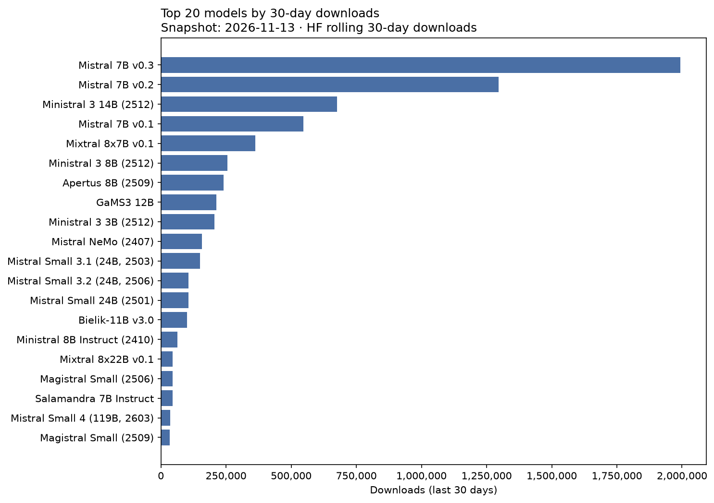
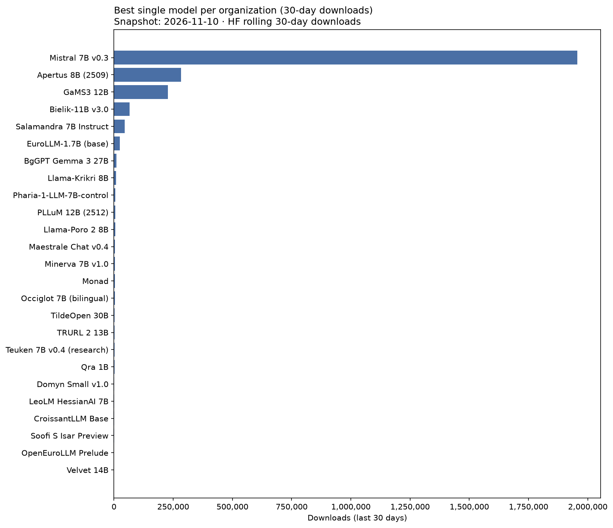
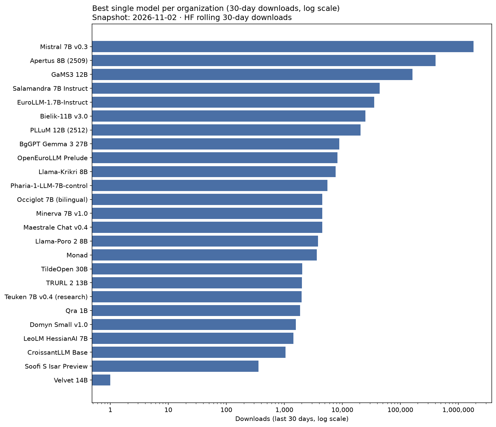
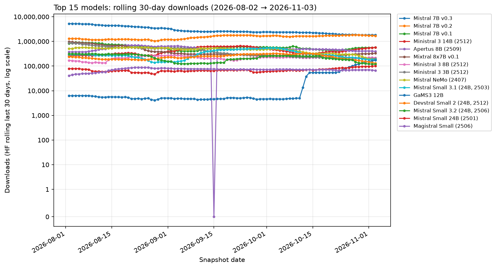
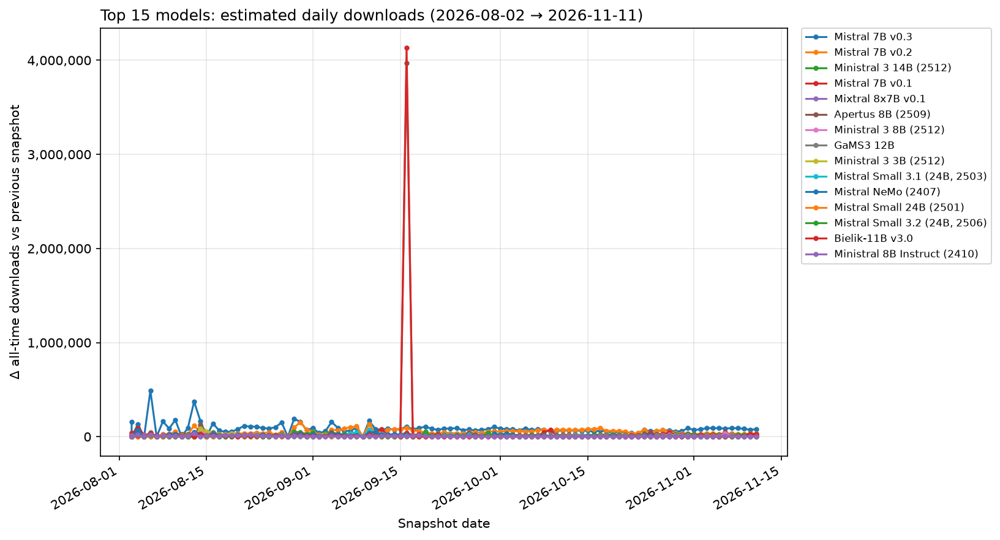
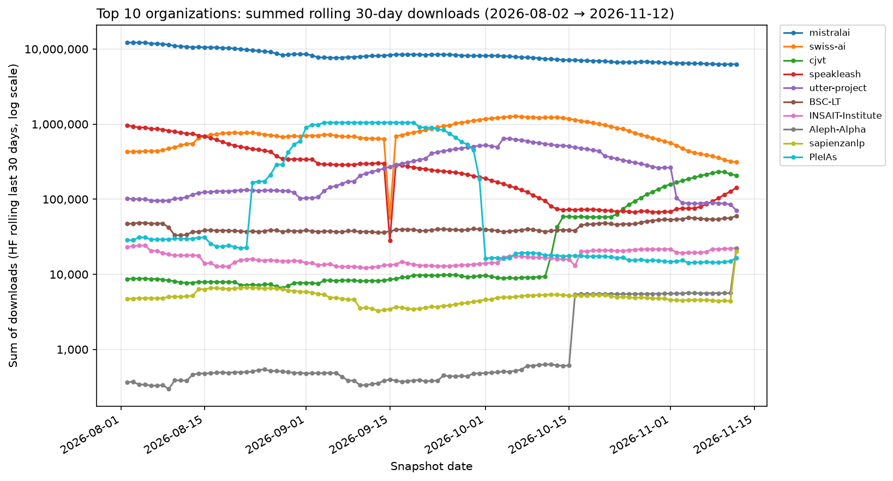
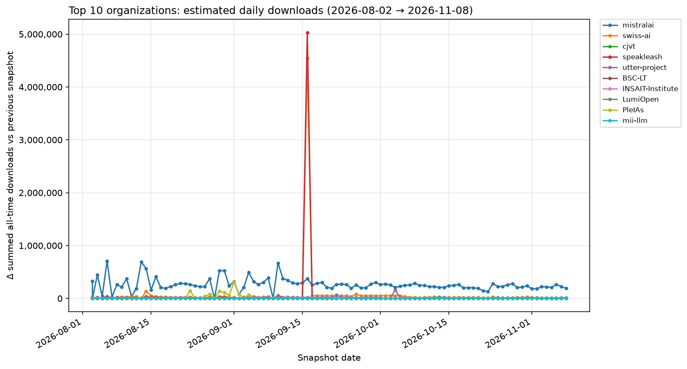

# European LLM Hugging Face download leaderboard

- **Snapshot date:** 2026-11-01
- **Generated at:** 2026-11-01T12:56:13Z
- **Ranking metric:** `total_downloads_30d` (last 30 days, summed across official format variants)
- **Rows:** 158

## Charts

### Trends over time

From daily snapshots in `data/metrics/timeseries.jsonl` (top 15 models / top 10 orgs by latest-day volume). Rolling-30d charts use a symlog y-axis (0 at zero, log compression above).

| Rank | Model | Country | Developer | Org | Downloads (30d) | Δ 30d | All-time | Momentum | Params | Repos |
| ---: | --- | :---: | --- | --- | ---: | ---: | ---: | ---: | ---: | ---: |
| 1 | Mistral 7B v0.3 | FR | Mistral AI | [mistralai](https://huggingface.co/mistralai) | 1,815,005 | -7,492 | 59,600,157 | 3.0% | 7.25B | 2 |
| 2 | Mistral 7B v0.2 | FR | Mistral AI | [mistralai](https://huggingface.co/mistralai) | 1,741,602 | -30,749 | 66,491,206 | 2.6% | 7.24B | 1 |
| 3 | Mistral 7B v0.1 | FR | Mistral AI | [mistralai](https://huggingface.co/mistralai) | 560,153 | -1,474 | 46,291,282 | 1.2% | 7.24B | 2 |
| 4 | Ministral 3 14B (2512) | FR | Mistral AI | [mistralai](https://huggingface.co/mistralai) | 540,981 | +15,375 | 4,259,737 | 12.4% | 13.95B | 6 |
| 5 | Apertus 8B (2509) | CH | swiss-ai | [swiss-ai](https://huggingface.co/swiss-ai) | 410,923 | +1,149 | 4,673,222 | 8.6% | 8.05B | 2 |
| 6 | Mixtral 8x7B v0.1 | FR | Mistral AI | [mistralai](https://huggingface.co/mistralai) | 318,478 | +1,232 | 32,686,217 | 1.0% | 46.70B | 2 |
| 7 | Ministral 3 8B (2512) | FR | Mistral AI | [mistralai](https://huggingface.co/mistralai) | 222,154 | +3,250 | 2,449,733 | 8.7% | 8.92B | 6 |
| 8 | Ministral 3 3B (2512) | FR | Mistral AI | [mistralai](https://huggingface.co/mistralai) | 202,181 | -3,721 | 5,820,703 | 3.4% | 3.85B | 7 |
| 9 | Mistral NeMo (2407) | FR | Mistral AI | [mistralai](https://huggingface.co/mistralai) | 195,320 | -21,659 | 16,632,945 | 1.2% | 12.25B | 3 |
| 10 | EuroLLM-1.7B-Instruct | EU | utter-project | [utter-project](https://huggingface.co/utter-project) | 194,013 | -182 | 941,618 | 18.6% | 1.66B | 1 |
| 11 | Mistral Small 3.1 (24B, 2503) | FR | Mistral AI | [mistralai](https://huggingface.co/mistralai) | 182,916 | -7,689 | 4,967,044 | 3.6% | 24.01B | 2 |
| 12 | GaMS3 12B | SI | CJVT UL (Center za jezikovne vire in tehnologije, University of Ljubljana) | [cjvt](https://huggingface.co/cjvt) | 154,523 | +9,999 | 221,591 | 48.0% | 12.77B | 5 |
| 13 | Devstral Small 2 (24B, 2512) | FR | Mistral AI | [mistralai](https://huggingface.co/mistralai) | 145,445 | -7,894 | 3,003,721 | 4.7% | 24.01B | 1 |
| 14 | Mistral Small 3.2 (24B, 2506) | FR | Mistral AI | [mistralai](https://huggingface.co/mistralai) | 122,835 | -3,957 | 5,596,126 | 2.2% | 24.01B | 1 |
| 15 | Apertus v1.5 8B | CH | swiss-ai | [swiss-ai](https://huggingface.co/swiss-ai) | 107,786 | -32,962 | 738,922 | 12.8% | 8.90B | 1 |
| 16 | Mistral Small 24B (2501) | FR | Mistral AI | [mistralai](https://huggingface.co/mistralai) | 96,880 | +20 | 7,683,412 | 1.2% | 23.57B | 2 |
| 17 | Magistral Small (2506) | FR | Mistral AI | [mistralai](https://huggingface.co/mistralai) | 70,105 | -37 | 803,531 | 7.8% | 23.57B | 2 |
| 18 | Mistral Small 4 (119B, 2603) | FR | Mistral AI | [mistralai](https://huggingface.co/mistralai) | 63,833 | -2,175 | 736,706 | 7.6% | 119.40B | 3 |
| 19 | Mixtral 8x22B v0.1 | FR | Mistral AI | [mistralai](https://huggingface.co/mistralai) | 58,136 | -1,367 | 11,275,770 | 0.5% | 140.63B | 2 |
| 20 | Ministral 8B Instruct (2410) | FR | Mistral AI | [mistralai](https://huggingface.co/mistralai) | 46,849 | -2,930 | 8,572,996 | 0.5% | 8.02B | 1 |
| 21 | Salamandra 7B Instruct | ES | BSC-LT | [BSC-LT](https://huggingface.co/BSC-LT) | 43,962 | +72 | 725,355 | 5.3% | 7.77B | 8 |
| 22 | Magistral Small (2509) | FR | Mistral AI | [mistralai](https://huggingface.co/mistralai) | 35,207 | +112 | 362,493 | 7.6% | 24.01B | 2 |
| 23 | Mistral Medium 3.5 (128B) | FR | Mistral AI | [mistralai](https://huggingface.co/mistralai) | 27,260 | -263 | 1,116,298 | 2.2% | 127.70B | 2 |
| 24 | EuroLLM-1.7B (base) | EU | utter-project | [utter-project](https://huggingface.co/utter-project) | 27,219 | -132 | 241,121 | 8.0% | — | 1 |
| 25 | PLLuM 12B (2512) | PL | CYFRAGOVPL / PLLuM consortium | [CYFRAGOVPL](https://huggingface.co/CYFRAGOVPL) | 23,037 | -1,518 | 44,289 | 16.0% | 12.25B | 3 |
| 26 | Bielik-11B v3.0 | PL | SpeakLeash / ACK Cyfronet AGH | [speakleash](https://huggingface.co/speakleash) | 20,086 | -283 | 4,167,953 | 0.5% | 11.34B | 8 |
| 27 | Apertus 70B (2509) | CH | swiss-ai | [swiss-ai](https://huggingface.co/swiss-ai) | 16,119 | -590 | 549,322 | 2.5% | 70.60B | 2 |
| 28 | Devstral Small (2507) | FR | Mistral AI | [mistralai](https://huggingface.co/mistralai) | 15,840 | +365 | 648,257 | 2.1% | 23.57B | 2 |
| 29 | Bielik-11B v2.3 | PL | SpeakLeash / ACK Cyfronet AGH | [speakleash](https://huggingface.co/speakleash) | 14,261 | +255 | 793,417 | 1.6% | 11.25B | 10 |
| 30 | Mistral Large Instruct (2407) | FR | Mistral AI | [mistralai](https://huggingface.co/mistralai) | 12,708 | +1 | 5,046,106 | 0.2% | 122.61B | 1 |
| 31 | EuroLLM-9B-Instruct (2512) | EU | utter-project | [utter-project](https://huggingface.co/utter-project) | 11,793 | -98 | 158,149 | 4.6% | 9.15B | 1 |
| 32 | Mistral Large Instruct (2411) | FR | Mistral AI | [mistralai](https://huggingface.co/mistralai) | 11,588 | +96 | 4,938,504 | 0.2% | 122.61B | 1 |
| 33 | BgGPT Gemma 3 27B | BG | INSAIT | [INSAIT-Institute](https://huggingface.co/INSAIT-Institute) | 11,452 | -58 | 20,436 | 9.5% | 27.43B | 3 |
| 34 | Bielik-7B v0.1 | PL | SpeakLeash | [speakleash](https://huggingface.co/speakleash) | 11,211 | +23 | 520,321 | 1.8% | 7.24B | 8 |
| 35 | EuroLLM-9B-Instruct | EU | utter-project | [utter-project](https://huggingface.co/utter-project) | 10,828 | +38 | 493,421 | 1.8% | 9.15B | 1 |
| 36 | Mistral Large 3 (675B, 2512) | FR | Mistral AI | [mistralai](https://huggingface.co/mistralai) | 9,676 | -365 | 84,473 | 5.2% | — | 5 |
| 37 | Mistral Small Instruct (2409) | FR | Mistral AI | [mistralai](https://huggingface.co/mistralai) | 8,800 | -29 | 5,387,525 | 0.2% | 22.25B | 1 |
| 38 | Apertus v1.5 70B | CH | swiss-ai | [swiss-ai](https://huggingface.co/swiss-ai) | 8,587 | -521 | 34,674 | 6.4% | 72.01B | 1 |
| 39 | EuroLLM-22B-Instruct (2512) | EU | utter-project | [utter-project](https://huggingface.co/utter-project) | 8,426 | -86 | 602,230 | 1.2% | 22.64B | 1 |
| 40 | OpenEuroLLM Prelude | EU | openeurollm | [openeurollm](https://huggingface.co/openeurollm) | 8,235 | +74 | 76,411 | 4.7% | — | 1 |
| 41 | Llama-Krikri 8B | GR | ILSP | [ilsp](https://huggingface.co/ilsp) | 7,655 | +10 | 117,110 | 3.5% | 8.42B | 7 |
| 42 | Devstral 2 (123B, 2512) | FR | Mistral AI | [mistralai](https://huggingface.co/mistralai) | 6,100 | -23 | 355,921 | 1.3% | 125.03B | 1 |
| 43 | Salamandra 2B | ES | BSC-LT | [BSC-LT](https://huggingface.co/BSC-LT) | 5,997 | -242 | 150,745 | 2.4% | 2.25B | 7 |
| 44 | Apertus v1.1 0.5B | CH | swiss-ai | [swiss-ai](https://huggingface.co/swiss-ai) | 5,779 | -325 | 20,769 | 4.8% | 572.6M | 5 |
| 45 | Pharia-1-LLM-7B-control | DE | Aleph Alpha | [Aleph-Alpha](https://huggingface.co/Aleph-Alpha) | 5,545 | +12 | 81,691 | 3.1% | 7.04B | 4 |
| 46 | Apertus v1.1 1.5B | CH | swiss-ai | [swiss-ai](https://huggingface.co/swiss-ai) | 5,487 | -33 | 13,827 | 4.8% | 1.51B | 6 |
| 47 | Apertus v1.1 4B | CH | swiss-ai | [swiss-ai](https://huggingface.co/swiss-ai) | 5,218 | +218 | 20,183 | 4.3% | 3.83B | 5 |
| 48 | Bielik-Minitron 7B v3.0 | PL | SpeakLeash / ACK Cyfronet AGH | [speakleash](https://huggingface.co/speakleash) | 5,167 | -105 | 139,615 | 2.2% | 7.48B | 5 |
| 49 | Bielik-4.5B v3.0 | PL | SpeakLeash | [speakleash](https://huggingface.co/speakleash) | 4,824 | +146 | 257,913 | 1.3% | 4.76B | 5 |
| 50 | Codestral 22B v0.1 | FR | Mistral AI | [mistralai](https://huggingface.co/mistralai) | 4,634 | +36 | 5,164,108 | 0.1% | 22.25B | 1 |
| 51 | Occiglot 7B (bilingual) | EU | occiglot | [occiglot](https://huggingface.co/occiglot) | 4,584 | +42 | 376,926 | 1.0% | 7.24B | 8 |
| 52 | Minerva 7B v1.0 | IT | SapienzaNLP | [sapienzanlp](https://huggingface.co/sapienzanlp) | 4,542 | -212 | 138,940 | 1.9% | 7.40B | 3 |
| 53 | Maestrale Chat v0.4 | IT | mii-llm | [mii-llm](https://huggingface.co/mii-llm) | 4,529 | +40 | 153,224 | 1.8% | 7.24B | 4 |
| 54 | Devstral Small (2505) | FR | Mistral AI | [mistralai](https://huggingface.co/mistralai) | 4,486 | -7 | 909,463 | 0.4% | 23.57B | 2 |
| 55 | Bielik-11B v2.2 | PL | SpeakLeash / ACK Cyfronet AGH | [speakleash](https://huggingface.co/speakleash) | 4,207 | -59 | 169,057 | 1.6% | 11.17B | 16 |
| 56 | Bielik-1.5B v3.0 | PL | SpeakLeash | [speakleash](https://huggingface.co/speakleash) | 4,100 | +67 | 62,080 | 2.5% | 1.60B | 5 |
| 57 | EuroMoE 2.6B-A0.6B (2512) | EU | utter-project | [utter-project](https://huggingface.co/utter-project) | 4,008 | +15 | 39,661 | 2.9% | 2.61B | 3 |
| 58 | Llama-Poro 2 8B | FI | LumiOpen | [LumiOpen](https://huggingface.co/LumiOpen) | 3,709 | +295 | 53,064 | 2.4% | 8.03B | 7 |
| 59 | Monad | FR | PleIAs | [PleIAs](https://huggingface.co/PleIAs) | 3,651 | -67 | 36,539 | 2.7% | 56.7M | 1 |
| 60 | Minerva Chat v0.1 | IT | mii-llm | [mii-llm](https://huggingface.co/mii-llm) | 3,144 | 0 | 95,126 | 1.6% | 2.89B | 1 |
| 61 | EuroLLM-22B (2512 base) | EU | utter-project | [utter-project](https://huggingface.co/utter-project) | 3,059 | +262 | 26,605 | 2.4% | 22.64B | 1 |
| 62 | Baguettotron | FR | PleIAs | [PleIAs](https://huggingface.co/PleIAs) | 2,914 | +60 | 42,914 | 2.0% | 13.29B | 3 |
| 63 | Viking 13B | FI | LumiOpen | [LumiOpen](https://huggingface.co/LumiOpen) | 2,714 | +4 | 34,405 | 2.0% | 14.03B | 1 |
| 64 | Mathstral 7B v0.1 | FR | Mistral AI | [mistralai](https://huggingface.co/mistralai) | 2,619 | +11 | 5,303,309 | 0.0% | 7.25B | 1 |
| 65 | Magistral Small (2507) | FR | Mistral AI | [mistralai](https://huggingface.co/mistralai) | 2,585 | -8 | 156,881 | 1.0% | 23.57B | 2 |
| 66 | PLLuM 12B (2412) | PL | CYFRAGOVPL / PLLuM consortium | [CYFRAGOVPL](https://huggingface.co/CYFRAGOVPL) | 2,514 | +13 | 179,273 | 0.9% | 12.25B | 6 |
| 67 | Salamandra 7B (base) | ES | BSC-LT | [BSC-LT](https://huggingface.co/BSC-LT) | 2,273 | -12 | 51,906 | 1.5% | 7.77B | 1 |
| 68 | Poro 34B | FI | LumiOpen | [LumiOpen](https://huggingface.co/LumiOpen) | 2,258 | +88 | 230,212 | 0.7% | 35.13B | 4 |
| 69 | MamayLM Gemma 3 4B v1.0 | UA | INSAIT | [INSAIT-Institute](https://huggingface.co/INSAIT-Institute) | 2,180 | +3 | 22,245 | 1.8% | 4.30B | 2 |
| 70 | GaMS 9B | SI | CJVT UL (Center za jezikovne vire in tehnologije, University of Ljubljana) | [cjvt](https://huggingface.co/cjvt) | 2,059 | +44 | 51,287 | 1.4% | 9.24B | 4 |
| 71 | TildeOpen 30B | LV | Tilde | [TildeAI](https://huggingface.co/TildeAI) | 2,019 | +19 | 101,740 | 1.0% | 30.68B | 1 |
| 72 | TRURL 2 13B | PL | Voicelab | [Voicelab](https://huggingface.co/Voicelab) | 2,006 | +20 | 357,891 | 0.4% | — | 3 |
| 73 | Teuken 7B v0.4 (research) | DE | openGPT-X | [openGPT-X](https://huggingface.co/openGPT-X) | 1,978 | +25 | 80,217 | 1.1% | 7.45B | 1 |
| 74 | Teuken 7B v0.4 (commercial) | DE | openGPT-X | [openGPT-X](https://huggingface.co/openGPT-X) | 1,912 | +20 | 107,806 | 0.9% | 7.45B | 1 |
| 75 | Qra 1B | PL | OPI-PG | [OPI-PG](https://huggingface.co/OPI-PG) | 1,850 | +21 | 159,506 | 0.7% | 1.10B | 1 |
| 76 | PLLuM 4B (2512) | PL | CYFRAGOVPL / PLLuM consortium | [CYFRAGOVPL](https://huggingface.co/CYFRAGOVPL) | 1,808 | +4 | 9,277 | 1.7% | 4.30B | 3 |
| 77 | EuroLLM-22B-Instruct (Preview) | EU | utter-project | [utter-project](https://huggingface.co/utter-project) | 1,800 | +12 | 34,505 | 1.3% | 22.64B | 1 |
| 78 | Pleias 1.2B Preview | FR | PleIAs | [PleIAs](https://huggingface.co/PleIAs) | 1,788 | -33 | 415,620 | 0.3% | 1.20B | 1 |
| 79 | TRURL 2 7B | PL | Voicelab | [Voicelab](https://huggingface.co/Voicelab) | 1,785 | +22 | 302,946 | 0.4% | 6.74B | 2 |
| 80 | Qra 7B | PL | OPI-PG | [OPI-PG](https://huggingface.co/OPI-PG) | 1,782 | +20 | 186,292 | 0.6% | 6.74B | 1 |
| 81 | Qra 13B | PL | OPI-PG | [OPI-PG](https://huggingface.co/OPI-PG) | 1,723 | +23 | 147,029 | 0.7% | 13.02B | 1 |
| 82 | Llama-Poro 2 70B | FI | LumiOpen | [LumiOpen](https://huggingface.co/LumiOpen) | 1,701 | +43 | 40,554 | 1.2% | 70.55B | 3 |
| 83 | MamayLM Gemma 3 12B v2.0 | UA | INSAIT | [INSAIT-Institute](https://huggingface.co/INSAIT-Institute) | 1,635 | -18 | 19,620 | 1.4% | 12.19B | 2 |
| 84 | Maestrale Chat v0.3 | IT | mii-llm | [mii-llm](https://huggingface.co/mii-llm) | 1,604 | +34 | 54,327 | 1.0% | 7.24B | 5 |
| 85 | Pleias 350M Preview | FR | PleIAs | [PleIAs](https://huggingface.co/PleIAs) | 1,598 | -33 | 418,948 | 0.3% | 353.4M | 1 |
| 86 | Pleias 3B Preview | FR | PleIAs | [PleIAs](https://huggingface.co/PleIAs) | 1,563 | -32 | 400,458 | 0.3% | 3.21B | 1 |
| 87 | Domyn Small v1.0 | IT | Domyn | [domyn](https://huggingface.co/domyn) | 1,523 | +63 | 9,269 | 1.4% | 9.82B | 1 |
| 88 | Maestrale Chat v0.2 | IT | mii-llm | [mii-llm](https://huggingface.co/mii-llm) | 1,517 | +15 | 53,093 | 1.0% | 7.24B | 1 |
| 89 | LeoLM HessianAI 7B | DE | LeoLM | [LeoLM](https://huggingface.co/LeoLM) | 1,395 | +22 | 801,862 | 0.2% | — | 3 |
| 90 | Bielik-11B v2.6 | PL | SpeakLeash / ACK Cyfronet AGH | [speakleash](https://huggingface.co/speakleash) | 1,390 | +5 | 174,777 | 0.5% | 11.51B | 7 |
| 91 | Viking 33B | FI | LumiOpen | [LumiOpen](https://huggingface.co/LumiOpen) | 1,361 | +7 | 31,529 | 1.0% | 33.12B | 1 |
| 92 | Teuken 7B v0.6 | DE | openGPT-X | [openGPT-X](https://huggingface.co/openGPT-X) | 1,326 | -23 | 671,039 | 0.2% | 7.45B | 2 |
| 93 | Bielik-11B v2.0 | PL | SpeakLeash / ACK Cyfronet AGH | [speakleash](https://huggingface.co/speakleash) | 1,282 | +34 | 23,795 | 1.0% | 11.17B | 5 |
| 94 | EuroLLM-9B (2512) | EU | utter-project | [utter-project](https://huggingface.co/utter-project) | 1,233 | +89 | 10,670 | 1.1% | 9.15B | 1 |
| 95 | Pleias RAG 1B | FR | PleIAs | [PleIAs](https://huggingface.co/PleIAs) | 1,225 | +12 | 19,979 | 1.0% | 1.20B | 2 |
| 96 | MamayLM Gemma 3 27B v2.0 | UA | INSAIT | [INSAIT-Institute](https://huggingface.co/INSAIT-Institute) | 1,097 | +6 | 9,149 | 1.0% | 28.84B | 3 |
| 97 | Pleias RAG 350M | FR | PleIAs | [PleIAs](https://huggingface.co/PleIAs) | 1,064 | +45 | 15,342 | 0.9% | 353.4M | 2 |
| 98 | Bielik-11B v2.1 | PL | SpeakLeash / ACK Cyfronet AGH | [speakleash](https://huggingface.co/speakleash) | 1,041 | -12 | 31,638 | 0.8% | 11.17B | 5 |
| 99 | Viking 7B | FI | LumiOpen | [LumiOpen](https://huggingface.co/LumiOpen) | 1,028 | +7 | 56,346 | 0.7% | 7.55B | 1 |
| 100 | CroissantLLM Base | FR | croissantllm | [croissantllm](https://huggingface.co/croissantllm) | 1,025 | -50 | 58,404 | 0.6% | 1.35B | 3 |
| 101 | ALIA 40B (base) | ES | BSC-LT | [BSC-LT](https://huggingface.co/BSC-LT) | 954 | +11 | 453,385 | 0.2% | 40.43B | 1 |
| 102 | BgGPT Gemma 3 12B | BG | INSAIT | [INSAIT-Institute](https://huggingface.co/INSAIT-Institute) | 904 | +2 | 218,766 | 0.3% | 12.19B | 3 |
| 103 | MamayLM Gemma 3 12B v1.0 | UA | INSAIT | [INSAIT-Institute](https://huggingface.co/INSAIT-Institute) | 851 | +13 | 44,882 | 0.6% | 12.19B | 2 |
| 104 | LeoLM Mistral HessianAI 7B | DE | LeoLM | [LeoLM](https://huggingface.co/LeoLM) | 803 | +54 | 233,451 | 0.2% | — | 2 |
| 105 | BgGPT 7B v0.2 | BG | INSAIT | [INSAIT-Institute](https://huggingface.co/INSAIT-Institute) | 766 | -15 | 112,133 | 0.4% | 7.29B | 2 |
| 106 | BgGPT Gemma 3 4B | BG | INSAIT | [INSAIT-Institute](https://huggingface.co/INSAIT-Institute) | 713 | -1 | 14,555 | 0.6% | 4.33B | 3 |
| 107 | OCRonos | FR | PleIAs | [PleIAs](https://huggingface.co/PleIAs) | 699 | -2 | 82,051 | 0.4% | 8.03B | 3 |
| 108 | CroissantLLM Chat v0.1 | FR | croissantllm | [croissantllm](https://huggingface.co/croissantllm) | 659 | +13 | 96,338 | 0.3% | 1.35B | 8 |
| 109 | GaMS 1B | SI | CJVT UL (Center za jezikovne vire in tehnologije, University of Ljubljana) | [cjvt](https://huggingface.co/cjvt) | 656 | +10 | 16,817 | 0.6% | 1.54B | 4 |
| 110 | GaMS 2B | SI | CJVT UL (Center za jezikovne vire in tehnologije, University of Ljubljana) | [cjvt](https://huggingface.co/cjvt) | 624 | +5 | 20,698 | 0.5% | 3.20B | 2 |
| 111 | MamayLM Gemma 2 9B v0.1 | UA | INSAIT | [INSAIT-Institute](https://huggingface.co/INSAIT-Institute) | 585 | +8 | 22,049 | 0.5% | 9.24B | 2 |
| 112 | BgGPT Gemma 2 9B | BG | INSAIT | [INSAIT-Institute](https://huggingface.co/INSAIT-Institute) | 557 | +31 | 27,817 | 0.4% | 9.24B | 2 |
| 113 | TildeOpen 30B (64k) | LV | Tilde | [TildeAI](https://huggingface.co/TildeAI) | 506 | -16 | 3,530 | 0.5% | 30.68B | 1 |
| 114 | GaMS2 27B | SI | CJVT UL (Center za jezikovne vire in tehnologije, University of Ljubljana) | [cjvt](https://huggingface.co/cjvt) | 494 | -4 | 1,732 | 0.5% | 27.23B | 3 |
| 115 | Llama-PLLuM 8B (2512) | PL | CYFRAGOVPL / PLLuM consortium | [CYFRAGOVPL](https://huggingface.co/CYFRAGOVPL) | 484 | -2 | 4,289 | 0.5% | 8.03B | 3 |
| 116 | Leanstral 1.5 (119B-A6B) | FR | Mistral AI | [mistralai](https://huggingface.co/mistralai) | 442 | -3 | 1,589 | 0.4% | — | 1 |
| 117 | BgGPT Gemma 2 27B | BG | INSAIT | [INSAIT-Institute](https://huggingface.co/INSAIT-Institute) | 398 | +23 | 12,151 | 0.4% | 27.23B | 2 |
| 118 | Soofi S Isar Preview | DE | Soofi Project | [Soofi-Project](https://huggingface.co/Soofi-Project) | 361 | +52 | 12,374 | 0.3% | 31.59B | 6 |
| 119 | ALIA 40B Instruct (2601) | ES | BSC-LT | [BSC-LT](https://huggingface.co/BSC-LT) | 354 | -2 | 32,863 | 0.3% | 40.43B | 2 |
| 120 | Nesso 4B | IT | mii-llm | [mii-llm](https://huggingface.co/mii-llm) | 354 | -10 | 2,819 | 0.3% | 4.02B | 2 |
| 121 | BgGPT Gemma 2 2.6B | BG | INSAIT | [INSAIT-Institute](https://huggingface.co/INSAIT-Institute) | 343 | +5 | 22,100 | 0.3% | 2.61B | 2 |
| 122 | Bielik-11B v2.5 | PL | SpeakLeash / ACK Cyfronet AGH | [speakleash](https://huggingface.co/speakleash) | 320 | -11 | 5,530 | 0.3% | 11.51B | 5 |
| 123 | Meltemi 7B v1.5 | GR | ILSP | [ilsp](https://huggingface.co/ilsp) | 308 | +4 | 39,398 | 0.2% | 7.48B | 2 |
| 124 | LeoLM HessianAI 13B | DE | LeoLM | [LeoLM](https://huggingface.co/LeoLM) | 301 | -7 | 107,227 | 0.1% | — | 3 |
| 125 | EuroLLM-9B (base) | EU | utter-project | [utter-project](https://huggingface.co/utter-project) | 289 | -4 | 84,583 | 0.2% | 9.15B | 1 |
| 126 | Occiglot 7B EU5 | EU | occiglot | [occiglot](https://huggingface.co/occiglot) | 278 | -9 | 322,232 | 0.1% | 7.24B | 2 |
| 127 | GaMS 27B | SI | CJVT UL (Center za jezikovne vire in tehnologije, University of Ljubljana) | [cjvt](https://huggingface.co/cjvt) | 276 | -5 | 37,807 | 0.2% | 27.23B | 3 |
| 128 | Zagreus 0.4B (ITA) | IT | mii-llm | [mii-llm](https://huggingface.co/mii-llm) | 274 | +3 | 5,156 | 0.3% | 437.8M | 1 |
| 129 | Bielik-11B v2 (base) | PL | SpeakLeash / ACK Cyfronet AGH | [speakleash](https://huggingface.co/speakleash) | 238 | +2 | 41,895 | 0.2% | 11.17B | 1 |
| 130 | LeoLM HessianAI 70B | DE | LeoLM | [LeoLM](https://huggingface.co/LeoLM) | 230 | 0 | 19,687 | 0.2% | 68.98B | 2 |
| 131 | Meltemi 7B v1 | GR | ILSP | [ilsp](https://huggingface.co/ilsp) | 219 | -4 | 44,648 | 0.2% | 7.70B | 5 |
| 132 | Llama-PLLuM 8B (2412) | PL | CYFRAGOVPL / PLLuM consortium | [CYFRAGOVPL](https://huggingface.co/CYFRAGOVPL) | 216 | -1 | 70,500 | 0.1% | 8.03B | 3 |
| 133 | Llama-PLLuM 70B (2508) | PL | CYFRAGOVPL / PLLuM consortium | [CYFRAGOVPL](https://huggingface.co/CYFRAGOVPL) | 212 | 0 | 5,052 | 0.2% | 70.55B | 3 |
| 134 | Llama-PLLuM 70B (2512) | PL | CYFRAGOVPL / PLLuM consortium | [CYFRAGOVPL](https://huggingface.co/CYFRAGOVPL) | 211 | -4 | 12,704 | 0.2% | 70.55B | 2 |
| 135 | BgGPT 7B v0.1 | BG | INSAIT | [INSAIT-Institute](https://huggingface.co/INSAIT-Institute) | 206 | +3 | 16,622 | 0.2% | 7.29B | 2 |
| 136 | EuroLLM-22B (Preview base) | EU | utter-project | [utter-project](https://huggingface.co/utter-project) | 189 | -1 | 2,551 | 0.2% | — | 1 |
| 137 | Soofi S Instruct Preview | DE | Soofi Project | [Soofi-Project](https://huggingface.co/Soofi-Project) | 166 | +15 | 7,476 | 0.2% | 31.59B | 6 |
| 138 | Pleias Pico | FR | PleIAs | [PleIAs](https://huggingface.co/PleIAs) | 159 | -16 | 5,499 | 0.2% | 353.4M | 2 |
| 139 | PLLuM 8x7B (2412) | PL | CYFRAGOVPL / PLLuM consortium | [CYFRAGOVPL](https://huggingface.co/CYFRAGOVPL) | 158 | 0 | 28,407 | 0.1% | 46.70B | 6 |
| 140 | Nesso 0.4B Agentic | IT | mii-llm | [mii-llm](https://huggingface.co/mii-llm) | 156 | +1 | 3,143 | 0.2% | 560.9M | 2 |
| 141 | Leanstral (2603) | FR | Mistral AI | [mistralai](https://huggingface.co/mistralai) | 140 | +2 | 1,152 | 0.1% | — | 1 |
| 142 | PLLuM 12B nc (2507) | PL | CYFRAGOVPL / PLLuM consortium | [CYFRAGOVPL](https://huggingface.co/CYFRAGOVPL) | 136 | 0 | 6,171 | 0.1% | 12.25B | 3 |
| 143 | Llama-PLLuM 70B (2412) | PL | CYFRAGOVPL / PLLuM consortium | [CYFRAGOVPL](https://huggingface.co/CYFRAGOVPL) | 93 | -2 | 38,716 | 0.1% | 70.55B | 3 |
| 144 | Pleias Nano | FR | PleIAs | [PleIAs](https://huggingface.co/PleIAs) | 93 | -8 | 7,252 | 0.1% | 1.20B | 2 |
| 145 | Nesso 0.4B Instruct | IT | mii-llm | [mii-llm](https://huggingface.co/mii-llm) | 76 | +2 | 1,315 | 0.1% | 560.9M | 1 |
| 146 | Open Zagreus 0.4B | IT | mii-llm | [mii-llm](https://huggingface.co/mii-llm) | 46 | +1 | 402 | 0.0% | 437.8M | 1 |
| 147 | Soofi S Rhine Preview | DE | Soofi Project | [Soofi-Project](https://huggingface.co/Soofi-Project) | 45 | +2 | 2,856 | 0.0% | 31.59B | 6 |
| 148 | Pleias SLM RAG | FR | PleIAs | [PleIAs](https://huggingface.co/PleIAs) | 40 | +1 | 434 | 0.0% | 321.0M | 1 |
| 149 | TildeOpen 15B WMT26 (cs-de) | LV | Tilde | [TildeAI](https://huggingface.co/TildeAI) | 35 | +2 | 258 | 0.0% | 15.17B | 3 |
| 150 | Zagreus 0.4B (SPA) | IT | mii-llm | [mii-llm](https://huggingface.co/mii-llm) | 32 | +1 | 222 | 0.0% | 437.8M | 1 |
| 151 | Maestrale Chat v0.1 | IT | mii-llm | [mii-llm](https://huggingface.co/mii-llm) | 31 | +10 | 145 | 0.0% | 7.24B | 1 |
| 152 | TildeOpen 8B WMT26 (cs-de) | LV | Tilde | [TildeAI](https://huggingface.co/TildeAI) | 31 | +2 | 197 | 0.0% | 8.16B | 3 |
| 153 | Zagreus 0.4B (POR) | IT | mii-llm | [mii-llm](https://huggingface.co/mii-llm) | 17 | 0 | 275 | 0.0% | 437.8M | 1 |
| 154 | Zagreus 0.4B (FRA) | IT | mii-llm | [mii-llm](https://huggingface.co/mii-llm) | 14 | +1 | 159 | 0.0% | 437.8M | 1 |
| 155 | Soofi S Base | DE | Soofi Project | [Soofi-Project](https://huggingface.co/Soofi-Project) | 10 | +2 | 1,507 | 0.0% | 31.58B | 2 |
| 156 | Emma 5 Boost | IT | mii-llm | [mii-llm](https://huggingface.co/mii-llm) | 0 | 0 | 8 | 0.0% | 1.39B | 1 |
| 157 | Velvet 14B | IT | Almawave | [Almawave](https://huggingface.co/Almawave) | 0 | 0 | 0 | 0.0% | — | 0 |
| 158 | Velvet 2B | IT | Almawave | [Almawave](https://huggingface.co/Almawave) | 0 | 0 | 0 | 0.0% | — | 0 |

## Organizations

Same downloads, aggregated across every model version an organization publishes.

| Rank | Organization | Developer | Country | Downloads (30d) | All-time | Models | Momentum |
| ---: | --- | --- | :---: | ---: | ---: | ---: | ---: |
| 1 | [mistralai](https://huggingface.co/mistralai) | Mistral AI | FR | 6,524,958 | 306,347,365 | 30 | 2.1% |
| 2 | [swiss-ai](https://huggingface.co/swiss-ai) | swiss-ai | CH | 559,899 | 6,050,919 | 7 | 9.1% |
| 3 | [utter-project](https://huggingface.co/utter-project) | utter-project | EU | 262,857 | 2,635,114 | 11 | 9.6% |
| 4 | [cjvt](https://huggingface.co/cjvt) | CJVT UL (Center za jezikovne vire in tehnologije, University of Ljubljana) | SI | 158,632 | 349,932 | 6 | 35.3% |
| 5 | [speakleash](https://huggingface.co/speakleash) | SpeakLeash / ACK Cyfronet AGH | PL | 68,127 | 6,387,991 | 12 | 1.1% |
| 6 | [BSC-LT](https://huggingface.co/BSC-LT) | BSC-LT | ES | 53,540 | 1,414,254 | 5 | 3.5% |
| 7 | [CYFRAGOVPL](https://huggingface.co/CYFRAGOVPL) | CYFRAGOVPL / PLLuM consortium | PL | 28,869 | 398,678 | 10 | 5.8% |
| 8 | [INSAIT-Institute](https://huggingface.co/INSAIT-Institute) | INSAIT | BG | 21,687 | 562,525 | 13 | 3.3% |
| 9 | [PleIAs](https://huggingface.co/PleIAs) | PleIAs | FR | 14,794 | 1,445,036 | 11 | 1.0% |
| 10 | [LumiOpen](https://huggingface.co/LumiOpen) | LumiOpen | FI | 12,771 | 446,110 | 6 | 2.3% |
| 11 | [mii-llm](https://huggingface.co/mii-llm) | mii-llm | IT | 11,794 | 369,414 | 14 | 2.5% |
| 12 | [openeurollm](https://huggingface.co/openeurollm) | openeurollm | EU | 8,235 | 76,411 | 1 | 4.7% |
| 13 | [ilsp](https://huggingface.co/ilsp) | ILSP | GR | 8,182 | 201,156 | 3 | 2.7% |
| 14 | [Aleph-Alpha](https://huggingface.co/Aleph-Alpha) | Aleph Alpha | DE | 5,545 | 81,691 | 1 | 3.1% |
| 15 | [OPI-PG](https://huggingface.co/OPI-PG) | OPI-PG | PL | 5,355 | 492,827 | 3 | 0.9% |
| 16 | [openGPT-X](https://huggingface.co/openGPT-X) | openGPT-X | DE | 5,216 | 859,062 | 3 | 0.5% |
| 17 | [occiglot](https://huggingface.co/occiglot) | occiglot | EU | 4,862 | 699,158 | 2 | 0.6% |
| 18 | [sapienzanlp](https://huggingface.co/sapienzanlp) | SapienzaNLP | IT | 4,542 | 138,940 | 1 | 1.9% |
| 19 | [Voicelab](https://huggingface.co/Voicelab) | Voicelab | PL | 3,791 | 660,837 | 2 | 0.5% |
| 20 | [LeoLM](https://huggingface.co/LeoLM) | LeoLM | DE | 2,729 | 1,162,227 | 4 | 0.2% |
| 21 | [TildeAI](https://huggingface.co/TildeAI) | Tilde | LV | 2,591 | 105,725 | 4 | 1.3% |
| 22 | [croissantllm](https://huggingface.co/croissantllm) | croissantllm | FR | 1,684 | 154,742 | 2 | 0.7% |
| 23 | [domyn](https://huggingface.co/domyn) | Domyn | IT | 1,523 | 9,269 | 1 | 1.4% |
| 24 | [Soofi-Project](https://huggingface.co/Soofi-Project) | Soofi Project | DE | 582 | 24,213 | 4 | 0.5% |
| 25 | [Almawave](https://huggingface.co/Almawave) | Almawave | IT | 0 | 0 | 2 | 0.0% |

### By best single model

Ranked by each organization's single highest-downloading model (no summing across versions) — who has the biggest individual hit.

| Rank | Organization | Best model | Downloads (30d) | All-time | Overall model rank |
| ---: | --- | --- | ---: | ---: | ---: |
| 1 | [mistralai](https://huggingface.co/mistralai) | Mistral 7B v0.3 | 1,815,005 | 59,600,157 | 1 |
| 2 | [swiss-ai](https://huggingface.co/swiss-ai) | Apertus 8B (2509) | 410,923 | 4,673,222 | 5 |
| 3 | [utter-project](https://huggingface.co/utter-project) | EuroLLM-1.7B-Instruct | 194,013 | 941,618 | 10 |
| 4 | [cjvt](https://huggingface.co/cjvt) | GaMS3 12B | 154,523 | 221,591 | 12 |
| 5 | [BSC-LT](https://huggingface.co/BSC-LT) | Salamandra 7B Instruct | 43,962 | 725,355 | 21 |
| 6 | [CYFRAGOVPL](https://huggingface.co/CYFRAGOVPL) | PLLuM 12B (2512) | 23,037 | 44,289 | 25 |
| 7 | [speakleash](https://huggingface.co/speakleash) | Bielik-11B v3.0 | 20,086 | 4,167,953 | 26 |
| 8 | [INSAIT-Institute](https://huggingface.co/INSAIT-Institute) | BgGPT Gemma 3 27B | 11,452 | 20,436 | 33 |
| 9 | [openeurollm](https://huggingface.co/openeurollm) | OpenEuroLLM Prelude | 8,235 | 76,411 | 40 |
| 10 | [ilsp](https://huggingface.co/ilsp) | Llama-Krikri 8B | 7,655 | 117,110 | 41 |
| 11 | [Aleph-Alpha](https://huggingface.co/Aleph-Alpha) | Pharia-1-LLM-7B-control | 5,545 | 81,691 | 45 |
| 12 | [occiglot](https://huggingface.co/occiglot) | Occiglot 7B (bilingual) | 4,584 | 376,926 | 51 |
| 13 | [sapienzanlp](https://huggingface.co/sapienzanlp) | Minerva 7B v1.0 | 4,542 | 138,940 | 52 |
| 14 | [mii-llm](https://huggingface.co/mii-llm) | Maestrale Chat v0.4 | 4,529 | 153,224 | 53 |
| 15 | [LumiOpen](https://huggingface.co/LumiOpen) | Llama-Poro 2 8B | 3,709 | 53,064 | 58 |
| 16 | [PleIAs](https://huggingface.co/PleIAs) | Monad | 3,651 | 36,539 | 59 |
| 17 | [TildeAI](https://huggingface.co/TildeAI) | TildeOpen 30B | 2,019 | 101,740 | 71 |
| 18 | [Voicelab](https://huggingface.co/Voicelab) | TRURL 2 13B | 2,006 | 357,891 | 72 |
| 19 | [openGPT-X](https://huggingface.co/openGPT-X) | Teuken 7B v0.4 (research) | 1,978 | 80,217 | 73 |
| 20 | [OPI-PG](https://huggingface.co/OPI-PG) | Qra 1B | 1,850 | 159,506 | 75 |
| 21 | [domyn](https://huggingface.co/domyn) | Domyn Small v1.0 | 1,523 | 9,269 | 87 |
| 22 | [LeoLM](https://huggingface.co/LeoLM) | LeoLM HessianAI 7B | 1,395 | 801,862 | 89 |
| 23 | [croissantllm](https://huggingface.co/croissantllm) | CroissantLLM Base | 1,025 | 58,404 | 100 |
| 24 | [Soofi-Project](https://huggingface.co/Soofi-Project) | Soofi S Isar Preview | 361 | 12,374 | 118 |
| 25 | [Almawave](https://huggingface.co/Almawave) | Velvet 14B | 0 | 0 | 157 |

### By momentum

Sorted by momentum (highest first). Momentum highlights orgs whose recent downloads are large *relative to their lifetime total* — i.e. accelerating adoption, not legacy long-tail traffic from an old release.

| Momentum rank | Organization | Momentum | Downloads (30d) | All-time | Downloads rank |
| ---: | --- | ---: | ---: | ---: | ---: |
| 1 | [cjvt](https://huggingface.co/cjvt) | 35.3% | 158,632 | 349,932 | 4 |
| 2 | [utter-project](https://huggingface.co/utter-project) | 9.6% | 262,857 | 2,635,114 | 3 |
| 3 | [swiss-ai](https://huggingface.co/swiss-ai) | 9.1% | 559,899 | 6,050,919 | 2 |
| 4 | [CYFRAGOVPL](https://huggingface.co/CYFRAGOVPL) | 5.8% | 28,869 | 398,678 | 7 |
| 5 | [openeurollm](https://huggingface.co/openeurollm) | 4.7% | 8,235 | 76,411 | 12 |
| 6 | [BSC-LT](https://huggingface.co/BSC-LT) | 3.5% | 53,540 | 1,414,254 | 6 |
| 7 | [INSAIT-Institute](https://huggingface.co/INSAIT-Institute) | 3.3% | 21,687 | 562,525 | 8 |
| 8 | [Aleph-Alpha](https://huggingface.co/Aleph-Alpha) | 3.1% | 5,545 | 81,691 | 14 |
| 9 | [ilsp](https://huggingface.co/ilsp) | 2.7% | 8,182 | 201,156 | 13 |
| 10 | [mii-llm](https://huggingface.co/mii-llm) | 2.5% | 11,794 | 369,414 | 11 |
| 11 | [LumiOpen](https://huggingface.co/LumiOpen) | 2.3% | 12,771 | 446,110 | 10 |
| 12 | [mistralai](https://huggingface.co/mistralai) | 2.1% | 6,524,958 | 306,347,365 | 1 |
| 13 | [sapienzanlp](https://huggingface.co/sapienzanlp) | 1.9% | 4,542 | 138,940 | 18 |
| 14 | [domyn](https://huggingface.co/domyn) | 1.4% | 1,523 | 9,269 | 23 |
| 15 | [TildeAI](https://huggingface.co/TildeAI) | 1.3% | 2,591 | 105,725 | 21 |
| 16 | [speakleash](https://huggingface.co/speakleash) | 1.1% | 68,127 | 6,387,991 | 5 |
| 17 | [PleIAs](https://huggingface.co/PleIAs) | 1.0% | 14,794 | 1,445,036 | 9 |
| 18 | [OPI-PG](https://huggingface.co/OPI-PG) | 0.9% | 5,355 | 492,827 | 15 |
| 19 | [croissantllm](https://huggingface.co/croissantllm) | 0.7% | 1,684 | 154,742 | 22 |
| 20 | [occiglot](https://huggingface.co/occiglot) | 0.6% | 4,862 | 699,158 | 17 |
| 21 | [openGPT-X](https://huggingface.co/openGPT-X) | 0.5% | 5,216 | 859,062 | 16 |
| 22 | [Voicelab](https://huggingface.co/Voicelab) | 0.5% | 3,791 | 660,837 | 19 |
| 23 | [Soofi-Project](https://huggingface.co/Soofi-Project) | 0.5% | 582 | 24,213 | 24 |
| 24 | [LeoLM](https://huggingface.co/LeoLM) | 0.2% | 2,729 | 1,162,227 | 20 |
| 25 | [Almawave](https://huggingface.co/Almawave) | 0.0% | 0 | 0 | 25 |

## Notes

- Downloads are Hugging Face Hub **rolling last-30-day** counts, aggregated over official repos matched by config regexes (GGUF / MLX / FP8 / etc. when published by the same org).
- **Params** is the max reported parameter count among member repos (`safetensors.total`, else `gguf.total`).
- **Momentum** = `downloads_30d / (downloads_all_time + 100,000)` — a recency ratio damped by a smoothing constant so low-volume/brand-new rows can't look like they have outsized momentum from a handful of downloads. Higher = more of its lifetime downloads happened in the last 30 days.
- **Trend charts** use [`data/metrics/timeseries.jsonl`](data/metrics/timeseries.jsonl). Rolling-30d lines follow HF’s sliding window; daily Δ lines use day-over-day changes in `downloads_all_time` (approximate new downloads, not unique users).
- Machine-readable data: [`output/leaderboard.json`](output/leaderboard.json), [`output/leaderboard.csv`](output/leaderboard.csv), [`output/leaderboard_orgs.json`](output/leaderboard_orgs.json), [`output/leaderboard_orgs.csv`](output/leaderboard_orgs.csv).
- How this is built / how to add models: [`DEVELOPMENT.md`](DEVELOPMENT.md).
- This file is regenerated by CI (`fetch` workflow) via `scripts/render_leaderboard_md.py`.
