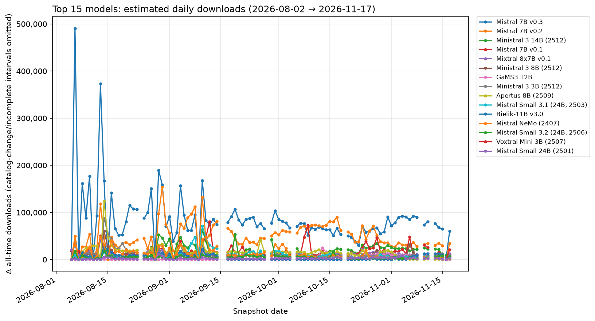
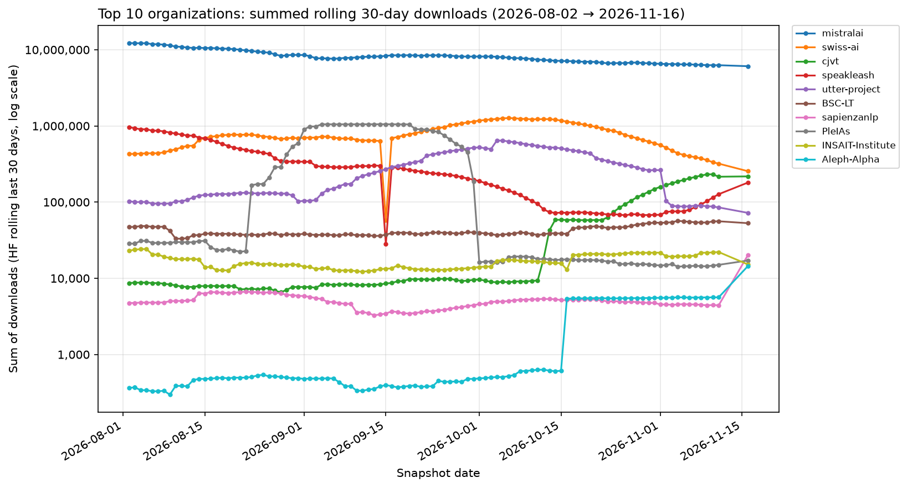

# European LLM Hugging Face download leaderboard

- **Snapshot date:** 2026-11-21
- **Generated at:** 2026-11-21T14:30:12Z
- **Ranking metric:** `total_downloads_30d` (last 30 days, summed across official format variants)
- **Rows:** 197

General-purpose generative LLMs, including general-purpose multimodal models. Task-specific OCR, translation, RAG, coding, math/proof, decision and function-calling specialists are excluded, alongside auxiliary models.

Historical snapshots retain their original scope; changes across the scope correction on 2026-11-16 also reflect the removed repositories.

## Charts

### Trends over time

From daily snapshots in `data/metrics/timeseries.jsonl` (top 15 models / top 10 orgs by latest-day volume). Rolling-30d charts use a symlog y-axis (0 at zero, log compression above).

Rolling-30-day charts omit incomplete model observations; organization totals have a gap if any member model is incomplete. Complete zero observations remain zero.

Daily estimates omit intervals where the catalog changed, its identity is unknown, or a fetch was incomplete; they resume after two complete observations of the same catalog. This avoids counting newly added models’ lifetime downloads as daily growth.

| Rank | Model | Country | Developer | Org | Downloads (30d) | Δ 30d | All-time | Momentum | Params | Repos |
| ---: | --- | :---: | --- | --- | ---: | ---: | ---: | ---: | ---: | ---: |
| 1 | Mistral 7B v0.3 | FR | Mistral AI | [mistralai](https://huggingface.co/mistralai) | 2,064,186 | +22,484 | 61,120,601 | 3.4% | 7.25B | 2 |
| 2 | Mistral 7B v0.2 | FR | Mistral AI | [mistralai](https://huggingface.co/mistralai) | 1,021,546 | -32,816 | 67,136,329 | 1.5% | 7.24B | 1 |
| 3 | Ministral 3 14B (2512) | FR | Mistral AI | [mistralai](https://huggingface.co/mistralai) | 659,591 | +5,346 | 4,689,422 | 13.8% | 13.95B | 6 |
| 4 | Mistral 7B v0.1 | FR | Mistral AI | [mistralai](https://huggingface.co/mistralai) | 547,278 | +1,079 | 46,628,040 | 1.2% | 7.24B | 2 |
| 5 | Mixtral 8x7B v0.1 | FR | Mistral AI | [mistralai](https://huggingface.co/mistralai) | 343,277 | -5,283 | 32,916,754 | 1.0% | 46.70B | 2 |
| 6 | Ministral 3 8B (2512) | FR | Mistral AI | [mistralai](https://huggingface.co/mistralai) | 265,055 | +4,682 | 2,619,390 | 9.7% | 8.92B | 6 |
| 7 | GaMS3 12B | SI | CJVT UL (Center za jezikovne vire in tehnologije, University of Ljubljana) | [cjvt](https://huggingface.co/cjvt) | 230,119 | +1,273 | 357,742 | 50.3% | 12.77B | 4 |
| 8 | Ministral 3 3B (2512) | FR | Mistral AI | [mistralai](https://huggingface.co/mistralai) | 211,097 | -1,606 | 5,971,071 | 3.5% | 3.85B | 7 |
| 9 | Voxtral Mini 3B (2507) | FR | Mistral AI | [mistralai](https://huggingface.co/mistralai) | 208,525 | +18,066 | 6,717,745 | 3.1% | 4.68B | 1 |
| 10 | Mistral Small 3.1 (24B, 2503) | FR | Mistral AI | [mistralai](https://huggingface.co/mistralai) | 159,404 | +3,718 | 5,080,790 | 3.1% | 24.01B | 2 |
| 11 | Bielik-11B v3.0 | PL | SpeakLeash / ACK Cyfronet AGH | [speakleash](https://huggingface.co/speakleash) | 135,987 | +425 | 4,306,202 | 3.1% | 11.34B | 10 |
| 12 | Apertus 8B (2509) | CH | swiss-ai | [swiss-ai](https://huggingface.co/swiss-ai) | 135,500 | -14,178 | 4,703,533 | 2.8% | 8.05B | 2 |
| 13 | Mistral NeMo (2407) | FR | Mistral AI | [mistralai](https://huggingface.co/mistralai) | 127,143 | +410 | 16,704,033 | 0.8% | 12.25B | 3 |
| 14 | Mistral Small 3.2 (24B, 2506) | FR | Mistral AI | [mistralai](https://huggingface.co/mistralai) | 110,809 | -340 | 5,682,498 | 1.9% | 24.01B | 1 |
| 15 | Mistral Small 24B (2501) | FR | Mistral AI | [mistralai](https://huggingface.co/mistralai) | 95,995 | -1,225 | 7,748,940 | 1.2% | 23.57B | 2 |
| 16 | Ministral 8B Instruct (2410) | FR | Mistral AI | [mistralai](https://huggingface.co/mistralai) | 62,519 | +146 | 8,620,164 | 0.7% | 8.02B | 1 |
| 17 | Mixtral 8x22B v0.1 | FR | Mistral AI | [mistralai](https://huggingface.co/mistralai) | 42,596 | -575 | 11,307,603 | 0.4% | 140.63B | 2 |
| 18 | Mistral Small 4 (119B, 2603) | FR | Mistral AI | [mistralai](https://huggingface.co/mistralai) | 36,099 | -52 | 757,080 | 4.2% | 119.40B | 3 |
| 19 | Salamandra 7B Instruct | ES | BSC-LT | [BSC-LT](https://huggingface.co/BSC-LT) | 34,289 | -385 | 741,989 | 4.1% | 7.77B | 5 |
| 20 | Magistral Small (2506) | FR | Mistral AI | [mistralai](https://huggingface.co/mistralai) | 27,159 | -2,215 | 808,533 | 3.0% | 23.57B | 2 |
| 21 | Mistral Large 4 (1T-A52B) | FR | Mistral AI | [mistralai](https://huggingface.co/mistralai) | 22,447 | +866 | 22,552 | 18.3% | — | 2 |
| 22 | EuroLLM-1.7B-Instruct | EU | utter-project | [utter-project](https://huggingface.co/utter-project) | 20,173 | -10 | 949,894 | 1.9% | 1.66B | 1 |
| 23 | Bielik-11B v2.3 | PL | SpeakLeash / ACK Cyfronet AGH | [speakleash](https://huggingface.co/speakleash) | 17,590 | +28 | 805,957 | 1.9% | 11.25B | 10 |
| 24 | Magistral Small (2509) | FR | Mistral AI | [mistralai](https://huggingface.co/mistralai) | 17,501 | +492 | 375,640 | 3.7% | 24.01B | 2 |
| 25 | Apertus v1.5 8B | CH | swiss-ai | [swiss-ai](https://huggingface.co/swiss-ai) | 15,217 | 0 | 751,687 | 1.8% | 8.90B | 5 |
| 26 | Mistral Medium 3.5 (128B) | FR | Mistral AI | [mistralai](https://huggingface.co/mistralai) | 14,973 | -109 | 1,126,064 | 1.2% | 127.70B | 2 |
| 27 | Mistral Large Instruct (2411) | FR | Mistral AI | [mistralai](https://huggingface.co/mistralai) | 14,760 | -57 | 4,948,797 | 0.3% | 122.61B | 1 |
| 28 | EuroLLM-1.7B (base) | EU | utter-project | [utter-project](https://huggingface.co/utter-project) | 13,802 | +110 | 251,951 | 3.9% | — | 1 |
| 29 | Kolibri-1 | DE | Aleph Alpha | [Aleph-Alpha](https://huggingface.co/Aleph-Alpha) | 12,028 | -167 | 37,387 | 8.8% | 78.10B | 2 |
| 30 | EuroLLM-9B-Instruct | EU | utter-project | [utter-project](https://huggingface.co/utter-project) | 11,472 | +457 | 501,641 | 1.9% | 9.15B | 1 |
| 31 | Bielik-7B v0.1 | PL | SpeakLeash | [speakleash](https://huggingface.co/speakleash) | 10,639 | +17 | 527,753 | 1.7% | 7.24B | 8 |
| 32 | Bielik-11B v3.1 | PL | SpeakLeash / ACK Cyfronet AGH | [speakleash](https://huggingface.co/speakleash) | 9,564 | +455 | 9,564 | 8.7% | 11.17B | 8 |
| 33 | Mistral Small Instruct (2409) | FR | Mistral AI | [mistralai](https://huggingface.co/mistralai) | 9,492 | +32 | 5,393,719 | 0.2% | 22.25B | 1 |
| 34 | Bielik-4.5B v3.0 | PL | SpeakLeash | [speakleash](https://huggingface.co/speakleash) | 8,998 | -157 | 264,702 | 2.5% | 4.76B | 8 |
| 35 | Mistral Large 3 (675B, 2512) | FR | Mistral AI | [mistralai](https://huggingface.co/mistralai) | 8,876 | +327 | 91,109 | 4.6% | — | 5 |
| 36 | Apertus v1.1 4B | CH | swiss-ai | [swiss-ai](https://huggingface.co/swiss-ai) | 8,421 | +26 | 25,033 | 6.7% | 3.83B | 5 |
| 37 | Pixtral 12B (2409) | FR | Mistral AI | [mistralai](https://huggingface.co/mistralai) | 8,153 | +222 | 145,471 | 3.3% | — | 2 |
| 38 | Apertus v1.5 70B | CH | swiss-ai | [swiss-ai](https://huggingface.co/swiss-ai) | 7,537 | -61 | 37,552 | 5.5% | 72.01B | 4 |
| 39 | Voxtral Small 24B (2507) | FR | Mistral AI | [mistralai](https://huggingface.co/mistralai) | 7,459 | -193 | 1,000,361 | 0.7% | 24.26B | 1 |
| 40 | Apertus v1.1 1.5B | CH | swiss-ai | [swiss-ai](https://huggingface.co/swiss-ai) | 7,429 | -122 | 18,478 | 6.3% | 1.51B | 6 |
| 41 | EuroLLM-9B-Instruct (2512) | EU | utter-project | [utter-project](https://huggingface.co/utter-project) | 7,280 | -563 | 164,039 | 2.8% | 9.15B | 1 |
| 42 | Llama-Poro 2 8B | FI | LumiOpen | [LumiOpen](https://huggingface.co/LumiOpen) | 6,956 | -2 | 58,626 | 4.4% | 8.03B | 7 |
| 43 | EuroLLM-22B-Instruct (2512) | EU | utter-project | [utter-project](https://huggingface.co/utter-project) | 6,647 | +47 | 606,558 | 0.9% | 22.64B | 1 |
| 44 | Soofi S Isar Preview | DE | Soofi Project | [Soofi-Project](https://huggingface.co/Soofi-Project) | 6,599 | +3,694 | 18,633 | 5.6% | 31.59B | 6 |
| 45 | Llama-Krikri 8B | GR | ILSP | [ilsp](https://huggingface.co/ilsp) | 6,259 | -180 | 121,183 | 2.8% | 8.42B | 7 |
| 46 | Salamandra 2B | ES | BSC-LT | [BSC-LT](https://huggingface.co/BSC-LT) | 6,142 | -20 | 154,670 | 2.4% | 2.25B | 7 |
| 47 | Apertus 70B (2509) | CH | swiss-ai | [swiss-ai](https://huggingface.co/swiss-ai) | 5,820 | +47 | 553,435 | 0.9% | 70.60B | 2 |
| 48 | Minerva 3B v1.0 | IT | SapienzaNLP | [sapienzanlp](https://huggingface.co/sapienzanlp) | 5,790 | -50 | 139,528 | 2.4% | 2.89B | 1 |
| 49 | Apertus v1.1 0.5B | CH | swiss-ai | [swiss-ai](https://huggingface.co/swiss-ai) | 5,674 | -487 | 25,127 | 4.5% | 572.6M | 5 |
| 50 | Minerva 350M v1.0 | IT | SapienzaNLP | [sapienzanlp](https://huggingface.co/sapienzanlp) | 5,650 | +7 | 160,535 | 2.2% | 351.6M | 1 |
| 51 | Bielik-1.5B v3.0 | PL | SpeakLeash | [speakleash](https://huggingface.co/speakleash) | 5,452 | +14 | 66,195 | 3.3% | 1.60B | 9 |
| 52 | EuroLLM-22B (2512 base) | EU | utter-project | [utter-project](https://huggingface.co/utter-project) | 5,331 | +352 | 30,852 | 4.1% | 22.64B | 1 |
| 53 | Monad | FR | PleIAs | [PleIAs](https://huggingface.co/PleIAs) | 5,031 | -17 | 40,199 | 3.6% | 56.7M | 1 |
| 54 | Baguettotron | FR | PleIAs | [PleIAs](https://huggingface.co/PleIAs) | 4,850 | +32 | 46,728 | 3.3% | 13.29B | 3 |
| 55 | Maestrale Chat v0.4 | IT | mii-llm | [mii-llm](https://huggingface.co/mii-llm) | 4,417 | +4 | 156,233 | 1.7% | 7.24B | 4 |
| 56 | Occiglot 7B (bilingual) | EU | occiglot | [occiglot](https://huggingface.co/occiglot) | 4,151 | +5 | 379,598 | 0.9% | 7.24B | 8 |
| 57 | Modello Italia 9B | IT | SapienzaNLP | [sapienzanlp](https://huggingface.co/sapienzanlp) | 4,146 | -32 | 125,886 | 1.8% | 8.54B | 2 |
| 58 | Minerva 7B v1.0 | IT | SapienzaNLP | [sapienzanlp](https://huggingface.co/sapienzanlp) | 4,133 | -3 | 141,829 | 1.7% | 7.40B | 3 |
| 59 | ALIA 40B Instruct (2606) | ES | BSC-LT | [BSC-LT](https://huggingface.co/BSC-LT) | 4,007 | -52 | 12,849 | 3.6% | 40.43B | 2 |
| 60 | Bielik-Minitron 7B v3.0 | PL | SpeakLeash / ACK Cyfronet AGH | [speakleash](https://huggingface.co/speakleash) | 3,926 | +17 | 132,329 | 1.7% | 7.48B | 9 |
| 61 | Salamandra 7B (base) | ES | BSC-LT | [BSC-LT](https://huggingface.co/BSC-LT) | 3,803 | +34 | 55,772 | 2.4% | 7.77B | 3 |
| 62 | EuroMoE 2.6B-A0.6B (2512) | EU | utter-project | [utter-project](https://huggingface.co/utter-project) | 3,649 | -19 | 42,212 | 2.6% | 2.61B | 3 |
| 63 | Mistral Large Instruct (2407) | FR | Mistral AI | [mistralai](https://huggingface.co/mistralai) | 3,547 | -1 | 5,048,481 | 0.1% | 122.61B | 1 |
| 64 | EuroLLM-9B (2512) | EU | utter-project | [utter-project](https://huggingface.co/utter-project) | 3,502 | +109 | 13,873 | 3.1% | 9.15B | 1 |
| 65 | Domyn Edge | IT | Domyn | [domyn](https://huggingface.co/domyn) | 3,441 | -40 | 3,981 | 3.3% | 3.93B | 2 |
| 66 | OpenEuroLLM Prelude-base 9B | EU | openeurollm | [openeurollm](https://huggingface.co/openeurollm) | 3,385 | +41 | 79,441 | 1.9% | 9.09B | 1 |
| 67 | Minerva Chat v0.1 | IT | mii-llm | [mii-llm](https://huggingface.co/mii-llm) | 3,244 | +7 | 97,382 | 1.6% | 2.89B | 1 |
| 68 | BgGPT Gemma 3 27B | BG | INSAIT | [INSAIT-Institute](https://huggingface.co/INSAIT-Institute) | 3,196 | -31 | 23,029 | 2.6% | 27.43B | 3 |
| 69 | Bielik-11B v2.2 | PL | SpeakLeash / ACK Cyfronet AGH | [speakleash](https://huggingface.co/speakleash) | 2,984 | -49 | 171,014 | 1.1% | 11.17B | 16 |
| 70 | AI Sweden Llama 3 8B | SE | AI Sweden | [AI-Sweden-Models](https://huggingface.co/AI-Sweden-Models) | 2,938 | -95 | 96,414 | 1.5% | 8.03B | 10 |
| 71 | Velvet 14B | IT | Almawave | [AlmawaveLabs](https://huggingface.co/AlmawaveLabs) | 2,811 | 0 | 71,040 | 1.6% | 14.08B | 1 |
| 72 | MamayLM Gemma 3 12B v2.0 | UA | INSAIT | [INSAIT-Institute](https://huggingface.co/INSAIT-Institute) | 2,781 | -30 | 21,728 | 2.3% | 12.19B | 2 |
| 73 | EuroLLM-9B (base) | EU | utter-project | [utter-project](https://huggingface.co/utter-project) | 2,776 | +79 | 87,276 | 1.5% | 9.15B | 1 |
| 74 | Velvet 2B | IT | Almawave | [AlmawaveLabs](https://huggingface.co/AlmawaveLabs) | 2,752 | -7 | 89,907 | 1.4% | 2.22B | 1 |
| 75 | MamayLM Gemma 3 4B v1.0 | UA | INSAIT | [INSAIT-Institute](https://huggingface.co/INSAIT-Institute) | 2,369 | +8 | 23,821 | 1.9% | 4.30B | 2 |
| 76 | TildeOpen 30B | LV | Tilde | [TildeAI](https://huggingface.co/TildeAI) | 2,278 | +1 | 103,347 | 1.1% | 30.68B | 1 |
| 77 | GaMS 9B | SI | CJVT UL (Center za jezikovne vire in tehnologije, University of Ljubljana) | [cjvt](https://huggingface.co/cjvt) | 2,142 | +62 | 52,728 | 1.4% | 9.24B | 4 |
| 78 | Poro 34B | FI | LumiOpen | [LumiOpen](https://huggingface.co/LumiOpen) | 2,118 | -64 | 231,334 | 0.6% | 35.13B | 4 |
| 79 | Teuken 7B v0.4 (research) | DE | openGPT-X | [openGPT-X](https://huggingface.co/openGPT-X) | 2,109 | -6 | 81,670 | 1.2% | 7.45B | 1 |
| 80 | TRURL 2 13B | PL | Voicelab | [Voicelab](https://huggingface.co/Voicelab) | 2,074 | -11 | 359,298 | 0.5% | — | 3 |
| 81 | ALIA 40B (base) | ES | BSC-LT | [BSC-LT](https://huggingface.co/BSC-LT) | 2,044 | -7 | 455,104 | 0.4% | 40.43B | 1 |
| 82 | Qra 1B | PL | OPI-PG | [OPI-PG](https://huggingface.co/OPI-PG) | 2,027 | -4 | 160,864 | 0.8% | 1.10B | 1 |
| 83 | Teuken 7B v0.4 (commercial) | DE | openGPT-X | [openGPT-X](https://huggingface.co/openGPT-X) | 2,003 | +1 | 109,184 | 1.0% | 7.45B | 1 |
| 84 | Pleias 350M Preview | FR | PleIAs | [PleIAs](https://huggingface.co/PleIAs) | 1,991 | +77 | 420,742 | 0.4% | 353.4M | 1 |
| 85 | Qra 7B | PL | OPI-PG | [OPI-PG](https://huggingface.co/OPI-PG) | 1,917 | -2 | 187,584 | 0.7% | 6.74B | 1 |
| 86 | TRURL 2 7B | PL | Voicelab | [Voicelab](https://huggingface.co/Voicelab) | 1,910 | -3 | 304,254 | 0.5% | 6.74B | 2 |
| 87 | EuroLLM-22B-Instruct (Preview) | EU | utter-project | [utter-project](https://huggingface.co/utter-project) | 1,898 | -7 | 35,810 | 1.4% | 22.64B | 1 |
| 88 | Pleias 3B Preview | FR | PleIAs | [PleIAs](https://huggingface.co/PleIAs) | 1,866 | +79 | 402,156 | 0.4% | 3.21B | 1 |
| 89 | Pleias 1.2B Preview | FR | PleIAs | [PleIAs](https://huggingface.co/PleIAs) | 1,865 | +83 | 417,306 | 0.4% | 1.20B | 1 |
| 90 | Qra 13B | PL | OPI-PG | [OPI-PG](https://huggingface.co/OPI-PG) | 1,850 | -5 | 148,299 | 0.7% | 13.02B | 1 |
| 91 | PLLuM 12B (2412) | PL | CYFRAGOVPL / PLLuM consortium | [CYFRAGOVPL](https://huggingface.co/CYFRAGOVPL) | 1,768 | +9 | 180,527 | 0.6% | 12.25B | 6 |
| 92 | Domyn Small v1.0 | IT | Domyn | [domyn](https://huggingface.co/domyn) | 1,727 | -41 | 10,669 | 1.6% | 9.82B | 1 |
| 93 | Maestrale Chat v0.3 | IT | mii-llm | [mii-llm](https://huggingface.co/mii-llm) | 1,544 | +9 | 55,362 | 1.0% | 7.24B | 5 |
| 94 | LeoLM HessianAI 7B | DE | LeoLM | [LeoLM](https://huggingface.co/LeoLM) | 1,526 | -55 | 802,832 | 0.2% | — | 3 |
| 95 | Maestrale Chat v0.2 | IT | mii-llm | [mii-llm](https://huggingface.co/mii-llm) | 1,473 | +2 | 54,094 | 1.0% | 7.24B | 1 |
| 96 | Llama-Poro 2 70B | FI | LumiOpen | [LumiOpen](https://huggingface.co/LumiOpen) | 1,432 | -50 | 41,280 | 1.0% | 70.55B | 3 |
| 97 | Magistral Small (2507) | FR | Mistral AI | [mistralai](https://huggingface.co/mistralai) | 1,399 | -160 | 157,693 | 0.5% | 23.57B | 2 |
| 98 | Viking 13B | FI | LumiOpen | [LumiOpen](https://huggingface.co/LumiOpen) | 1,384 | -46 | 34,862 | 1.0% | 14.03B | 1 |
| 99 | PLLuM 12B (2512) | PL | CYFRAGOVPL / PLLuM consortium | [CYFRAGOVPL](https://huggingface.co/CYFRAGOVPL) | 1,225 | -23 | 45,068 | 0.8% | 12.25B | 3 |
| 100 | Viking 7B | FI | LumiOpen | [LumiOpen](https://huggingface.co/LumiOpen) | 1,196 | +3 | 57,165 | 0.8% | 7.55B | 1 |
| 101 | Bielik-11B v2.6 | PL | SpeakLeash / ACK Cyfronet AGH | [speakleash](https://huggingface.co/speakleash) | 1,178 | +2 | 175,636 | 0.4% | 11.51B | 9 |
| 102 | CroissantLLM Base | FR | croissantllm | [croissantllm](https://huggingface.co/croissantllm) | 1,116 | +70 | 59,225 | 0.7% | 1.35B | 3 |
| 103 | PLLuM 4B (2512) | PL | CYFRAGOVPL / PLLuM consortium | [CYFRAGOVPL](https://huggingface.co/CYFRAGOVPL) | 1,100 | -49 | 9,926 | 1.0% | 4.30B | 3 |
| 104 | BgGPT Gemma 3 4B | BG | INSAIT | [INSAIT-Institute](https://huggingface.co/INSAIT-Institute) | 1,041 | +42 | 15,406 | 0.9% | 4.33B | 3 |
| 105 | MamayLM Gemma 3 12B v1.0 | UA | INSAIT | [INSAIT-Institute](https://huggingface.co/INSAIT-Institute) | 1,025 | -2 | 45,490 | 0.7% | 12.19B | 2 |
| 106 | MamayLM Gemma 3 27B v2.0 | UA | INSAIT | [INSAIT-Institute](https://huggingface.co/INSAIT-Institute) | 1,014 | -5 | 9,651 | 0.9% | 28.84B | 3 |
| 107 | Teuken 7B v0.6 | DE | openGPT-X | [openGPT-X](https://huggingface.co/openGPT-X) | 991 | -10 | 671,711 | 0.1% | 7.45B | 2 |
| 108 | Viking 33B | FI | LumiOpen | [LumiOpen](https://huggingface.co/LumiOpen) | 987 | -35 | 32,037 | 0.7% | 33.12B | 1 |
| 109 | BgGPT Gemma 3 12B | BG | INSAIT | [INSAIT-Institute](https://huggingface.co/INSAIT-Institute) | 969 | +13 | 219,440 | 0.3% | 12.19B | 3 |
| 110 | CroissantLLM Chat v0.1 | FR | croissantllm | [croissantllm](https://huggingface.co/croissantllm) | 945 | +78 | 97,062 | 0.5% | 1.35B | 8 |
| 111 | EuroLLM 1.5 9B | EU | utter-project | [utter-project](https://huggingface.co/utter-project) | 875 | +104 | 1,754 | 0.9% | 9.15B | 2 |
| 112 | LeoLM Mistral HessianAI 7B | DE | LeoLM | [LeoLM](https://huggingface.co/LeoLM) | 849 | -7 | 233,753 | 0.3% | — | 2 |
| 113 | Baguettotron 600M | FR | PleIAs | [PleIAs](https://huggingface.co/PleIAs) | 848 | -3 | 1,930 | 0.8% | 608.3M | 1 |
| 114 | Bielik-11B v2.0 | PL | SpeakLeash / ACK Cyfronet AGH | [speakleash](https://huggingface.co/speakleash) | 845 | -11 | 24,334 | 0.7% | 11.17B | 5 |
| 115 | EuroVLM 9B Preview | EU | UTTER consortium | [utter-project](https://huggingface.co/utter-project) | 764 | -27 | 8,653 | 0.7% | 9.57B | 1 |
| 116 | Pharia-1-LLM-7B-control | DE | Aleph Alpha | [Aleph-Alpha](https://huggingface.co/Aleph-Alpha) | 738 | -22 | 82,193 | 0.4% | 7.04B | 4 |
| 117 | BgGPT 7B v0.2 | BG | INSAIT | [INSAIT-Institute](https://huggingface.co/INSAIT-Institute) | 696 | 0 | 112,633 | 0.3% | 7.29B | 2 |
| 118 | Bielik-11B v2.1 | PL | SpeakLeash / ACK Cyfronet AGH | [speakleash](https://huggingface.co/speakleash) | 684 | -19 | 32,068 | 0.5% | 11.17B | 5 |
| 119 | GaMS 2B | SI | CJVT UL (Center za jezikovne vire in tehnologije, University of Ljubljana) | [cjvt](https://huggingface.co/cjvt) | 673 | +6 | 21,026 | 0.6% | 3.20B | 2 |
| 120 | GaMS 1B | SI | CJVT UL (Center za jezikovne vire in tehnologije, University of Ljubljana) | [cjvt](https://huggingface.co/cjvt) | 656 | -16 | 17,244 | 0.6% | 1.54B | 4 |
| 121 | BgGPT Gemma 2 9B | BG | INSAIT | [INSAIT-Institute](https://huggingface.co/INSAIT-Institute) | 567 | -21 | 28,102 | 0.4% | 9.24B | 2 |
| 122 | TildeOpen 30B (64k) | LV | Tilde | [TildeAI](https://huggingface.co/TildeAI) | 564 | -17 | 3,898 | 0.5% | 30.68B | 1 |
| 123 | GaMS2 27B | SI | CJVT UL (Center za jezikovne vire in tehnologije, University of Ljubljana) | [cjvt](https://huggingface.co/cjvt) | 540 | 0 | 1,809 | 0.5% | 852,480 | 2 |
| 124 | MamayLM Gemma 2 9B v0.1 | UA | INSAIT | [INSAIT-Institute](https://huggingface.co/INSAIT-Institute) | 456 | -11 | 22,309 | 0.4% | 9.24B | 2 |
| 125 | OpenEuroLLM Prelude-long 9B | EU | OpenEuroLLM | [openeurollm](https://huggingface.co/openeurollm) | 453 | +6 | 453 | 0.5% | 9.09B | 1 |
| 126 | Bielik-11B v2.5 | PL | SpeakLeash / ACK Cyfronet AGH | [speakleash](https://huggingface.co/speakleash) | 437 | -11 | 5,850 | 0.4% | 11.51B | 5 |
| 127 | Llama-PLLuM 8B (2512) | PL | CYFRAGOVPL / PLLuM consortium | [CYFRAGOVPL](https://huggingface.co/CYFRAGOVPL) | 425 | -16 | 4,603 | 0.4% | 8.03B | 3 |
| 128 | GaMS 27B | SI | CJVT UL (Center za jezikovne vire in tehnologije, University of Ljubljana) | [cjvt](https://huggingface.co/cjvt) | 408 | +17 | 38,133 | 0.3% | 27.23B | 3 |
| 129 | OpenEuroLLM Prelude SFT Excellent v0.2 | EU | OpenEuroLLM | [openeurollm](https://huggingface.co/openeurollm) | 380 | +1 | 380 | 0.4% | 9.09B | 1 |
| 130 | BgGPT Gemma 2 27B | BG | INSAIT | [INSAIT-Institute](https://huggingface.co/INSAIT-Institute) | 343 | +3 | 12,334 | 0.3% | 27.23B | 2 |
| 131 | BgGPT Gemma 2 2.6B | BG | INSAIT | [INSAIT-Institute](https://huggingface.co/INSAIT-Institute) | 335 | -12 | 22,340 | 0.3% | 2.61B | 2 |
| 132 | Llama-PLLuM 8B (2412) | PL | CYFRAGOVPL / PLLuM consortium | [CYFRAGOVPL](https://huggingface.co/CYFRAGOVPL) | 325 | +8 | 70,727 | 0.2% | 8.03B | 3 |
| 133 | LeoLM HessianAI 13B | DE | LeoLM | [LeoLM](https://huggingface.co/LeoLM) | 273 | -6 | 107,409 | 0.1% | — | 3 |
| 134 | Mambaoutai 1.6B | FR | LightOn | [lightonai](https://huggingface.co/lightonai) | 250 | +16 | 1,422 | 0.2% | 1.62B | 1 |
| 135 | ALIA 40B Instruct (2601) | ES | BSC-LT | [BSC-LT](https://huggingface.co/BSC-LT) | 236 | +2 | 33,016 | 0.2% | 40.43B | 2 |
| 136 | Minerva 1B v1.0 | IT | SapienzaNLP | [sapienzanlp](https://huggingface.co/sapienzanlp) | 224 | -16 | 29,906 | 0.2% | 1.01B | 1 |
| 137 | Bielik-11B v2 (base) | PL | SpeakLeash / ACK Cyfronet AGH | [speakleash](https://huggingface.co/speakleash) | 221 | 0 | 42,050 | 0.2% | 11.17B | 1 |
| 138 | Occiglot 7B EU5 | EU | occiglot | [occiglot](https://huggingface.co/occiglot) | 209 | 0 | 322,398 | 0.0% | 7.24B | 2 |
| 139 | Nesso 4B | IT | mii-llm | [mii-llm](https://huggingface.co/mii-llm) | 205 | -37 | 2,893 | 0.2% | 4.02B | 2 |
| 140 | Soofi S Rhine Preview | DE | Soofi Project | [Soofi-Project](https://huggingface.co/Soofi-Project) | 191 | 0 | 3,010 | 0.2% | 31.59B | 6 |
| 141 | Meltemi 7B v1.5 | GR | ILSP | [ilsp](https://huggingface.co/ilsp) | 186 | +4 | 39,509 | 0.1% | 7.48B | 2 |
| 142 | BgGPT 7B v0.1 | BG | INSAIT | [INSAIT-Institute](https://huggingface.co/INSAIT-Institute) | 183 | -4 | 16,748 | 0.2% | 7.29B | 2 |
| 143 | LeoLM HessianAI 70B | DE | LeoLM | [LeoLM](https://huggingface.co/LeoLM) | 171 | -7 | 19,788 | 0.1% | 68.98B | 2 |
| 144 | PLLuM 8x7B (2412) | PL | CYFRAGOVPL / PLLuM consortium | [CYFRAGOVPL](https://huggingface.co/CYFRAGOVPL) | 171 | 0 | 28,536 | 0.1% | 46.70B | 6 |
| 145 | Velvet2 3B Speech | IT | Almawave | [AlmawaveLabs](https://huggingface.co/AlmawaveLabs) | 170 | +5 | 209 | 0.2% | 4.55B | 1 |
| 146 | Alfred 40B (1023) | FR | LightOn | [lightonai](https://huggingface.co/lightonai) | 158 | -3 | 78,658 | 0.1% | — | 1 |
| 147 | Pixtral Large (2411) | FR | Mistral AI | [mistralai](https://huggingface.co/mistralai) | 156 | -3 | 4,503 | 0.1% | — | 1 |
| 148 | PAGnol xl | FR | LightOn / Inria | [lightonai](https://huggingface.co/lightonai) | 154 | -3 | 1,649 | 0.2% | 1.64B | 1 |
| 149 | Meltemi 7B v1 | GR | ILSP | [ilsp](https://huggingface.co/ilsp) | 153 | +5 | 44,748 | 0.1% | 7.70B | 5 |
| 150 | TowerVision 2B | EU | UTTER consortium | [utter-project](https://huggingface.co/utter-project) | 150 | -1 | 2,796 | 0.1% | 3.02B | 1 |
| 151 | Llama-PLLuM 70B (2512) | PL | CYFRAGOVPL / PLLuM consortium | [CYFRAGOVPL](https://huggingface.co/CYFRAGOVPL) | 137 | +4 | 12,804 | 0.1% | 70.55B | 2 |
| 152 | ALIA 40B Instruct (2605) | ES | BSC-LT | [BSC-LT](https://huggingface.co/BSC-LT) | 136 | -1 | 2,978 | 0.1% | 40.43B | 2 |
| 153 | GPT-SW3 1.3B | SE | AI Sweden | [AI-Sweden-Models](https://huggingface.co/AI-Sweden-Models) | 134 | +3 | 306,790 | 0.0% | 1.47B | 4 |
| 154 | Zagreus 0.4B (ITA) | IT | mii-llm | [mii-llm](https://huggingface.co/mii-llm) | 133 | 0 | 5,259 | 0.1% | 437.8M | 1 |
| 155 | Velvet2 3B | IT | Almawave | [AlmawaveLabs](https://huggingface.co/AlmawaveLabs) | 125 | +8 | 144 | 0.1% | 3.89B | 1 |
| 156 | EuroLLM-22B (Preview base) | EU | utter-project | [utter-project](https://huggingface.co/utter-project) | 119 | -5 | 2,625 | 0.1% | — | 1 |
| 157 | Llama-PLLuM 70B (2508) | PL | CYFRAGOVPL / PLLuM consortium | [CYFRAGOVPL](https://huggingface.co/CYFRAGOVPL) | 111 | +4 | 5,127 | 0.1% | 70.55B | 3 |
| 158 | Salamandra VL 7B (2512) | ES | Barcelona Supercomputing Center | [BSC-LT](https://huggingface.co/BSC-LT) | 108 | -5 | 2,110 | 0.1% | 8.90B | 1 |
| 159 | Llama-PLLuM 70B (2412) | PL | CYFRAGOVPL / PLLuM consortium | [CYFRAGOVPL](https://huggingface.co/CYFRAGOVPL) | 100 | +5 | 38,795 | 0.1% | 70.55B | 3 |
| 160 | GPT-sl Base | SI | CJVT UL | [cjvt](https://huggingface.co/cjvt) | 99 | +4 | 1,847 | 0.1% | — | 1 |
| 161 | PAGnol medium | FR | LightOn / Inria | [lightonai](https://huggingface.co/lightonai) | 94 | -12 | 1,171 | 0.1% | 380.0M | 1 |
| 162 | Open Zagreus 0.4B | IT | mii-llm | [mii-llm](https://huggingface.co/mii-llm) | 93 | 0 | 480 | 0.1% | 437.8M | 1 |
| 163 | Alfred 40B (0723) | FR | LightOn | [lightonai](https://huggingface.co/lightonai) | 92 | -1 | 5,555 | 0.1% | — | 1 |
| 164 | EuroVLM 1.7B Preview | EU | UTTER consortium | [utter-project](https://huggingface.co/utter-project) | 89 | +1 | 3,049 | 0.1% | 2.06B | 1 |
| 165 | CroissantCool v0.2 | FR | CroissantLLM consortium | [croissantllm](https://huggingface.co/croissantllm) | 87 | +5 | 14,823 | 0.1% | 1.35B | 1 |
| 166 | Soofi S Instruct Preview | DE | Soofi Project | [Soofi-Project](https://huggingface.co/Soofi-Project) | 86 | -4 | 7,512 | 0.1% | 31.59B | 6 |
| 167 | TowerVision 9B | EU | UTTER consortium | [utter-project](https://huggingface.co/utter-project) | 80 | 0 | 1,390 | 0.1% | 9.66B | 1 |
| 168 | Zagreus 0.4B (FRA) | IT | mii-llm | [mii-llm](https://huggingface.co/mii-llm) | 75 | +2 | 228 | 0.1% | 437.8M | 1 |
| 169 | Zagreus 0.4B (SPA) | IT | mii-llm | [mii-llm](https://huggingface.co/mii-llm) | 74 | +6 | 289 | 0.1% | 437.8M | 1 |
| 170 | PAGnol small | FR | LightOn / Inria | [lightonai](https://huggingface.co/lightonai) | 72 | +3 | 4,676 | 0.1% | — | 1 |
| 171 | Nesso 0.4B Instruct | IT | mii-llm | [mii-llm](https://huggingface.co/mii-llm) | 62 | +1 | 1,342 | 0.1% | 560.9M | 1 |
| 172 | Zagreus 0.4B (POR) | IT | mii-llm | [mii-llm](https://huggingface.co/mii-llm) | 62 | +1 | 330 | 0.1% | 437.8M | 1 |
| 173 | PAGnol large | FR | LightOn / Inria | [lightonai](https://huggingface.co/lightonai) | 51 | +2 | 897 | 0.1% | — | 1 |
| 174 | TowerVideo 9B | EU | UTTER consortium | [utter-project](https://huggingface.co/utter-project) | 47 | 0 | 487 | 0.0% | 9.66B | 1 |
| 175 | OpenEuroLLM Prelude SFT Excellent v0.1 | EU | OpenEuroLLM | [openeurollm](https://huggingface.co/openeurollm) | 42 | +3 | 62 | 0.0% | 9.10B | 1 |
| 176 | Salamandra 7B Vision | ES | Barcelona Supercomputing Center | [BSC-LT](https://huggingface.co/BSC-LT) | 42 | 0 | 3,724 | 0.0% | 8.19B | 1 |
| 177 | Flor 6.3B | ES | BSC-LT | [BSC-LT](https://huggingface.co/BSC-LT) | 41 | +2 | 631 | 0.0% | 6.25B | 2 |
| 178 | TowerVideo 2B | EU | UTTER consortium | [utter-project](https://huggingface.co/utter-project) | 40 | 0 | 1,133 | 0.0% | 3.02B | 1 |
| 179 | Velvet2 3B Vision | IT | Almawave | [AlmawaveLabs](https://huggingface.co/AlmawaveLabs) | 39 | +2 | 94 | 0.0% | 4.33B | 1 |
| 180 | Llama-PLLuM 8B (2508) | PL | CYFRAGOVPL / PLLuM consortium | [CYFRAGOVPL](https://huggingface.co/CYFRAGOVPL) | 38 | +2 | 1,471 | 0.0% | 8.03B | 1 |
| 181 | NorwAI Magistral 24B reasoning | NO | NorwAI / NTNU | [NorwAI](https://huggingface.co/NorwAI) | 31 | 0 | 547,892 | 0.0% | 23.85B | 1 |
| 182 | CroissantCool v0.1 | FR | CroissantLLM consortium | [croissantllm](https://huggingface.co/croissantllm) | 30 | +3 | 611 | 0.0% | 1.35B | 1 |
| 183 | Maestrale Chat v0.1 | IT | mii-llm | [mii-llm](https://huggingface.co/mii-llm) | 30 | +1 | 159 | 0.0% | 7.24B | 1 |
| 184 | Tyr 7B | SE | AI Sweden | [AI-Sweden-Models](https://huggingface.co/AI-Sweden-Models) | 27 | +3 | 922 | 0.0% | 7.24B | 1 |
| 185 | GPT-SW3 20B | SE | AI Sweden | [AI-Sweden-Models](https://huggingface.co/AI-Sweden-Models) | 26 | +2 | 141,987 | 0.0% | 20.92B | 5 |
| 186 | NorwAI Mistral-7B | NO | NorwAI / NTNU | [NorwAI](https://huggingface.co/NorwAI) | 25 | 0 | 111,668 | 0.0% | 7.54B | 3 |
| 187 | PLLuM 12B (2508) | PL | CYFRAGOVPL / PLLuM consortium | [CYFRAGOVPL](https://huggingface.co/CYFRAGOVPL) | 21 | +1 | 385 | 0.0% | 12.25B | 1 |
| 188 | GPT-SW3 126M | SE | AI Sweden | [AI-Sweden-Models](https://huggingface.co/AI-Sweden-Models) | 10 | 0 | 893,762 | 0.0% | 186.1M | 4 |
| 189 | PLLuM 12B nc (2507) | PL | CYFRAGOVPL / PLLuM consortium | [CYFRAGOVPL](https://huggingface.co/CYFRAGOVPL) | 9 | 0 | 6,176 | 0.0% | 12.25B | 3 |
| 190 | GPT-SW3 6.7B v2 | SE | AI Sweden | [AI-Sweden-Models](https://huggingface.co/AI-Sweden-Models) | 7 | 0 | 262,851 | 0.0% | 7.11B | 5 |
| 191 | Soofi S Base | DE | Soofi Project | [Soofi-Project](https://huggingface.co/Soofi-Project) | 6 | 0 | 1,509 | 0.0% | 31.58B | 2 |
| 192 | GPT-SW3 40B | SE | AI Sweden | [AI-Sweden-Models](https://huggingface.co/AI-Sweden-Models) | 4 | -1 | 59,798 | 0.0% | 39.93B | 2 |
| 193 | NorwAI Mixtral-8x7B | NO | NorwAI / NTNU | [NorwAI](https://huggingface.co/NorwAI) | 3 | 0 | 2,175 | 0.0% | 47.00B | 2 |
| 194 | Emma 5 Boost | IT | mii-llm | [mii-llm](https://huggingface.co/mii-llm) | 0 | 0 | 8 | 0.0% | 1.39B | 1 |
| 195 | GPT-SW3 356M | SE | AI Sweden | [AI-Sweden-Models](https://huggingface.co/AI-Sweden-Models) | 0 | 0 | 334,511 | 0.0% | 470.6M | 4 |
| 196 | GPT-SW3 6.7B | SE | AI Sweden | [AI-Sweden-Models](https://huggingface.co/AI-Sweden-Models) | 0 | 0 | 68,906 | 0.0% | 7.11B | 1 |
| 197 | NorwAI Llama2-7B | NO | NorwAI / NTNU | [NorwAI](https://huggingface.co/NorwAI) | 0 | 0 | 65,548 | 0.0% | 7.03B | 1 |

## Organizations

Same downloads, aggregated across every model version an organization publishes.

| Rank | Organization | Developer | Country | Downloads (30d) | All-time | Models | Momentum |
| ---: | --- | --- | :---: | ---: | ---: | ---: | ---: |
| 1 | [mistralai](https://huggingface.co/mistralai) | Mistral AI | FR | 6,091,042 | 302,823,383 | 27 | 2.0% |
| 2 | [cjvt](https://huggingface.co/cjvt) | CJVT UL (Center za jezikovne vire in tehnologije, University of Ljubljana) | SI | 234,637 | 490,529 | 7 | 39.7% |
| 3 | [speakleash](https://huggingface.co/speakleash) | SpeakLeash / ACK Cyfronet AGH | PL | 198,505 | 6,563,654 | 13 | 3.0% |
| 4 | [swiss-ai](https://huggingface.co/swiss-ai) | swiss-ai | CH | 185,598 | 6,114,845 | 7 | 3.0% |
| 5 | [utter-project](https://huggingface.co/utter-project) | utter-project | EU | 78,694 | 2,705,993 | 18 | 2.8% |
| 6 | [BSC-LT](https://huggingface.co/BSC-LT) | BSC-LT | ES | 50,848 | 1,462,843 | 10 | 3.3% |
| 7 | [sapienzanlp](https://huggingface.co/sapienzanlp) | SapienzaNLP | IT | 19,943 | 597,684 | 5 | 2.9% |
| 8 | [PleIAs](https://huggingface.co/PleIAs) | PleIAs | FR | 16,451 | 1,329,061 | 6 | 1.2% |
| 9 | [INSAIT-Institute](https://huggingface.co/INSAIT-Institute) | INSAIT | BG | 14,975 | 573,031 | 13 | 2.2% |
| 10 | [LumiOpen](https://huggingface.co/LumiOpen) | LumiOpen | FI | 14,073 | 455,304 | 6 | 2.5% |
| 11 | [Aleph-Alpha](https://huggingface.co/Aleph-Alpha) | Aleph Alpha | DE | 12,766 | 119,580 | 2 | 5.8% |
| 12 | [mii-llm](https://huggingface.co/mii-llm) | mii-llm | IT | 11,412 | 374,059 | 13 | 2.4% |
| 13 | [Soofi-Project](https://huggingface.co/Soofi-Project) | Soofi Project | DE | 6,882 | 30,664 | 4 | 5.3% |
| 14 | [ilsp](https://huggingface.co/ilsp) | ILSP | GR | 6,598 | 205,440 | 3 | 2.2% |
| 15 | [AlmawaveLabs](https://huggingface.co/AlmawaveLabs) | Almawave | IT | 5,897 | 161,394 | 5 | 2.3% |
| 16 | [OPI-PG](https://huggingface.co/OPI-PG) | OPI-PG | PL | 5,794 | 496,747 | 3 | 1.0% |
| 17 | [CYFRAGOVPL](https://huggingface.co/CYFRAGOVPL) | CYFRAGOVPL / PLLuM consortium | PL | 5,430 | 404,145 | 12 | 1.1% |
| 18 | [domyn](https://huggingface.co/domyn) | Domyn | IT | 5,168 | 14,650 | 2 | 4.5% |
| 19 | [openGPT-X](https://huggingface.co/openGPT-X) | openGPT-X | DE | 5,103 | 862,565 | 3 | 0.5% |
| 20 | [occiglot](https://huggingface.co/occiglot) | occiglot | EU | 4,360 | 701,996 | 2 | 0.5% |
| 21 | [openeurollm](https://huggingface.co/openeurollm) | openeurollm | EU | 4,260 | 80,336 | 4 | 2.4% |
| 22 | [Voicelab](https://huggingface.co/Voicelab) | Voicelab | PL | 3,984 | 663,552 | 2 | 0.5% |
| 23 | [AI-Sweden-Models](https://huggingface.co/AI-Sweden-Models) | AI Sweden | SE | 3,146 | 2,165,941 | 9 | 0.1% |
| 24 | [TildeAI](https://huggingface.co/TildeAI) | Tilde | LV | 2,842 | 107,245 | 2 | 1.4% |
| 25 | [LeoLM](https://huggingface.co/LeoLM) | LeoLM | DE | 2,819 | 1,163,782 | 4 | 0.2% |
| 26 | [croissantllm](https://huggingface.co/croissantllm) | croissantllm | FR | 2,178 | 171,721 | 4 | 0.8% |
| 27 | [lightonai](https://huggingface.co/lightonai) | LightOn | FR | 871 | 94,028 | 7 | 0.4% |
| 28 | [NorwAI](https://huggingface.co/NorwAI) | NorwAI / NTNU | NO | 59 | 727,283 | 4 | 0.0% |

### By best single model

Ranked by each organization's single highest-downloading model (no summing across versions) — who has the biggest individual hit.

| Rank | Organization | Best model | Downloads (30d) | All-time | Overall model rank |
| ---: | --- | --- | ---: | ---: | ---: |
| 1 | [mistralai](https://huggingface.co/mistralai) | Mistral 7B v0.3 | 2,064,186 | 61,120,601 | 1 |
| 2 | [cjvt](https://huggingface.co/cjvt) | GaMS3 12B | 230,119 | 357,742 | 7 |
| 3 | [speakleash](https://huggingface.co/speakleash) | Bielik-11B v3.0 | 135,987 | 4,306,202 | 11 |
| 4 | [swiss-ai](https://huggingface.co/swiss-ai) | Apertus 8B (2509) | 135,500 | 4,703,533 | 12 |
| 5 | [BSC-LT](https://huggingface.co/BSC-LT) | Salamandra 7B Instruct | 34,289 | 741,989 | 19 |
| 6 | [utter-project](https://huggingface.co/utter-project) | EuroLLM-1.7B-Instruct | 20,173 | 949,894 | 22 |
| 7 | [Aleph-Alpha](https://huggingface.co/Aleph-Alpha) | Kolibri-1 | 12,028 | 37,387 | 29 |
| 8 | [LumiOpen](https://huggingface.co/LumiOpen) | Llama-Poro 2 8B | 6,956 | 58,626 | 42 |
| 9 | [Soofi-Project](https://huggingface.co/Soofi-Project) | Soofi S Isar Preview | 6,599 | 18,633 | 44 |
| 10 | [ilsp](https://huggingface.co/ilsp) | Llama-Krikri 8B | 6,259 | 121,183 | 45 |
| 11 | [sapienzanlp](https://huggingface.co/sapienzanlp) | Minerva 3B v1.0 | 5,790 | 139,528 | 48 |
| 12 | [PleIAs](https://huggingface.co/PleIAs) | Monad | 5,031 | 40,199 | 53 |
| 13 | [mii-llm](https://huggingface.co/mii-llm) | Maestrale Chat v0.4 | 4,417 | 156,233 | 55 |
| 14 | [occiglot](https://huggingface.co/occiglot) | Occiglot 7B (bilingual) | 4,151 | 379,598 | 56 |
| 15 | [domyn](https://huggingface.co/domyn) | Domyn Edge | 3,441 | 3,981 | 65 |
| 16 | [openeurollm](https://huggingface.co/openeurollm) | OpenEuroLLM Prelude-base 9B | 3,385 | 79,441 | 66 |
| 17 | [INSAIT-Institute](https://huggingface.co/INSAIT-Institute) | BgGPT Gemma 3 27B | 3,196 | 23,029 | 68 |
| 18 | [AI-Sweden-Models](https://huggingface.co/AI-Sweden-Models) | AI Sweden Llama 3 8B | 2,938 | 96,414 | 70 |
| 19 | [AlmawaveLabs](https://huggingface.co/AlmawaveLabs) | Velvet 14B | 2,811 | 71,040 | 71 |
| 20 | [TildeAI](https://huggingface.co/TildeAI) | TildeOpen 30B | 2,278 | 103,347 | 76 |
| 21 | [openGPT-X](https://huggingface.co/openGPT-X) | Teuken 7B v0.4 (research) | 2,109 | 81,670 | 79 |
| 22 | [Voicelab](https://huggingface.co/Voicelab) | TRURL 2 13B | 2,074 | 359,298 | 80 |
| 23 | [OPI-PG](https://huggingface.co/OPI-PG) | Qra 1B | 2,027 | 160,864 | 82 |
| 24 | [CYFRAGOVPL](https://huggingface.co/CYFRAGOVPL) | PLLuM 12B (2412) | 1,768 | 180,527 | 91 |
| 25 | [LeoLM](https://huggingface.co/LeoLM) | LeoLM HessianAI 7B | 1,526 | 802,832 | 94 |
| 26 | [croissantllm](https://huggingface.co/croissantllm) | CroissantLLM Base | 1,116 | 59,225 | 102 |
| 27 | [lightonai](https://huggingface.co/lightonai) | Mambaoutai 1.6B | 250 | 1,422 | 134 |
| 28 | [NorwAI](https://huggingface.co/NorwAI) | NorwAI Magistral 24B reasoning | 31 | 547,892 | 181 |

### By momentum

Sorted by momentum (highest first). Momentum highlights orgs whose recent downloads are large *relative to their lifetime total* — i.e. accelerating adoption, not legacy long-tail traffic from an old release.

| Momentum rank | Organization | Momentum | Downloads (30d) | All-time | Downloads rank |
| ---: | --- | ---: | ---: | ---: | ---: |
| 1 | [cjvt](https://huggingface.co/cjvt) | 39.7% | 234,637 | 490,529 | 2 |
| 2 | [Aleph-Alpha](https://huggingface.co/Aleph-Alpha) | 5.8% | 12,766 | 119,580 | 11 |
| 3 | [Soofi-Project](https://huggingface.co/Soofi-Project) | 5.3% | 6,882 | 30,664 | 13 |
| 4 | [domyn](https://huggingface.co/domyn) | 4.5% | 5,168 | 14,650 | 18 |
| 5 | [BSC-LT](https://huggingface.co/BSC-LT) | 3.3% | 50,848 | 1,462,843 | 6 |
| 6 | [swiss-ai](https://huggingface.co/swiss-ai) | 3.0% | 185,598 | 6,114,845 | 4 |
| 7 | [speakleash](https://huggingface.co/speakleash) | 3.0% | 198,505 | 6,563,654 | 3 |
| 8 | [sapienzanlp](https://huggingface.co/sapienzanlp) | 2.9% | 19,943 | 597,684 | 7 |
| 9 | [utter-project](https://huggingface.co/utter-project) | 2.8% | 78,694 | 2,705,993 | 5 |
| 10 | [LumiOpen](https://huggingface.co/LumiOpen) | 2.5% | 14,073 | 455,304 | 10 |
| 11 | [mii-llm](https://huggingface.co/mii-llm) | 2.4% | 11,412 | 374,059 | 12 |
| 12 | [openeurollm](https://huggingface.co/openeurollm) | 2.4% | 4,260 | 80,336 | 21 |
| 13 | [AlmawaveLabs](https://huggingface.co/AlmawaveLabs) | 2.3% | 5,897 | 161,394 | 15 |
| 14 | [INSAIT-Institute](https://huggingface.co/INSAIT-Institute) | 2.2% | 14,975 | 573,031 | 9 |
| 15 | [ilsp](https://huggingface.co/ilsp) | 2.2% | 6,598 | 205,440 | 14 |
| 16 | [mistralai](https://huggingface.co/mistralai) | 2.0% | 6,091,042 | 302,823,383 | 1 |
| 17 | [TildeAI](https://huggingface.co/TildeAI) | 1.4% | 2,842 | 107,245 | 24 |
| 18 | [PleIAs](https://huggingface.co/PleIAs) | 1.2% | 16,451 | 1,329,061 | 8 |
| 19 | [CYFRAGOVPL](https://huggingface.co/CYFRAGOVPL) | 1.1% | 5,430 | 404,145 | 17 |
| 20 | [OPI-PG](https://huggingface.co/OPI-PG) | 1.0% | 5,794 | 496,747 | 16 |
| 21 | [croissantllm](https://huggingface.co/croissantllm) | 0.8% | 2,178 | 171,721 | 26 |
| 22 | [occiglot](https://huggingface.co/occiglot) | 0.5% | 4,360 | 701,996 | 20 |
| 23 | [openGPT-X](https://huggingface.co/openGPT-X) | 0.5% | 5,103 | 862,565 | 19 |
| 24 | [Voicelab](https://huggingface.co/Voicelab) | 0.5% | 3,984 | 663,552 | 22 |
| 25 | [lightonai](https://huggingface.co/lightonai) | 0.4% | 871 | 94,028 | 27 |
| 26 | [LeoLM](https://huggingface.co/LeoLM) | 0.2% | 2,819 | 1,163,782 | 25 |
| 27 | [AI-Sweden-Models](https://huggingface.co/AI-Sweden-Models) | 0.1% | 3,146 | 2,165,941 | 23 |
| 28 | [NorwAI](https://huggingface.co/NorwAI) | 0.0% | 59 | 727,283 | 28 |

## Notes

- Downloads are Hugging Face Hub **rolling last-30-day** counts, aggregated over official repos matched by config regexes (GGUF / MLX / FP8 / etc. when published by the same org).
- **Params** is the max reported parameter count among member repos (`safetensors.total`, else `gguf.total`).
- **Momentum** = `downloads_30d / (downloads_all_time + 100,000)` — a recency ratio damped by a smoothing constant so low-volume/brand-new rows can't look like they have outsized momentum from a handful of downloads. Higher = more of its lifetime downloads happened in the last 30 days.
- **Trend charts** use [`data/metrics/timeseries.jsonl`](data/metrics/timeseries.jsonl). Rolling-30d lines follow HF’s sliding window; daily Δ lines use day-over-day changes in `downloads_all_time` (approximate new downloads, not unique users).
- Machine-readable data: [`output/leaderboard.json`](output/leaderboard.json), [`output/leaderboard.csv`](output/leaderboard.csv), [`output/leaderboard_orgs.json`](output/leaderboard_orgs.json), [`output/leaderboard_orgs.csv`](output/leaderboard_orgs.csv).
- How this is built / how to add models: [`DEVELOPMENT.md`](DEVELOPMENT.md).
- This file is regenerated by CI (`fetch` workflow) via `scripts/render_leaderboard_md.py`.
